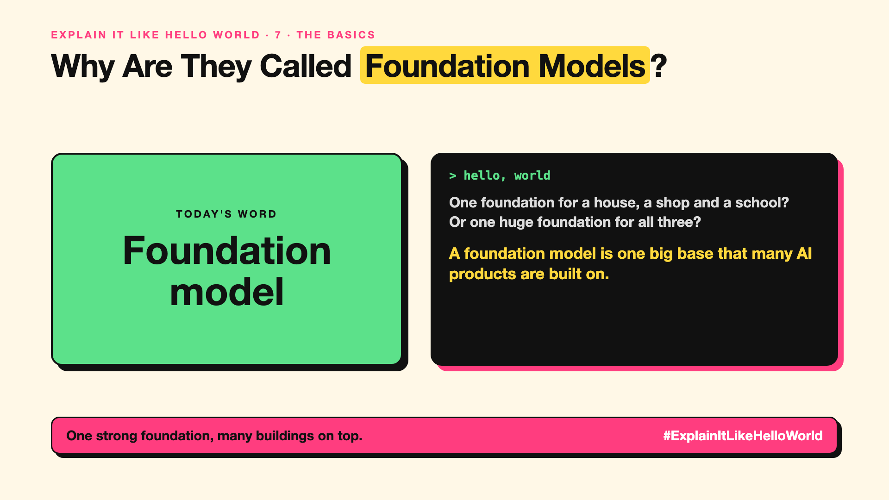

# 7. Why Are They Called Foundation Models? | Foundation model



*Explain It Like Hello World series: Foundation model*

"Foundation model." Investors, governments and regulators use the phrase. It sounds like construction.

## The hello world

Building a house, a shop and a school: you could pour a new foundation for each. Or pour one huge, strong foundation and build all three on top.

That's the hello world: a **foundation model** is one big model trained on broad data, then reused as the base for many different products and tasks.

## One step further

Before, companies trained a separate model for each job: one for translation, one for summaries, one for support emails. A foundation model learns general skills once, at great cost. Then teams adapt it cheaply with prompts (write-up 20) or fine-tuning (write-up 35).

The term was popularised by Stanford researchers in 2021. GPT, Claude, Gemini and Llama are all foundation models.

## Where you've already met it

Every app "built on" a well-known model. The same model powering a chatbot, a coding tool and a writing assistant.

## The real name

A **foundation model**.

- **Foundation model:** a large, general model used as a base for many tasks.
- **Adaptation:** shaping it for a task with prompts or fine-tuning.
- **Downstream task:** the specific job it's adapted for.

## What it's not

A foundation model isn't a finished product. It needs adapting, testing and guardrails for each use. And any flaw in the foundation shows up in everything built on it.

## Take this to your next meeting

1. Ask which foundation model a product is built on.
2. Expect its strengths and weaknesses to show up in your app.
3. Adapt with prompts first; fine-tune only if needed.

One strong foundation, many buildings on top.

Next write-up (8): **What Is a Frontier Model, and Who Decides?**

Follow me for the next one. How many products do you use that sit on the same few foundation models?

**Earlier in this series:**

1. [AI words everyone uses. Nobody explains.](https://lnkd.in/p/d8abaPhq) (the curtain raiser post)
2. [What Actually Counts as Artificial Intelligence?](https://www.linkedin.com/pulse/2-what-actually-counts-artificial-intelligence-arpit-jain-su9lf)
3. [How Does Machine Learning Learn Without Being Told the Rules?](https://www.linkedin.com/pulse/3-how-does-machine-learning-learn-without-being-told-rules-arpit-jain-ppdyf)
4. [What's "Deep" About Deep Learning?](https://www.linkedin.com/pulse/4-whats-deep-learning-arpit-jain-rvlff)
5. [Is a Neural Network Really Like a Brain?](https://www.linkedin.com/pulse/5-neural-network-really-like-brain-arpit-jain-jpigf)
6. [What Makes Generative AI "Generative"?](https://www.linkedin.com/pulse/6-what-makes-generative-ai-arpit-jain-q2rkf)

**Previous series:**

- **Series 1, #JustAddRAG:** [start here](https://www.linkedin.com/pulse/why-does-just-add-rag-sound-like-2-weeks-take-6-months-arpit-jain-l4kkf/) or jump to [the grand finale](https://www.linkedin.com/pulse/15-so-should-you-really-just-add-rag-grand-finale-arpit-jain-ninmf/)
- **Series 2, Beyond Just RAG: From Answers to Actions:** [start here](https://www.linkedin.com/pulse/1-your-ai-can-answer-now-has-act-from-answers-actions-arpit-jain-po6lf/) or jump to [the finale](https://www.linkedin.com/pulse/8-so-should-your-ai-do-things-just-answer-finale-arpit-jain-x7cxf)
- **Series 20, Today in AI** (ongoing): [start here](https://www.linkedin.com/pulse/today-ai-001-what-happens-when-your-agent-visits-someone-arpit-jain-2vqmf/) or read [the latest issue](https://www.linkedin.com/pulse/today-ai-011-text-to-speech-fits-your-phone-internet-needed-jain-1ipuf)

---

**Post text (copy and paste):**

```
One foundation for a house, a shop and a school?
Or one huge foundation for all three?

A foundation model is one big base that many AI products are built on.

GPT, Claude, Gemini and Llama are all foundation models.

How many products do you use that sit on the same few foundation models?

#AI #GenAI #LearnAI #ExplainItLikeHelloWorld
```

**Series index (post as the first comment):**

```
Explain It Like Hello World

Start here: AI words everyone uses. Nobody explains. https://lnkd.in/p/d8abaPhq
Previous: 6. What Makes Generative AI "Generative"? https://www.linkedin.com/pulse/6-what-makes-generative-ai-arpit-jain-q2rkf
You're here: 7. Why Are They Called Foundation Models?
Next: 8. What Is a Frontier Model, and Who Decides?

Full list: in the curtain raiser post.
```
