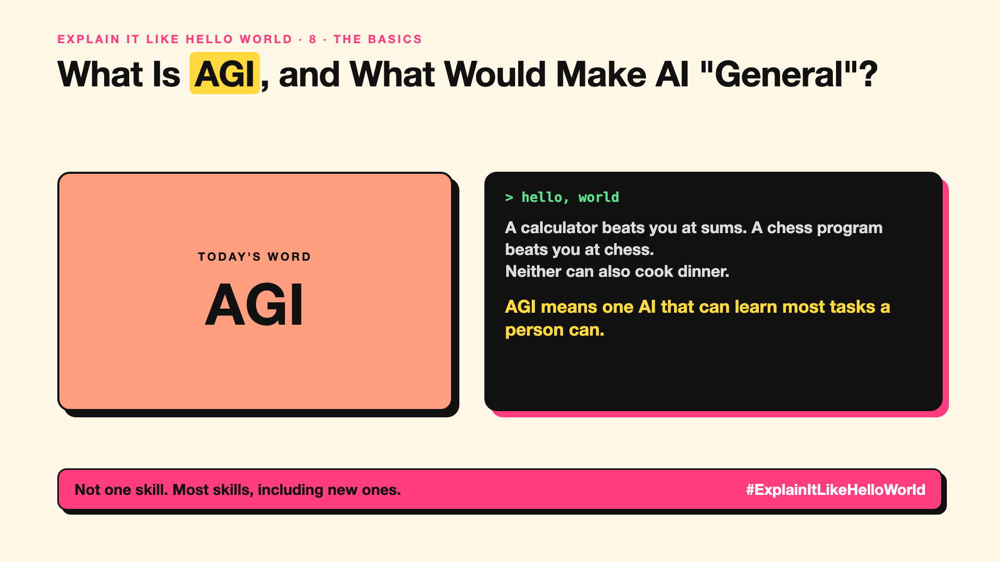

# 8. What Would It Mean for AI to Be "General"? | AGI



*Explain It Like Hello World series: AGI*

"AGI is coming." Tech leaders predict it, critics doubt it, and nobody quite agrees what it is.

## The hello world

A calculator beats you at sums. A chess program beats you at chess. But neither can also cook, learn a new language and fix a bike.

That's the hello world: **AGI** (artificial general intelligence) means an AI that could learn and do most intellectual tasks a person can, not just one.

## One step further

Today's AI is impressive but uneven: brilliant at writing code, then confused by a simple puzzle. AGI would be broad and reliable across tasks, including new ones it wasn't trained for.

There's no agreed test. Some define it by economic value ("does most work people do"), others by learning ability. That's why predictions range from "a few years" to "never".

## Where you've already met it

Headlines and company mission statements. Not yet in a product.

## The real name

**AGI**, artificial general intelligence.

- **Narrow AI:** good at specific tasks.
- **General intelligence:** able to learn and do a wide range of tasks.
- **Benchmark:** a test used to measure progress (write-up 97).

## What it's not

AGI isn't the same as consciousness, and it isn't a product launch date. When someone says "AGI", ask which definition they mean.

## Take this to your next meeting

1. Ask "by which definition?" whenever AGI comes up.
2. Plan for today's uneven AI, not for a predicted date.
3. Watch for tasks AI still fails at; they show the gap.

Not one skill. Most skills, including new ones.

Next write-up (9): **What Is Superintelligence, and Should We Worry?**

Follow me for the next one. Do you think AGI is years away, or decades?

**Earlier in this series:**

1. AI words everyone uses. Nobody explains. (the curtain raiser post) *(link added when published)*
2. What Actually Counts as AI? *(link added when published)*
3. How Does a Computer Learn Without Being Told the Rules? *(link added when published)*
4. What's "Deep" About Deep Learning? *(link added when published)*
5. Is a Neural Network Really Like a Brain? *(link added when published)*
6. What Makes AI "Generative"? *(link added when published)*
7. Why Are They Called Foundation Models? *(link added when published)*

**Previous series:**

- **Series 1, #JustAddRAG:** [start here](https://www.linkedin.com/pulse/why-does-just-add-rag-sound-like-2-weeks-take-6-months-arpit-jain-l4kkf/) or jump to [the grand finale](https://www.linkedin.com/pulse/15-so-should-you-really-just-add-rag-grand-finale-arpit-jain-ninmf/)
- **Series 2, Beyond Just RAG: From Answers to Actions:** [start here](https://www.linkedin.com/pulse/1-your-ai-can-answer-now-has-act-from-answers-actions-arpit-jain-po6lf/) or jump to [the finale](https://www.linkedin.com/pulse/8-so-should-your-ai-do-things-just-answer-finale-arpit-jain-x7cxf)

---

**Post text (copy and paste):**

```
A calculator beats you at sums. A chess program beats you at chess.
Neither can also cook dinner.

AGI means one AI that can learn most tasks a person can.

Nobody agrees on the definition, or the date.

Do you think AGI is years away, or decades?

#AI #GenAI #LearnAI #ExplainItLikeHelloWorld
```

**Series index (post as the first comment):**

```
Explain It Like Hello World

Start here: 1. AI words everyone uses. Nobody explains. [link]
Previous: 7. Why Are They Called Foundation Models? [link]
You're here: 8. What Would It Mean for AI to Be "General"?
Next: 9. What Is Superintelligence, and Should We Worry?

Full list: in the curtain raiser post.
```
