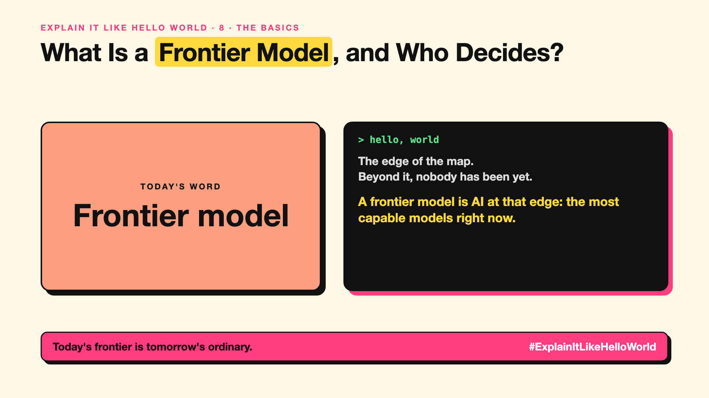

# 8. What Is a Frontier Model, and Who Decides? | Frontier model



*Explain It Like Hello World series: Frontier model*

"Frontier model." "Frontier AI." Headlines and new AI laws use it for the most powerful models. What puts a model at the frontier?

## The hello world

The edge of a map that explorers are still drawing. Beyond it, nobody has been yet.

That's the hello world: a **frontier model** is one of the most capable AI models at the moment, pushing the edge of what AI can do.

## One step further

Frontier models are usually the newest, largest foundation models (write-up 7) from a handful of labs, trained with huge amounts of computing power (write-up 44 explains why scale helped). They lead on benchmarks (write-up 116) and often get new abilities first.

Because they are the most powerful, safety rules and voluntary commitments often focus on them. The frontier also moves: today's frontier model is next year's ordinary one.

## Where you've already met it

The flagship models that AI labs announce with big launch events, and the top tier in a chatbot's model menu.

## The real name

A **frontier model**, part of **frontier AI**.

- **Frontier:** the current edge of what AI can do.
- **Flagship model:** a lab's most capable model.
- **Compute:** the computing power used to train and run a model.

## What it's not

Frontier doesn't mean best for your task. A smaller, cheaper model (write-up 56) often does a simple job just as well.

## Take this to your next meeting

1. Ask whether your task truly needs a frontier model.
2. Expect the frontier to move every few months.
3. Re-test cheaper models as they catch up.

Today's frontier is tomorrow's ordinary.

Next write-up (9): **What Is AGI, and What Would Make AI "General"?**

Follow me for the next one. Does your team use a frontier model for jobs a small one could do?

**Earlier in this series:**

1. [AI words everyone uses. Nobody explains.](https://lnkd.in/p/d8abaPhq) (the curtain raiser post)
2. [What Actually Counts as Artificial Intelligence?](https://www.linkedin.com/pulse/2-what-actually-counts-artificial-intelligence-arpit-jain-su9lf)
3. [How Does Machine Learning Learn Without Being Told the Rules?](https://www.linkedin.com/pulse/3-how-does-machine-learning-learn-without-being-told-rules-arpit-jain-ppdyf)
4. [What's "Deep" About Deep Learning?](https://www.linkedin.com/pulse/4-whats-deep-learning-arpit-jain-rvlff)
5. Is a Neural Network Really Like a Brain? *(link added when published)*
6. What Makes Generative AI "Generative"? *(link added when published)*
7. Why Are They Called Foundation Models? *(link added when published)*

**Previous series:**

- **Series 1, #JustAddRAG:** [start here](https://www.linkedin.com/pulse/why-does-just-add-rag-sound-like-2-weeks-take-6-months-arpit-jain-l4kkf/) or jump to [the grand finale](https://www.linkedin.com/pulse/15-so-should-you-really-just-add-rag-grand-finale-arpit-jain-ninmf/)
- **Series 2, Beyond Just RAG: From Answers to Actions:** [start here](https://www.linkedin.com/pulse/1-your-ai-can-answer-now-has-act-from-answers-actions-arpit-jain-po6lf/) or jump to [the finale](https://www.linkedin.com/pulse/8-so-should-your-ai-do-things-just-answer-finale-arpit-jain-x7cxf)
- **Series 20, Today in AI** (ongoing): [start here](https://www.linkedin.com/pulse/today-ai-001-what-happens-when-your-agent-visits-someone-arpit-jain-2vqmf/) or read [the latest issue](https://www.linkedin.com/pulse/today-ai-011-text-to-speech-fits-your-phone-internet-needed-jain-1ipuf)

---

**Post text (copy and paste):**

```
The edge of the map.
Beyond it, nobody has been yet.

A frontier model is AI at that edge: the most capable models right now.

The edge moves every few months.

Does your team use a frontier model for jobs a small one could do?

#AI #GenAI #LearnAI #ExplainItLikeHelloWorld
```

**Series index (post as the first comment):**

```
Explain It Like Hello World

Start here: AI words everyone uses. Nobody explains. https://lnkd.in/p/d8abaPhq
Previous: 7. Why Are They Called Foundation Models? [link]
You're here: 8. What Is a Frontier Model, and Who Decides?
Next: 9. What Is AGI, and What Would Make AI "General"?

Full list: in the curtain raiser post.
```
