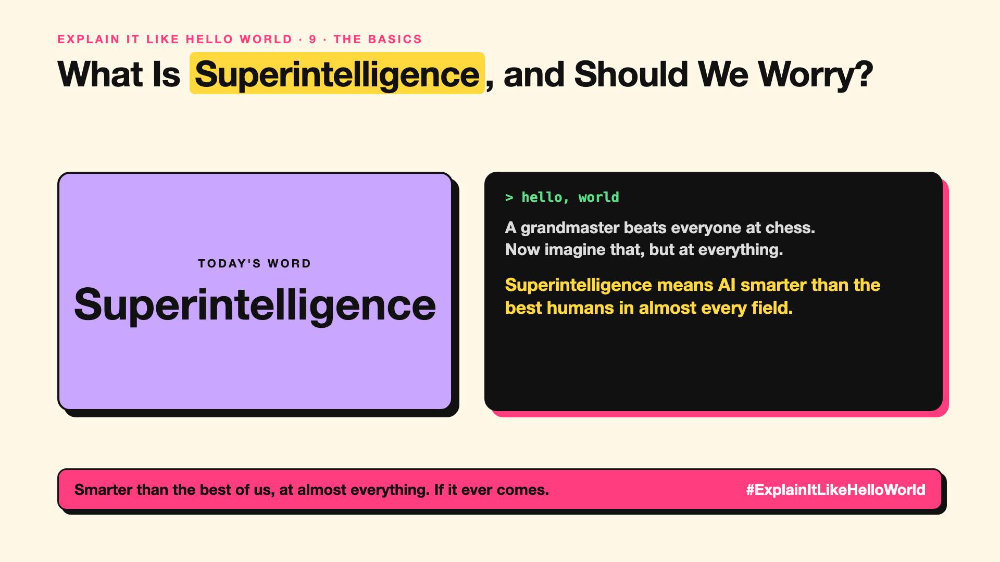

# 9. What Is Superintelligence, and Should We Worry? | Superintelligence



*Explain It Like Hello World series: Superintelligence*

"Superintelligence." It shows up in warnings from scientists and in company mission statements. It sounds like science fiction.

## The hello world

A grandmaster plays chess better than any of us. Now imagine something that out-thinks the best humans not just at chess, but at science, strategy, persuasion, everything.

That's the hello world: **superintelligence** means AI far smarter than the best humans across almost every field.

## One step further

It's the step after AGI (write-up 8). Some researchers think an AI that can improve AI research could speed itself up. Others think progress will stay gradual and bumpy.

The debate is about control: how do you make sure something smarter than you does what you intended? That's the core of AI alignment (write-up 92).

## Where you've already met it

News about AI safety, open letters from researchers, and companies naming superintelligence as a goal.

## The real name

**Superintelligence**, sometimes **ASI** (artificial superintelligence).

- **ASI:** AI beyond the best human ability in most fields.
- **Intelligence explosion:** the idea that AI could rapidly improve itself.
- **AI safety:** work on keeping powerful AI beneficial.

## What it's not

It doesn't exist today, and nobody knows if or when it will. It also isn't "evil AI" by default; the worry is about goals that don't match ours.

## Take this to your next meeting

1. Separate today's practical risks from long-term debates.
2. Read who's talking: researcher, company or critic, and why.
3. Support safety work in your own AI projects, starting small.

Smarter than the best of us, at almost everything. If it ever comes.

Next write-up (10): **What Are Tokens, and Why Does an AI Read in Pieces?**

Follow me for the next one. Does superintelligence excite you or worry you?

**Earlier in this series:**

1. [AI words everyone uses. Nobody explains.](https://lnkd.in/p/d8abaPhq) (the curtain raiser post)
2. [What Actually Counts as Artificial Intelligence?](https://www.linkedin.com/pulse/2-what-actually-counts-artificial-intelligence-arpit-jain-su9lf)
3. How Does Machine Learning Learn Without Being Told the Rules? *(link added when published)*
4. What's "Deep" About Deep Learning? *(link added when published)*
5. Is a Neural Network Really Like a Brain? *(link added when published)*
6. What Makes Generative AI "Generative"? *(link added when published)*
7. Why Are They Called Foundation Models? *(link added when published)*
8. What Is AGI, and What Would Make AI "General"? *(link added when published)*

**Previous series:**

- **Series 1, #JustAddRAG:** [start here](https://www.linkedin.com/pulse/why-does-just-add-rag-sound-like-2-weeks-take-6-months-arpit-jain-l4kkf/) or jump to [the grand finale](https://www.linkedin.com/pulse/15-so-should-you-really-just-add-rag-grand-finale-arpit-jain-ninmf/)
- **Series 2, Beyond Just RAG: From Answers to Actions:** [start here](https://www.linkedin.com/pulse/1-your-ai-can-answer-now-has-act-from-answers-actions-arpit-jain-po6lf/) or jump to [the finale](https://www.linkedin.com/pulse/8-so-should-your-ai-do-things-just-answer-finale-arpit-jain-x7cxf)

---

**Post text (copy and paste):**

```
A grandmaster beats everyone at chess.
Now imagine that, but at everything.

Superintelligence means AI smarter than the best humans in almost every field.

It doesn't exist. The debate is about keeping control if it does.

Does superintelligence excite you or worry you?

#AI #GenAI #LearnAI #ExplainItLikeHelloWorld
```

**Series index (post as the first comment):**

```
Explain It Like Hello World

Start here: AI words everyone uses. Nobody explains. https://lnkd.in/p/d8abaPhq
Previous: 8. What Is AGI, and What Would Make AI "General"? [link]
You're here: 9. What Is Superintelligence, and Should We Worry?
Next: 10. What Are Tokens, and Why Does an AI Read in Pieces?

Full list: in the curtain raiser post.
```
