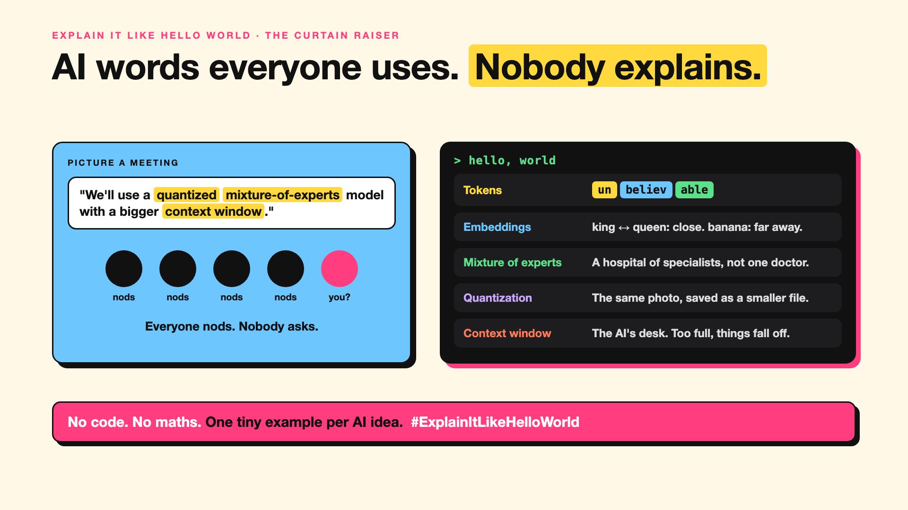

# 1. AI Words Everyone Uses. Nobody Explains. | Explain It Like Hello World



*Explain It Like Hello World series: the curtain raiser*

Picture a meeting. Someone says: "We'll use a quantized mixture-of-experts model with a bigger context window."

Everyone nods. Nobody asks.

AI has a vocabulary problem. The words arrive faster than the explanations.

## Why "hello world"?

When programmers learn a new language, the first thing they write is "hello world": the smallest program that works. Not the whole language. Just enough to see it run, and think "oh, that's all it is".

This series does the same for AI ideas. No code. No maths. One tiny example that shows the whole idea working, then one step closer to the real thing.

## How each write-up works

- **The buzzword:** what people say, and why it sounds scary.
- **The hello world:** the smallest example that makes it click.
- **One step further:** how it really works, in plain words.
- **Where you've already met it:** your phone, your search bar, your chat app.
- **The real name:** the technical term, revealed last.

## A taste of what's coming

- **Tokens:** why an AI reads "unbelievable" as three pieces.
- **Embeddings:** how "king" ends up close to "queen" and far from "banana".
- **Mixture of experts:** why some AI works like a hospital full of specialists.

## Who it's for

Students starting out. Leaders who sign off on AI budgets. Engineers who never got the basics explained simply. If you've ever nodded along to an AI word, this is for you.

## Take this to your next meeting

1. When you hear an AI word you can't explain, write it down.
2. Ask: "What's the simplest example of that?"
3. Send me the word. It might be the next write-up.

The words sound hard. The ideas usually aren't.

Next write-up (2): **How does an AI read a word?** (Tokens)

Follow me for the next one. Which AI word do you nod along to most?

**Previous series:**

- **Series 1, #JustAddRAG:** [start here](https://www.linkedin.com/pulse/why-does-just-add-rag-sound-like-2-weeks-take-6-months-arpit-jain-l4kkf/) or jump to [the grand finale](https://www.linkedin.com/pulse/15-so-should-you-really-just-add-rag-grand-finale-arpit-jain-ninmf/)
- **Series 2, Beyond Just RAG: From Answers to Actions:** [start here](https://www.linkedin.com/pulse/1-your-ai-can-answer-now-has-act-from-answers-actions-arpit-jain-po6lf/) or jump to [the finale](https://www.linkedin.com/pulse/8-so-should-your-ai-do-things-just-answer-finale-arpit-jain-x7cxf)

---

**Post text (copy and paste):**

```
Picture a meeting. Someone says: "We'll use a quantized mixture-of-experts model with a bigger context window."

Everyone nods. Nobody asks.

AI words arrive faster than the explanations.

New series: Explain It Like Hello World. One AI idea at a time, through the smallest example that makes it click. No code. No maths.

Which AI word do you nod along to most?

#AI #GenAI #AIForEveryone #LearnAI #ExplainItLikeHelloWorld
```

**Series index (post as the first comment, then pin it):**

```
Explain It Like Hello World

1. AI words everyone uses. Nobody explains. (you're here)
2. How does an AI read a word? (next)
```
