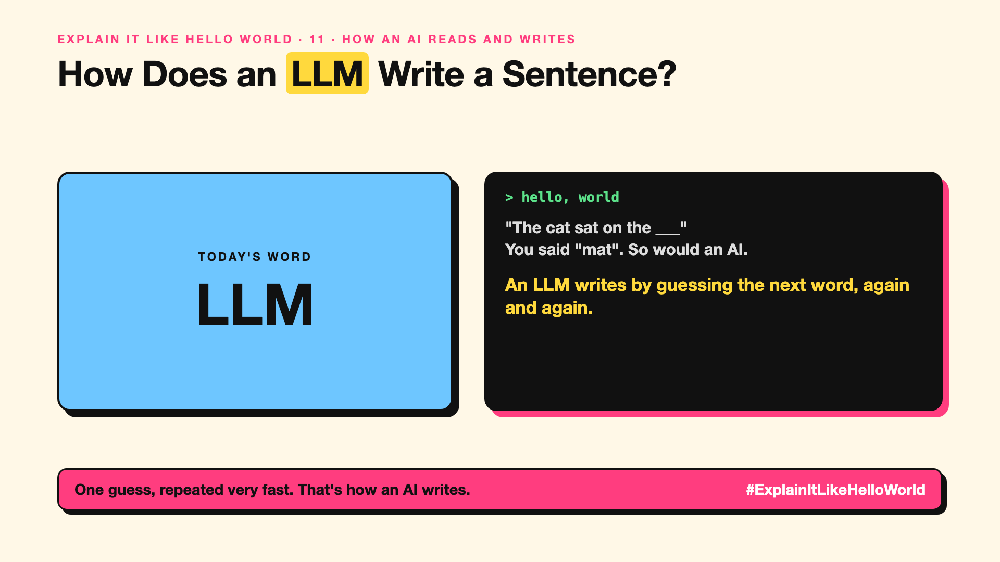

# 11. How Does an LLM Write a Sentence? | LLM



*Explain It Like Hello World series: LLM*

"Large language model." It sounds like a giant brain composing essays. The real trick is much smaller, and repeated very fast.

## The hello world

Finish this: "The cat sat on the ___".

You thought "mat". So would an AI. That's the hello world: an AI writes by guessing the **next token**, one at a time.

It guesses "mat". Then it looks at "The cat sat on the mat" and guesses the next piece: maybe ".". Then the next. A whole essay is that one guess, repeated hundreds of times.

## One step further

The AI doesn't pick one answer. For every next piece it gives each option a score: "mat" very likely, "sofa" likely, "moon" unlikely. Then one is picked, and the loop continues.

It learned those scores by reading a huge amount of text and practising this exact game: hide the next word, guess it, get corrected, billions of times.

## Where you've already met it

Your phone keyboard suggesting the next word. Same idea, far smaller. And the way ChatGPT or Claude types its answer bit by bit on screen: you're watching the guesses happen.

## The real name

A **large language model (LLM)**, doing **next-token prediction**.

- **LLM:** a model trained to predict the next token in text.
- **Next-token prediction:** guessing the most likely next piece, again and again.
- **Probability:** the score the AI gives each possible next piece.

## What it's not

It's not looking answers up in a database, and it doesn't plan the whole paragraph first. That's why it can sound fluent and still be wrong (more in write-up 83).

## Take this to your next meeting

1. Watch an AI answer appear word by word: that's next-token prediction live.
2. Remember fluent isn't the same as correct.
3. Ask: what text would make the right next words most likely? That's what a good prompt does.

One guess, repeated very fast. That's how an AI writes.

Next write-up (12): **How Do Embeddings Know "King" Is Close to "Queen"?**

Follow me for the next one. Did you know your phone keyboard works on the same idea?

**Earlier in this series:**

1. [AI words everyone uses. Nobody explains.](https://lnkd.in/p/d8abaPhq) (the curtain raiser post)
2. [What Actually Counts as Artificial Intelligence?](https://www.linkedin.com/pulse/2-what-actually-counts-artificial-intelligence-arpit-jain-su9lf)
3. [How Does Machine Learning Learn Without Being Told the Rules?](https://www.linkedin.com/pulse/3-how-does-machine-learning-learn-without-being-told-rules-arpit-jain-ppdyf)
4. What's "Deep" About Deep Learning? *(link added when published)*
5. Is a Neural Network Really Like a Brain? *(link added when published)*
6. What Makes Generative AI "Generative"? *(link added when published)*
7. Why Are They Called Foundation Models? *(link added when published)*
8. What Is AGI, and What Would Make AI "General"? *(link added when published)*
9. What Is Superintelligence, and Should We Worry? *(link added when published)*
10. What Are Tokens, and Why Does an AI Read in Pieces? *(link added when published)*

**Previous series:**

- **Series 1, #JustAddRAG:** [start here](https://www.linkedin.com/pulse/why-does-just-add-rag-sound-like-2-weeks-take-6-months-arpit-jain-l4kkf/) or jump to [the grand finale](https://www.linkedin.com/pulse/15-so-should-you-really-just-add-rag-grand-finale-arpit-jain-ninmf/)
- **Series 2, Beyond Just RAG: From Answers to Actions:** [start here](https://www.linkedin.com/pulse/1-your-ai-can-answer-now-has-act-from-answers-actions-arpit-jain-po6lf/) or jump to [the finale](https://www.linkedin.com/pulse/8-so-should-your-ai-do-things-just-answer-finale-arpit-jain-x7cxf)

---

**Post text (copy and paste):**

```
"The cat sat on the ___"
You said "mat". So would an AI.

An LLM writes by guessing the next word, again and again.

A whole essay is that one guess, repeated hundreds of times.

Did you know your phone keyboard works on the same idea?

#AI #GenAI #LearnAI #ExplainItLikeHelloWorld
```

**Series index (post as the first comment):**

```
Explain It Like Hello World

Start here: AI words everyone uses. Nobody explains. https://lnkd.in/p/d8abaPhq
Previous: 10. What Are Tokens, and Why Does an AI Read in Pieces? [link]
You're here: 11. How Does an LLM Write a Sentence?
Next: 12. How Do Embeddings Know "King" Is Close to "Queen"?

Full list: in the curtain raiser post.
```
