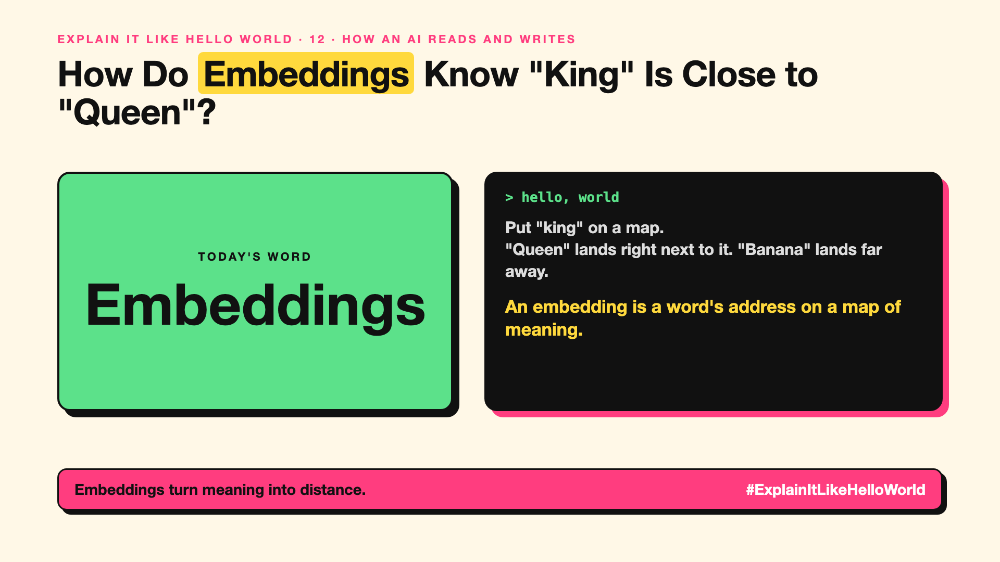

# 12. How Do Embeddings Know "King" Is Close to "Queen"? | Embeddings



*Explain It Like Hello World series: Embeddings*

"We'll embed the documents and store the vectors." Embeddings power AI search, recommendations and RAG. The word sounds like maths homework.

## The hello world

Draw a map. Put "king" on it. Put "queen" right next to it. Put "banana" far away, near "apple".

That's the hello world: an **embedding** is a word's position on a map of meaning. Similar meanings sit close together. Different meanings sit far apart.

## One step further

A real map has two directions: north and east. An AI's meaning map has hundreds or thousands of directions at once, so it can place things by many qualities: royalty, gender, food, formality.

Each position is just a long list of numbers. To ask "how similar are these two things?", the AI measures how close their positions are. It works for sentences, pages and images too, not just single words.

## Where you've already met it

Searching "cheap flights" and finding "budget airfares". Spotify suggesting songs that feel similar. Photo apps finding "dog" pictures you never labelled.

## The real name

**Embeddings**, also called **vectors**.

- **Embedding:** a list of numbers that places something on a map of meaning.
- **Vector:** that list of numbers.
- **Similarity search:** finding the items closest on the map.

## What it's not

An embedding isn't a definition or a keyword. Two texts can share no words and still sit close together. That's the point. (How this powers document search is covered in #JustAddRAG.)

## Take this to your next meeting

1. When someone says "semantic search", picture the meaning map.
2. Ask what was embedded: words, sentences or whole pages? It changes results.
3. Remember: close on the map means similar meaning, not true.

Embeddings turn meaning into distance.

Next write-up (13): **How Does Attention Help an AI Know What "It" Means?**

Follow me for the next one. Where have you seen search that understood what you meant?

**Earlier in this series:**

1. [AI words everyone uses. Nobody explains.](https://lnkd.in/p/d8abaPhq) (the curtain raiser post)
2. [What Actually Counts as Artificial Intelligence?](https://www.linkedin.com/pulse/2-what-actually-counts-artificial-intelligence-arpit-jain-su9lf)
3. How Does Machine Learning Learn Without Being Told the Rules? *(link added when published)*
4. What's "Deep" About Deep Learning? *(link added when published)*
5. Is a Neural Network Really Like a Brain? *(link added when published)*
6. What Makes Generative AI "Generative"? *(link added when published)*
7. Why Are They Called Foundation Models? *(link added when published)*
8. What Is AGI, and What Would Make AI "General"? *(link added when published)*
9. What Is Superintelligence, and Should We Worry? *(link added when published)*
10. What Are Tokens, and Why Does an AI Read in Pieces? *(link added when published)*
11. How Does an LLM Write a Sentence? *(link added when published)*

**Previous series:**

- **Series 1, #JustAddRAG:** [start here](https://www.linkedin.com/pulse/why-does-just-add-rag-sound-like-2-weeks-take-6-months-arpit-jain-l4kkf/) or jump to [the grand finale](https://www.linkedin.com/pulse/15-so-should-you-really-just-add-rag-grand-finale-arpit-jain-ninmf/)
- **Series 2, Beyond Just RAG: From Answers to Actions:** [start here](https://www.linkedin.com/pulse/1-your-ai-can-answer-now-has-act-from-answers-actions-arpit-jain-po6lf/) or jump to [the finale](https://www.linkedin.com/pulse/8-so-should-your-ai-do-things-just-answer-finale-arpit-jain-x7cxf)

---

**Post text (copy and paste):**

```
Put "king" on a map.
"Queen" lands right next to it. "Banana" lands far away.

An embedding is a word's address on a map of meaning.

Close on the map means close in meaning.

Where have you seen search that understood what you meant?

#AI #GenAI #LearnAI #ExplainItLikeHelloWorld
```

**Series index (post as the first comment):**

```
Explain It Like Hello World

Start here: AI words everyone uses. Nobody explains. https://lnkd.in/p/d8abaPhq
Previous: 11. How Does an LLM Write a Sentence? [link]
You're here: 12. How Do Embeddings Know "King" Is Close to "Queen"?
Next: 13. How Does Attention Help an AI Know What "It" Means?

Full list: in the curtain raiser post.
```
