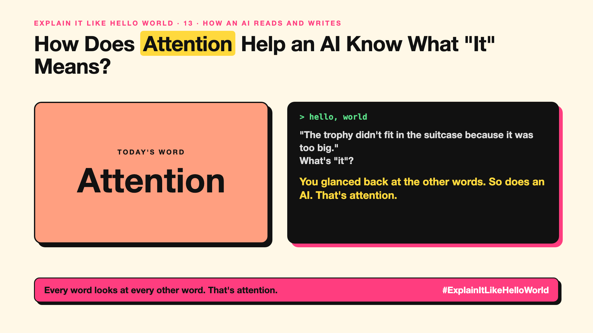

# 13. How Does Attention Help an AI Know What "It" Means? | Attention



*Explain It Like Hello World series: Attention*

"Transformers." "Attention is all you need." The idea behind almost every modern AI sounds like a sci-fi film.

## The hello world

Read this: "The trophy didn't fit in the suitcase because **it** was too big."

What's "it"? The trophy. You worked it out by glancing back at the other words. That glance is the hello world: **attention**. For every word, the AI looks at all the other words and decides which ones matter for understanding it.

## One step further

Change one word: "...because it was too **small**." Now "it" is the suitcase. Attention catches that, because "small" pulls the focus to a different word.

A transformer does this for every word at once, in many layers, each looking for different links: who did what, what refers to what, which words go together. Older AIs read one word at a time and forgot the start of long sentences. Attention lets every word see every other word directly.

## Where you've already met it

Every modern chatbot and translator. Translation got much better around 2017 to 2018, when this design took over.

## The real name

**Attention**, the core of the **transformer**.

- **Attention:** each word deciding which other words to focus on.
- **Transformer:** the AI design built on attention, the "T" in GPT.
- **Layer:** one round of attention; models stack many.

## What it's not

Attention isn't the AI paying attention the way you do, and it isn't memory of past chats. It works only within the text in front of it right now (that's the context window, write-up 15).

## Take this to your next meeting

1. Next time you hear "transformer", picture every word glancing at every other word.
2. Remember why long texts cost more: every word looks at every other word.
3. Know that GPT stands for Generative Pre-trained Transformer.

Every word looks at every other word. That's attention.

Next write-up (14): **What Is a Transformer, the "T" in GPT?**

Follow me for the next one. Did you get the trophy and suitcase right on the first try?

**Earlier in this series:**

1. [AI words everyone uses. Nobody explains.](https://lnkd.in/p/d8abaPhq) (the curtain raiser post)
2. [What Actually Counts as Artificial Intelligence?](https://www.linkedin.com/pulse/2-what-actually-counts-artificial-intelligence-arpit-jain-su9lf)
3. [How Does Machine Learning Learn Without Being Told the Rules?](https://www.linkedin.com/pulse/3-how-does-machine-learning-learn-without-being-told-rules-arpit-jain-ppdyf)
4. What's "Deep" About Deep Learning? *(link added when published)*
5. Is a Neural Network Really Like a Brain? *(link added when published)*
6. What Makes Generative AI "Generative"? *(link added when published)*
7. Why Are They Called Foundation Models? *(link added when published)*
8. What Is AGI, and What Would Make AI "General"? *(link added when published)*
9. What Is Superintelligence, and Should We Worry? *(link added when published)*
10. What Are Tokens, and Why Does an AI Read in Pieces? *(link added when published)*
11. How Does an LLM Write a Sentence? *(link added when published)*
12. How Do Embeddings Know "King" Is Close to "Queen"? *(link added when published)*

**Previous series:**

- **Series 1, #JustAddRAG:** [start here](https://www.linkedin.com/pulse/why-does-just-add-rag-sound-like-2-weeks-take-6-months-arpit-jain-l4kkf/) or jump to [the grand finale](https://www.linkedin.com/pulse/15-so-should-you-really-just-add-rag-grand-finale-arpit-jain-ninmf/)
- **Series 2, Beyond Just RAG: From Answers to Actions:** [start here](https://www.linkedin.com/pulse/1-your-ai-can-answer-now-has-act-from-answers-actions-arpit-jain-po6lf/) or jump to [the finale](https://www.linkedin.com/pulse/8-so-should-your-ai-do-things-just-answer-finale-arpit-jain-x7cxf)

---

**Post text (copy and paste):**

```
"The trophy didn't fit in the suitcase because it was too big."
What's "it"?

You glanced back at the other words. So does an AI. That's attention.

It's the idea behind almost every modern AI.

Did you get the trophy and suitcase right on the first try?

#AI #GenAI #LearnAI #ExplainItLikeHelloWorld
```

**Series index (post as the first comment):**

```
Explain It Like Hello World

Start here: AI words everyone uses. Nobody explains. https://lnkd.in/p/d8abaPhq
Previous: 12. How Do Embeddings Know "King" Is Close to "Queen"? [link]
You're here: 13. How Does Attention Help an AI Know What "It" Means?
Next: 14. What Is a Transformer, the "T" in GPT?

Full list: in the curtain raiser post.
```
