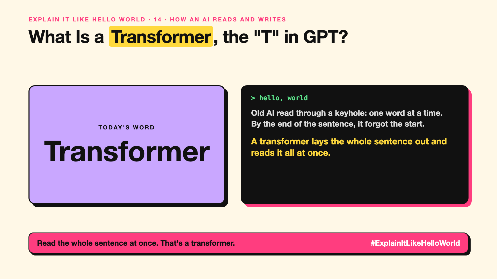

# 14. What Is a Transformer, the "T" in GPT? | Transformer



*Explain It Like Hello World series: Transformer*

GPT stands for Generative Pre-trained Transformer. Most people know the first two words. The third is the one that changed everything.

## The hello world

Old AI read a sentence like someone reading through a keyhole: one word at a time, left to right, forgetting the start by the end.

A **transformer** lays the whole sentence out on a table and lets every word look at every other word at once (that's attention, write-up 13). That's the hello world: read everything together, not one word at a time.

## One step further

A transformer is a stack of layers. In each layer, every token (write-up 10) gathers information from the others through attention, then refines it. Dozens of layers later, the model has a rich picture of the text and predicts the next token.

Because all words are processed together, transformers train well on GPUs (write-up 46), which is why they could be scaled to today's huge models. The design was published by Google researchers in 2017 in a paper called "Attention Is All You Need".

## Where you've already met it

Every major chatbot, translator and coding assistant. Many image, speech and video models use transformers too.

## The real name

The **transformer** architecture.

- **Architecture:** the overall design of a model.
- **Layer:** one round of attention and refinement.
- **GPT:** Generative Pre-trained Transformer.

## What it's not

A transformer isn't a specific product or a robot. It's a design, like "suspension bridge" is a design, used by many different models.

## Take this to your next meeting

1. Read "transformer" as "the design behind modern AI".
2. Remember why long inputs cost more: every word looks at every other word.
3. Expect new designs to challenge it; none has replaced it yet.

Read the whole sentence at once. That's a transformer.

Next write-up (15): **What Is a Context Window, and Why Does an AI Forget?**

Follow me for the next one. Did you know what the T in GPT stood for?

**Earlier in this series:**

1. [AI words everyone uses. Nobody explains.](https://lnkd.in/p/d8abaPhq) (the curtain raiser post)
2. [What Actually Counts as Artificial Intelligence?](https://www.linkedin.com/pulse/2-what-actually-counts-artificial-intelligence-arpit-jain-su9lf)
3. [How Does Machine Learning Learn Without Being Told the Rules?](https://www.linkedin.com/pulse/3-how-does-machine-learning-learn-without-being-told-rules-arpit-jain-ppdyf)
4. [What's "Deep" About Deep Learning?](https://www.linkedin.com/pulse/4-whats-deep-learning-arpit-jain-rvlff)
5. Is a Neural Network Really Like a Brain? *(link added when published)*
6. What Makes Generative AI "Generative"? *(link added when published)*
7. Why Are They Called Foundation Models? *(link added when published)*
8. What Is AGI, and What Would Make AI "General"? *(link added when published)*
9. What Is Superintelligence, and Should We Worry? *(link added when published)*
10. What Are Tokens, and Why Does an AI Read in Pieces? *(link added when published)*
11. How Does an LLM Write a Sentence? *(link added when published)*
12. How Do Embeddings Know "King" Is Close to "Queen"? *(link added when published)*
13. How Does Attention Help an AI Know What "It" Means? *(link added when published)*

**Previous series:**

- **Series 1, #JustAddRAG:** [start here](https://www.linkedin.com/pulse/why-does-just-add-rag-sound-like-2-weeks-take-6-months-arpit-jain-l4kkf/) or jump to [the grand finale](https://www.linkedin.com/pulse/15-so-should-you-really-just-add-rag-grand-finale-arpit-jain-ninmf/)
- **Series 2, Beyond Just RAG: From Answers to Actions:** [start here](https://www.linkedin.com/pulse/1-your-ai-can-answer-now-has-act-from-answers-actions-arpit-jain-po6lf/) or jump to [the finale](https://www.linkedin.com/pulse/8-so-should-your-ai-do-things-just-answer-finale-arpit-jain-x7cxf)
- **Series 20, Today in AI** (ongoing): [start here](https://www.linkedin.com/pulse/today-ai-001-what-happens-when-your-agent-visits-someone-arpit-jain-2vqmf/) or read [the latest issue](https://www.linkedin.com/pulse/today-ai-011-text-to-speech-fits-your-phone-internet-needed-jain-1ipuf)

---

**Post text (copy and paste):**

```
Old AI read through a keyhole: one word at a time.
By the end of the sentence, it forgot the start.

A transformer lays the whole sentence out and reads it all at once.

It's the T in GPT.

Did you know what the T in GPT stood for?

#AI #GenAI #LearnAI #ExplainItLikeHelloWorld
```

**Series index (post as the first comment):**

```
Explain It Like Hello World

Start here: AI words everyone uses. Nobody explains. https://lnkd.in/p/d8abaPhq
Previous: 13. How Does Attention Help an AI Know What "It" Means? [link]
You're here: 14. What Is a Transformer, the "T" in GPT?
Next: 15. What Is a Context Window, and Why Does an AI Forget?

Full list: in the curtain raiser post.
```
