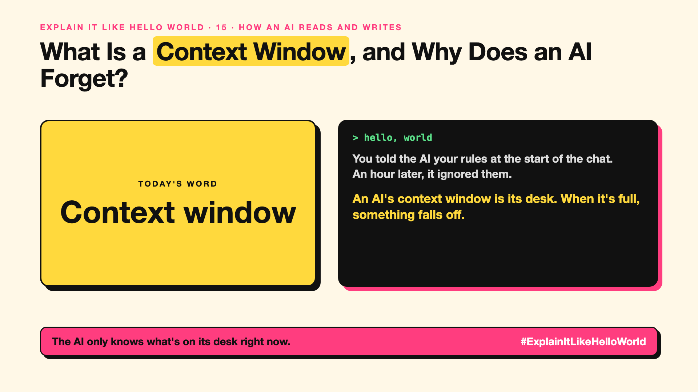

# 15. What Is a Context Window, and Why Does an AI Forget? | Context window



*Explain It Like Hello World series: Context window*

"This model has a one-million-token context window." It's on every launch announcement. Bigger sounds better. But what is it?

## The hello world

Picture a desk. Everything the AI can see right now has to fit on it: your question, the chat so far, any documents you pasted, and its answer.

The desk has a fixed size. When it's full, something has to come off, usually the oldest pages. That's the hello world: the **context window** is the AI's desk.

## One step further

The desk is measured in tokens (write-up 10). Everything counts: your messages, its replies, hidden instructions, pasted files.

Most chat apps quietly drop or summarise old messages when the desk fills up. That's why a long chat can "forget" what you said at the start. Bigger desks help, but AIs can still miss details buried in the middle of a very long desk, and bigger desks cost more per question.

## Where you've already met it

A long chat where the AI forgets your name or the rules you set at the start. Or a "this document is too long" error.

## The real name

The **context window**, measured in **tokens**.

- **Context window:** the most text an AI can consider at once.
- **Truncation:** cutting older text to make room.
- **Long context:** models with very large windows.

## What it's not

The context window isn't memory. When the chat ends, the desk is cleared. Remembering you across chats is a separate feature (covered in Series 12, memory).

## Take this to your next meeting

1. Put the most important instructions and facts near your question, not buried in the middle.
2. Start a fresh chat for a new topic.
3. Remember: a bigger desk can still be messy. Fewer, better documents often beat more.

The AI only knows what's on its desk right now.

Next write-up (16): **Why Does Temperature Change the AI's Answer?**

Follow me for the next one. Has an AI ever forgotten something you told it earlier?

**Earlier in this series:**

1. [AI words everyone uses. Nobody explains.](https://lnkd.in/p/d8abaPhq) (the curtain raiser post)
2. [What Actually Counts as Artificial Intelligence?](https://www.linkedin.com/pulse/2-what-actually-counts-artificial-intelligence-arpit-jain-su9lf)
3. [How Does Machine Learning Learn Without Being Told the Rules?](https://www.linkedin.com/pulse/3-how-does-machine-learning-learn-without-being-told-rules-arpit-jain-ppdyf)
4. [What's "Deep" About Deep Learning?](https://www.linkedin.com/pulse/4-whats-deep-learning-arpit-jain-rvlff)
5. Is a Neural Network Really Like a Brain? *(link added when published)*
6. What Makes Generative AI "Generative"? *(link added when published)*
7. Why Are They Called Foundation Models? *(link added when published)*
8. What Is AGI, and What Would Make AI "General"? *(link added when published)*
9. What Is Superintelligence, and Should We Worry? *(link added when published)*
10. What Are Tokens, and Why Does an AI Read in Pieces? *(link added when published)*
11. How Does an LLM Write a Sentence? *(link added when published)*
12. How Do Embeddings Know "King" Is Close to "Queen"? *(link added when published)*
13. How Does Attention Help an AI Know What "It" Means? *(link added when published)*
14. What Is a Transformer, the "T" in GPT? *(link added when published)*

**Previous series:**

- **Series 1, #JustAddRAG:** [start here](https://www.linkedin.com/pulse/why-does-just-add-rag-sound-like-2-weeks-take-6-months-arpit-jain-l4kkf/) or jump to [the grand finale](https://www.linkedin.com/pulse/15-so-should-you-really-just-add-rag-grand-finale-arpit-jain-ninmf/)
- **Series 2, Beyond Just RAG: From Answers to Actions:** [start here](https://www.linkedin.com/pulse/1-your-ai-can-answer-now-has-act-from-answers-actions-arpit-jain-po6lf/) or jump to [the finale](https://www.linkedin.com/pulse/8-so-should-your-ai-do-things-just-answer-finale-arpit-jain-x7cxf)
- **Series 20, Today in AI** (ongoing): [start here](https://www.linkedin.com/pulse/today-ai-001-what-happens-when-your-agent-visits-someone-arpit-jain-2vqmf/) or read [the latest issue](https://www.linkedin.com/pulse/today-ai-011-text-to-speech-fits-your-phone-internet-needed-jain-1ipuf)

---

**Post text (copy and paste):**

```
You told the AI your rules at the start of the chat.
An hour later, it ignored them.

An AI's context window is its desk. When it's full, something falls off.

And when the chat ends, the desk is cleared.

Has an AI ever forgotten something you told it earlier?

#AI #GenAI #LearnAI #ExplainItLikeHelloWorld
```

**Series index (post as the first comment):**

```
Explain It Like Hello World

Start here: AI words everyone uses. Nobody explains. https://lnkd.in/p/d8abaPhq
Previous: 14. What Is a Transformer, the "T" in GPT? [link]
You're here: 15. What Is a Context Window, and Why Does an AI Forget?
Next: 16. Why Does Temperature Change the AI's Answer?

Full list: in the curtain raiser post.
```
