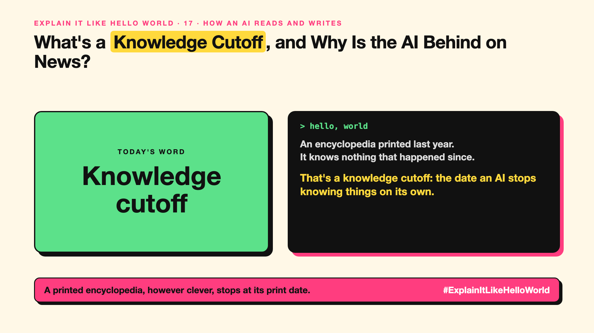

# 17. What's a Knowledge Cutoff, and Why Is the AI Behind on News? | Knowledge cutoff



*Explain It Like Hello World series: Knowledge cutoff*

"Knowledge cutoff." "Training cutoff." It's why a chatbot can be confidently out of date.

## The hello world

An encyclopedia printed last year. Everything in it was true when it went to print, but it knows nothing about what happened since.

That's the hello world: the **knowledge cutoff** is the date after which a model has no training data, so on its own it knows nothing newer.

## One step further

A model learns from a snapshot of text collected up to a certain date (write-up 34). Training takes months, so a model is often released well after its cutoff, and then used for a long time.

To know newer things, the AI needs fresh information at question time: web search, your documents (write-up 60), or tools (write-up 75). Without them, it may guess, and guesses can sound sure (write-up 99).

## Where you've already met it

A chatbot that says "as of my last update", or one that searches the web before answering about recent events.

## The real name

A **knowledge cutoff**, also called a **training cutoff**.

- **Cutoff date:** the last date covered by the training data.
- **Snapshot:** the fixed set of text a model learned from.
- **Web search:** fetching fresh pages at question time.

## What it's not

It isn't a bug a quick update fixes. Retraining is expensive, so fresh facts usually come from search or documents, not from the model itself.

## Take this to your next meeting

1. Check a model's knowledge cutoff before trusting it on recent topics.
2. Turn on search or attach sources for anything time-sensitive.
3. Ask the AI which date its answer is based on.

A printed encyclopedia, however clever, stops at its print date.

Next write-up (18): **What Is Context Rot, and Why Do Long Chats Get Worse?**

Follow me for the next one. Has an AI ever given you out-of-date facts with total confidence?

**Earlier in this series:**

1. [AI words everyone uses. Nobody explains.](https://lnkd.in/p/d8abaPhq) (the curtain raiser post)
2. [What Actually Counts as Artificial Intelligence?](https://www.linkedin.com/pulse/2-what-actually-counts-artificial-intelligence-arpit-jain-su9lf)
3. [How Does Machine Learning Learn Without Being Told the Rules?](https://www.linkedin.com/pulse/3-how-does-machine-learning-learn-without-being-told-rules-arpit-jain-ppdyf)
4. [What's "Deep" About Deep Learning?](https://www.linkedin.com/pulse/4-whats-deep-learning-arpit-jain-rvlff)
5. Is a Neural Network Really Like a Brain? *(link added when published)*
6. What Makes Generative AI "Generative"? *(link added when published)*
7. Why Are They Called Foundation Models? *(link added when published)*
8. What Is a Frontier Model, and Who Decides? *(link added when published)*
9. What Is AGI, and What Would Make AI "General"? *(link added when published)*
10. What Is Superintelligence, and Should We Worry? *(link added when published)*
11. What Are Tokens, and Why Does an AI Read in Pieces? *(link added when published)*
12. How Does an LLM Write a Sentence? *(link added when published)*
13. How Do Embeddings Know "King" Is Close to "Queen"? *(link added when published)*
14. How Does Attention Help an AI Know What "It" Means? *(link added when published)*
15. What Is a Transformer, the "T" in GPT? *(link added when published)*
16. What Is a Context Window, and Why Does an AI Forget? *(link added when published)*

**Previous series:**

- **Series 1, #JustAddRAG:** [start here](https://www.linkedin.com/pulse/why-does-just-add-rag-sound-like-2-weeks-take-6-months-arpit-jain-l4kkf/) or jump to [the grand finale](https://www.linkedin.com/pulse/15-so-should-you-really-just-add-rag-grand-finale-arpit-jain-ninmf/)
- **Series 2, Beyond Just RAG: From Answers to Actions:** [start here](https://www.linkedin.com/pulse/1-your-ai-can-answer-now-has-act-from-answers-actions-arpit-jain-po6lf/) or jump to [the finale](https://www.linkedin.com/pulse/8-so-should-your-ai-do-things-just-answer-finale-arpit-jain-x7cxf)
- **Series 20, Today in AI** (ongoing): [start here](https://www.linkedin.com/pulse/today-ai-001-what-happens-when-your-agent-visits-someone-arpit-jain-2vqmf/) or read [the latest issue](https://www.linkedin.com/pulse/today-ai-011-text-to-speech-fits-your-phone-internet-needed-jain-1ipuf)

---

**Post text (copy and paste):**

```
An encyclopedia printed last year.
It knows nothing that happened since.

That's a knowledge cutoff: the date an AI stops knowing things on its own.

Fresh facts need search or sources.

Has an AI ever given you out-of-date facts with total confidence?

#AI #GenAI #LearnAI #ExplainItLikeHelloWorld
```

**Series index (post as the first comment):**

```
Explain It Like Hello World

Start here: AI words everyone uses. Nobody explains. https://lnkd.in/p/d8abaPhq
Previous: 16. What Is a Context Window, and Why Does an AI Forget? [link]
You're here: 17. What's a Knowledge Cutoff, and Why Is the AI Behind on News?
Next: 18. What Is Context Rot, and Why Do Long Chats Get Worse?

Full list: in the curtain raiser post.
```
