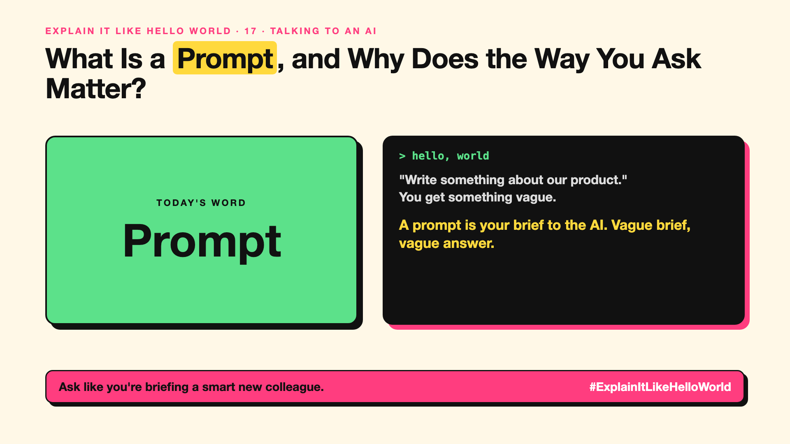

# 17. What Is a Prompt, and Why Does the Way You Ask Matter? | Prompt



*Explain It Like Hello World series: Prompt*

"Just write a better prompt." Everyone says it. What exactly is a prompt?

## The hello world

Ask a new colleague "Write something about our product." You'll get something vague. Ask "Write a 3-line email to a busy CFO explaining how our product cuts invoice processing time, friendly tone." You'll get something useful.

That's the hello world: a **prompt** is everything you give the AI to work with, and it shapes everything you get back.

## One step further

Remember write-up 11: an AI continues text in the most likely way. Your prompt is the start of that text. A clear prompt makes the right answer the most likely continuation.

Good prompts usually say who it's for, what you want, the format, and any examples or limits. Pasted documents, earlier chat messages and hidden instructions are part of the prompt too.

## Where you've already met it

Every message you type into a chatbot. The text box in image generators.

## The real name

A **prompt**.

- **Prompt:** the input you give an AI.
- **Instruction:** the part that says what to do.
- **Output:** what the AI gives back.

## What it's not

A prompt isn't a magic spell or a secret code. It's a clear brief. And a great prompt can't fix missing information; if the AI doesn't have the facts, give them.

## Take this to your next meeting

1. Say who it's for, what you want, and the format.
2. Give an example of a good answer.
3. Add the facts it needs instead of hoping it knows them.

Ask like you're briefing a smart new colleague.

Next write-up (18): **Is Prompt Engineering a Real Skill?**

Follow me for the next one. What's the best prompt tip you've learned?

**Earlier in this series:**

1. [AI words everyone uses. Nobody explains.](https://lnkd.in/p/d8abaPhq) (the curtain raiser post)
2. [What Actually Counts as Artificial Intelligence?](https://www.linkedin.com/pulse/2-what-actually-counts-artificial-intelligence-arpit-jain-su9lf)
3. How Does Machine Learning Learn Without Being Told the Rules? *(link added when published)*
4. What's "Deep" About Deep Learning? *(link added when published)*
5. Is a Neural Network Really Like a Brain? *(link added when published)*
6. What Makes Generative AI "Generative"? *(link added when published)*
7. Why Are They Called Foundation Models? *(link added when published)*
8. What Is AGI, and What Would Make AI "General"? *(link added when published)*
9. What Is Superintelligence, and Should We Worry? *(link added when published)*
10. What Are Tokens, and Why Does an AI Read in Pieces? *(link added when published)*
11. How Does an LLM Write a Sentence? *(link added when published)*
12. How Do Embeddings Know "King" Is Close to "Queen"? *(link added when published)*
13. How Does Attention Help an AI Know What "It" Means? *(link added when published)*
14. What Is a Transformer, the "T" in GPT? *(link added when published)*
15. What Is a Context Window, and Why Does an AI Forget? *(link added when published)*
16. Why Does Temperature Change the AI's Answer? *(link added when published)*

**Previous series:**

- **Series 1, #JustAddRAG:** [start here](https://www.linkedin.com/pulse/why-does-just-add-rag-sound-like-2-weeks-take-6-months-arpit-jain-l4kkf/) or jump to [the grand finale](https://www.linkedin.com/pulse/15-so-should-you-really-just-add-rag-grand-finale-arpit-jain-ninmf/)
- **Series 2, Beyond Just RAG: From Answers to Actions:** [start here](https://www.linkedin.com/pulse/1-your-ai-can-answer-now-has-act-from-answers-actions-arpit-jain-po6lf/) or jump to [the finale](https://www.linkedin.com/pulse/8-so-should-your-ai-do-things-just-answer-finale-arpit-jain-x7cxf)

---

**Post text (copy and paste):**

```
"Write something about our product."
You get something vague.

A prompt is your brief to the AI. Vague brief, vague answer.

Say who it's for, what you want, and the format.

What's the best prompt tip you've learned?

#AI #GenAI #LearnAI #ExplainItLikeHelloWorld
```

**Series index (post as the first comment):**

```
Explain It Like Hello World

Start here: AI words everyone uses. Nobody explains. https://lnkd.in/p/d8abaPhq
Previous: 16. Why Does Temperature Change the AI's Answer? [link]
You're here: 17. What Is a Prompt, and Why Does the Way You Ask Matter?
Next: 18. Is Prompt Engineering a Real Skill?

Full list: in the curtain raiser post.
```
