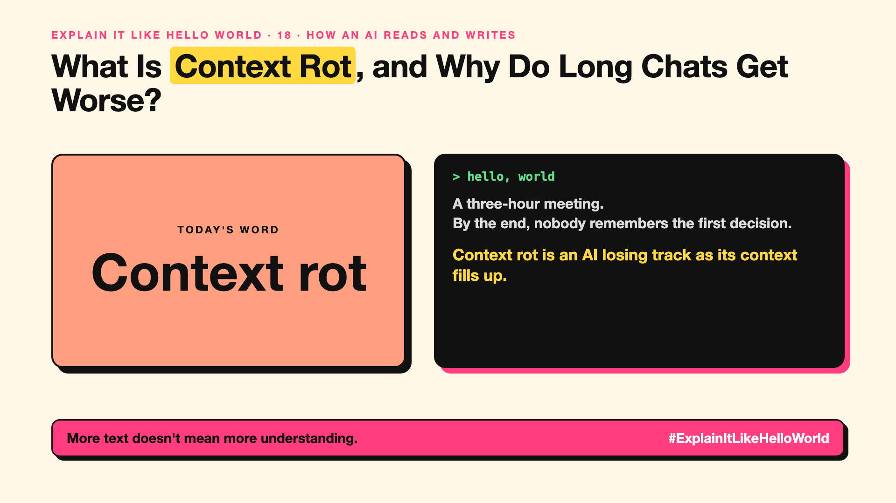

# 18. What Is Context Rot, and Why Do Long Chats Get Worse? | Context rot



*Explain It Like Hello World series: Context rot*

"Context rot." AI answers can get worse as the conversation or documents grow. Longer is not always better.

## The hello world

A meeting that runs for three hours. By the end, nobody remembers the first decision, and the notes have so much in them that the key point is buried.

That's the hello world: **context rot** is an AI's answers getting worse as its context fills with more text, so the important details get lost.

## One step further

The context window (write-up 16) has a fixed size, and the model pays attention across all of it. As the context grows, old details may be overlooked, and irrelevant text competes for attention. Research on long contexts has found that models often miss facts placed in the middle of long inputs.

The fixes are practical: keep only what matters, summarise old turns, start a fresh chat for a new task, and retrieve the right passages instead of pasting everything.

## Where you've already met it

Long chats where an AI forgets an earlier instruction, and tools that tell you to start a new chat when the thread gets long.

## The real name

**Context rot**, sometimes called **lost in the middle**.

- **Context rot:** answers degrading as context grows.
- **Lost in the middle:** facts in the middle of long input are missed more often.
- **Summarising:** shortening old turns into their key points.

## What it's not

A bigger context window doesn't fix context rot by itself. A longer window can hold more text, but it doesn't guarantee the model uses all of it well.

## Take this to your next meeting

1. Start a fresh chat when a task changes.
2. Keep the key instructions near the start and end of the prompt.
3. Summarise long threads instead of pasting everything.

More text doesn't mean more understanding.

Next write-up (19): **Why Does Temperature Change the AI's Answer?**

Follow me for the next one. Have you seen an AI forget something you said earlier in a long chat?

**Earlier in this series:**

1. [AI words everyone uses. Nobody explains.](https://lnkd.in/p/d8abaPhq) (the curtain raiser post)
2. [What Actually Counts as Artificial Intelligence?](https://www.linkedin.com/pulse/2-what-actually-counts-artificial-intelligence-arpit-jain-su9lf)
3. [How Does Machine Learning Learn Without Being Told the Rules?](https://www.linkedin.com/pulse/3-how-does-machine-learning-learn-without-being-told-rules-arpit-jain-ppdyf)
4. [What's "Deep" About Deep Learning?](https://www.linkedin.com/pulse/4-whats-deep-learning-arpit-jain-rvlff)
5. [Is a Neural Network Really Like a Brain?](https://www.linkedin.com/pulse/5-neural-network-really-like-brain-arpit-jain-jpigf)
6. [What Makes Generative AI "Generative"?](https://www.linkedin.com/pulse/6-what-makes-generative-ai-arpit-jain-q2rkf)
7. Why Are They Called Foundation Models? *(link added when published)*
8. What Is a Frontier Model, and Who Decides? *(link added when published)*
9. What Is AGI, and What Would Make AI "General"? *(link added when published)*
10. What Is Superintelligence, and Should We Worry? *(link added when published)*
11. What Are Tokens, and Why Does an AI Read in Pieces? *(link added when published)*
12. How Does an LLM Write a Sentence? *(link added when published)*
13. How Do Embeddings Know "King" Is Close to "Queen"? *(link added when published)*
14. How Does Attention Help an AI Know What "It" Means? *(link added when published)*
15. What Is a Transformer, the "T" in GPT? *(link added when published)*
16. What Is a Context Window, and Why Does an AI Forget? *(link added when published)*
17. What's a Knowledge Cutoff, and Why Is the AI Behind on News? *(link added when published)*

**Previous series:**

- **Series 1, #JustAddRAG:** [start here](https://www.linkedin.com/pulse/why-does-just-add-rag-sound-like-2-weeks-take-6-months-arpit-jain-l4kkf/) or jump to [the grand finale](https://www.linkedin.com/pulse/15-so-should-you-really-just-add-rag-grand-finale-arpit-jain-ninmf/)
- **Series 2, Beyond Just RAG: From Answers to Actions:** [start here](https://www.linkedin.com/pulse/1-your-ai-can-answer-now-has-act-from-answers-actions-arpit-jain-po6lf/) or jump to [the finale](https://www.linkedin.com/pulse/8-so-should-your-ai-do-things-just-answer-finale-arpit-jain-x7cxf)
- **Series 20, Today in AI** (ongoing): [start here](https://www.linkedin.com/pulse/today-ai-001-what-happens-when-your-agent-visits-someone-arpit-jain-2vqmf/) or read [the latest issue](https://www.linkedin.com/pulse/today-ai-011-text-to-speech-fits-your-phone-internet-needed-jain-1ipuf)

---

**Post text (copy and paste):**

```
A three-hour meeting.
By the end, nobody remembers the first decision.

Context rot is an AI losing track as its context fills up.

More text is not always better.

Have you seen an AI forget something you said earlier in a long chat?

#AI #GenAI #LearnAI #ExplainItLikeHelloWorld
```

**Series index (post as the first comment):**

```
Explain It Like Hello World

Start here: AI words everyone uses. Nobody explains. https://lnkd.in/p/d8abaPhq
Previous: 17. What's a Knowledge Cutoff, and Why Is the AI Behind on News? [link]
You're here: 18. What Is Context Rot, and Why Do Long Chats Get Worse?
Next: 19. Why Does Temperature Change the AI's Answer?

Full list: in the curtain raiser post.
```
