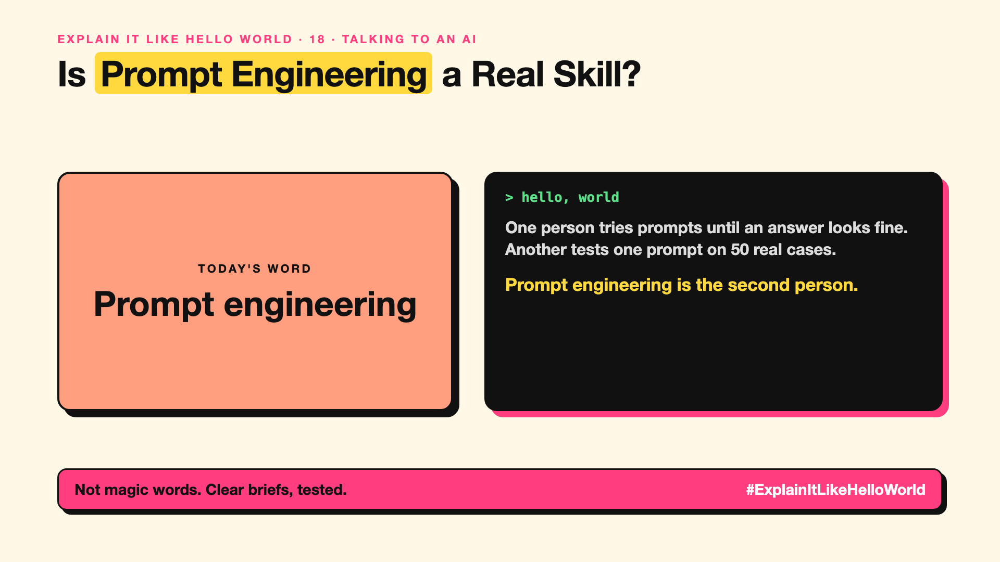

# 18. Is Prompt Engineering a Real Skill? | Prompt engineering



*Explain It Like Hello World series: Prompt engineering*

"Prompt engineer" became a job title, then a joke, then quietly part of every AI job. Is it real engineering?

## The hello world

One person asks the AI 50 questions and copies the answers that look fine. Another writes the instructions once, tests them on 50 real cases, fixes what fails, and saves the version that works.

That's the hello world: **prompt engineering** is designing, testing and improving prompts (write-up 17) systematically, not just typing better questions.

## One step further

In real products, prompts are reused thousands of times. So teams write them carefully: clear role, steps, format, examples (write-up 21), and rules for unclear cases. Then they test them against a set of real examples (write-up 88), change one thing at a time, and keep versions.

As models get better at understanding plain requests, the tricks matter less and the clear thinking matters more.

## Where you've already met it

Any AI feature in an app you use: someone wrote and tested the prompt behind it.

## The real name

**Prompt engineering**.

- **Prompt template:** a reusable prompt with blanks for each case.
- **Iteration:** changing one thing, then testing again.
- **Prompt version:** a saved, tested copy of a prompt.

## What it's not

It isn't finding magic words, and it can't make a model do what it's unable to do. For hard rules and guarantees, use code, not prompts (Series 3).

## Take this to your next meeting

1. Test prompts on real examples, not one lucky try.
2. Change one thing at a time and keep versions.
3. Put must-never-break rules in code, not in the prompt.

Not magic words. Clear briefs, tested.

Next write-up (19): **What's in a System Prompt, the Hidden Instruction Behind Every Chatbot?**

Follow me for the next one. Do you test your prompts, or try until one looks right?

**Earlier in this series:**

1. [AI words everyone uses. Nobody explains.](https://lnkd.in/p/d8abaPhq) (the curtain raiser post)
2. [What Actually Counts as Artificial Intelligence?](https://www.linkedin.com/pulse/2-what-actually-counts-artificial-intelligence-arpit-jain-su9lf)
3. [How Does Machine Learning Learn Without Being Told the Rules?](https://www.linkedin.com/pulse/3-how-does-machine-learning-learn-without-being-told-rules-arpit-jain-ppdyf)
4. [What's "Deep" About Deep Learning?](https://www.linkedin.com/pulse/4-whats-deep-learning-arpit-jain-rvlff)
5. Is a Neural Network Really Like a Brain? *(link added when published)*
6. What Makes Generative AI "Generative"? *(link added when published)*
7. Why Are They Called Foundation Models? *(link added when published)*
8. What Is AGI, and What Would Make AI "General"? *(link added when published)*
9. What Is Superintelligence, and Should We Worry? *(link added when published)*
10. What Are Tokens, and Why Does an AI Read in Pieces? *(link added when published)*
11. How Does an LLM Write a Sentence? *(link added when published)*
12. How Do Embeddings Know "King" Is Close to "Queen"? *(link added when published)*
13. How Does Attention Help an AI Know What "It" Means? *(link added when published)*
14. What Is a Transformer, the "T" in GPT? *(link added when published)*
15. What Is a Context Window, and Why Does an AI Forget? *(link added when published)*
16. Why Does Temperature Change the AI's Answer? *(link added when published)*
17. What Is a Prompt, and Why Does the Way You Ask Matter? *(link added when published)*

**Previous series:**

- **Series 1, #JustAddRAG:** [start here](https://www.linkedin.com/pulse/why-does-just-add-rag-sound-like-2-weeks-take-6-months-arpit-jain-l4kkf/) or jump to [the grand finale](https://www.linkedin.com/pulse/15-so-should-you-really-just-add-rag-grand-finale-arpit-jain-ninmf/)
- **Series 2, Beyond Just RAG: From Answers to Actions:** [start here](https://www.linkedin.com/pulse/1-your-ai-can-answer-now-has-act-from-answers-actions-arpit-jain-po6lf/) or jump to [the finale](https://www.linkedin.com/pulse/8-so-should-your-ai-do-things-just-answer-finale-arpit-jain-x7cxf)
- **Series 20, Today in AI** (ongoing): [start here](https://www.linkedin.com/pulse/today-ai-001-what-happens-when-your-agent-visits-someone-arpit-jain-2vqmf/) or read [the latest issue](https://www.linkedin.com/pulse/today-ai-011-text-to-speech-fits-your-phone-internet-needed-jain-1ipuf)

---

**Post text (copy and paste):**

```
One person tries prompts until an answer looks fine.
Another tests one prompt on 50 real cases.

Prompt engineering is the second person.

Design, test, fix, keep versions.

Do you test your prompts, or try until one looks right?

#AI #GenAI #LearnAI #ExplainItLikeHelloWorld
```

**Series index (post as the first comment):**

```
Explain It Like Hello World

Start here: AI words everyone uses. Nobody explains. https://lnkd.in/p/d8abaPhq
Previous: 17. What Is a Prompt, and Why Does the Way You Ask Matter? [link]
You're here: 18. Is Prompt Engineering a Real Skill?
Next: 19. What's in a System Prompt, the Hidden Instruction Behind Every Chatbot?

Full list: in the curtain raiser post.
```
