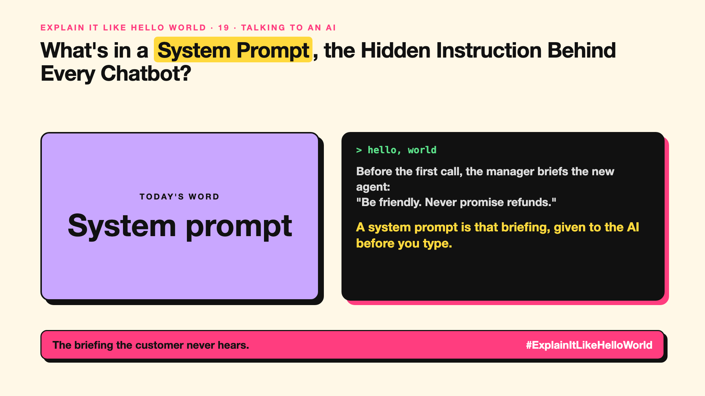

# 19. What's in a System Prompt, the Hidden Instruction Behind Every Chatbot? | System prompt



*Explain It Like Hello World series: System prompt*

"System prompt." Companies guard theirs. Hackers try to leak them. What's in it?

## The hello world

Before a new support agent takes their first call, the manager tells them: "You work for Acme. Be friendly. Never promise refunds. Answer only about our products."

Customers never hear that briefing, but it shapes every answer. That's the hello world: a **system prompt** is the hidden briefing given to the AI before you type anything.

## One step further

Every chat app sends the AI a system prompt first, then your message. It sets the role, tone, format, what to avoid and sometimes today's date or tools it can use.

The AI gives it extra weight, but it isn't unbreakable: clever user messages can sometimes push against it (write-ups 85 and 86). So real rules, like refund limits, belong in code too.

## Where you've already met it

Every branded chatbot that stays "in character". Custom GPTs and assistants you set up with instructions.

## The real name

The **system prompt**, also called **system instructions**.

- **System prompt:** hidden setup instructions sent before the conversation.
- **User prompt:** what the person types.
- **Persona:** the role and tone the AI is told to take.

## What it's not

A system prompt isn't a security wall or a secret vault. Don't put passwords or confidential data in it, and don't rely on it alone to enforce rules.

## Take this to your next meeting

1. Write your assistant's role, tone and limits in the system prompt.
2. Never put secrets in it.
3. Enforce money, access and safety rules in code as well.

The briefing the customer never hears.

Next write-up (20): **What Is Zero-Shot, and Can an AI Do a Task It Was Never Shown?**

Follow me for the next one. If you built a chatbot, what would its first instruction be?

**Earlier in this series:**

1. [AI words everyone uses. Nobody explains.](https://lnkd.in/p/d8abaPhq) (the curtain raiser post)
2. [What Actually Counts as Artificial Intelligence?](https://www.linkedin.com/pulse/2-what-actually-counts-artificial-intelligence-arpit-jain-su9lf)
3. [How Does Machine Learning Learn Without Being Told the Rules?](https://www.linkedin.com/pulse/3-how-does-machine-learning-learn-without-being-told-rules-arpit-jain-ppdyf)
4. [What's "Deep" About Deep Learning?](https://www.linkedin.com/pulse/4-whats-deep-learning-arpit-jain-rvlff)
5. Is a Neural Network Really Like a Brain? *(link added when published)*
6. What Makes Generative AI "Generative"? *(link added when published)*
7. Why Are They Called Foundation Models? *(link added when published)*
8. What Is AGI, and What Would Make AI "General"? *(link added when published)*
9. What Is Superintelligence, and Should We Worry? *(link added when published)*
10. What Are Tokens, and Why Does an AI Read in Pieces? *(link added when published)*
11. How Does an LLM Write a Sentence? *(link added when published)*
12. How Do Embeddings Know "King" Is Close to "Queen"? *(link added when published)*
13. How Does Attention Help an AI Know What "It" Means? *(link added when published)*
14. What Is a Transformer, the "T" in GPT? *(link added when published)*
15. What Is a Context Window, and Why Does an AI Forget? *(link added when published)*
16. Why Does Temperature Change the AI's Answer? *(link added when published)*
17. What Is a Prompt, and Why Does the Way You Ask Matter? *(link added when published)*
18. Is Prompt Engineering a Real Skill? *(link added when published)*

**Previous series:**

- **Series 1, #JustAddRAG:** [start here](https://www.linkedin.com/pulse/why-does-just-add-rag-sound-like-2-weeks-take-6-months-arpit-jain-l4kkf/) or jump to [the grand finale](https://www.linkedin.com/pulse/15-so-should-you-really-just-add-rag-grand-finale-arpit-jain-ninmf/)
- **Series 2, Beyond Just RAG: From Answers to Actions:** [start here](https://www.linkedin.com/pulse/1-your-ai-can-answer-now-has-act-from-answers-actions-arpit-jain-po6lf/) or jump to [the finale](https://www.linkedin.com/pulse/8-so-should-your-ai-do-things-just-answer-finale-arpit-jain-x7cxf)
- **Series 20, Today in AI** (ongoing): [start here](https://www.linkedin.com/pulse/today-ai-001-what-happens-when-your-agent-visits-someone-arpit-jain-2vqmf/) or read [the latest issue](https://www.linkedin.com/pulse/today-ai-011-text-to-speech-fits-your-phone-internet-needed-jain-1ipuf)

---

**Post text (copy and paste):**

```
Before the first call, the manager briefs the new agent:
"Be friendly. Never promise refunds."

A system prompt is that briefing, given to the AI before you type.

Hidden, important, and not a security wall.

If you built a chatbot, what would its first instruction be?

#AI #GenAI #LearnAI #ExplainItLikeHelloWorld
```

**Series index (post as the first comment):**

```
Explain It Like Hello World

Start here: AI words everyone uses. Nobody explains. https://lnkd.in/p/d8abaPhq
Previous: 18. Is Prompt Engineering a Real Skill? [link]
You're here: 19. What's in a System Prompt, the Hidden Instruction Behind Every Chatbot?
Next: 20. What Is Zero-Shot, and Can an AI Do a Task It Was Never Shown?

Full list: in the curtain raiser post.
```
