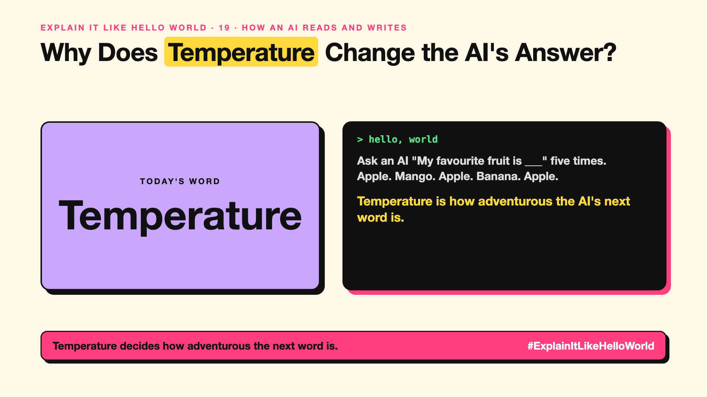

# 19. Why Does Temperature Change the AI's Answer? | Temperature



*Explain It Like Hello World series: Temperature*

"Set temperature to zero." Developers say it like a magic spell. What is being cooled down?

## The hello world

Ask an AI to finish "My favourite fruit is ___" five times.

It might say apple, mango, apple, banana, apple. Remember write-up 12: the AI scores every possible next word, then **picks** one. Temperature is how adventurous that pick is.

## One step further

**Low temperature:** almost always pick the top-scoring word. Answers are steady and predictable. Good for facts, forms and code.

**High temperature:** give lower-scoring words a real chance. Answers vary and surprise. Good for brainstorming, stories and taglines.

Even at temperature zero, answers can still differ slightly, and other changes (a new model version, different wording) change answers too.

## Where you've already met it

Pressing "regenerate" and getting a different answer. Creative tools that offer "more creative" or "more precise" modes.

## The real name

**Temperature**, a **sampling** setting.

- **Sampling:** choosing the next word from the AI's scored options.
- **Temperature:** how much randomness goes into that choice.
- **Deterministic:** same input, same output, every time.

## What it's not

Temperature doesn't make the AI smarter or more accurate. Low temperature makes it consistent, even consistently wrong. (Why answers change after a model update is in #JustAddRAG 14.)

## Take this to your next meeting

1. Use low temperature for anything that must be repeatable.
2. Use higher temperature when you want options, then pick.
3. Don't treat temperature zero as a guarantee of identical answers.

Temperature decides how adventurous the next word is.

Next write-up (20): **What Is a Prompt, and Why Does the Way You Ask Matter?**

Follow me for the next one. Do you want your AI predictable or creative?

**Earlier in this series:**

1. [AI words everyone uses. Nobody explains.](https://lnkd.in/p/d8abaPhq) (the curtain raiser post)
2. [What Actually Counts as Artificial Intelligence?](https://www.linkedin.com/pulse/2-what-actually-counts-artificial-intelligence-arpit-jain-su9lf)
3. [How Does Machine Learning Learn Without Being Told the Rules?](https://www.linkedin.com/pulse/3-how-does-machine-learning-learn-without-being-told-rules-arpit-jain-ppdyf)
4. [What's "Deep" About Deep Learning?](https://www.linkedin.com/pulse/4-whats-deep-learning-arpit-jain-rvlff)
5. Is a Neural Network Really Like a Brain? *(link added when published)*
6. What Makes Generative AI "Generative"? *(link added when published)*
7. Why Are They Called Foundation Models? *(link added when published)*
8. What Is a Frontier Model, and Who Decides? *(link added when published)*
9. What Is AGI, and What Would Make AI "General"? *(link added when published)*
10. What Is Superintelligence, and Should We Worry? *(link added when published)*
11. What Are Tokens, and Why Does an AI Read in Pieces? *(link added when published)*
12. How Does an LLM Write a Sentence? *(link added when published)*
13. How Do Embeddings Know "King" Is Close to "Queen"? *(link added when published)*
14. How Does Attention Help an AI Know What "It" Means? *(link added when published)*
15. What Is a Transformer, the "T" in GPT? *(link added when published)*
16. What Is a Context Window, and Why Does an AI Forget? *(link added when published)*
17. What's a Knowledge Cutoff, and Why Is the AI Behind on News? *(link added when published)*
18. What Is Context Rot, and Why Do Long Chats Get Worse? *(link added when published)*

**Previous series:**

- **Series 1, #JustAddRAG:** [start here](https://www.linkedin.com/pulse/why-does-just-add-rag-sound-like-2-weeks-take-6-months-arpit-jain-l4kkf/) or jump to [the grand finale](https://www.linkedin.com/pulse/15-so-should-you-really-just-add-rag-grand-finale-arpit-jain-ninmf/)
- **Series 2, Beyond Just RAG: From Answers to Actions:** [start here](https://www.linkedin.com/pulse/1-your-ai-can-answer-now-has-act-from-answers-actions-arpit-jain-po6lf/) or jump to [the finale](https://www.linkedin.com/pulse/8-so-should-your-ai-do-things-just-answer-finale-arpit-jain-x7cxf)
- **Series 20, Today in AI** (ongoing): [start here](https://www.linkedin.com/pulse/today-ai-001-what-happens-when-your-agent-visits-someone-arpit-jain-2vqmf/) or read [the latest issue](https://www.linkedin.com/pulse/today-ai-011-text-to-speech-fits-your-phone-internet-needed-jain-1ipuf)

---

**Post text (copy and paste):**

```
Ask an AI "My favourite fruit is ___" five times.
Apple. Mango. Apple. Banana. Apple.

Temperature is how adventurous the AI's next word is.

Low for facts, high for ideas.

Do you want your AI predictable or creative?

#AI #GenAI #LearnAI #ExplainItLikeHelloWorld
```

**Series index (post as the first comment):**

```
Explain It Like Hello World

Start here: AI words everyone uses. Nobody explains. https://lnkd.in/p/d8abaPhq
Previous: 18. What Is Context Rot, and Why Do Long Chats Get Worse? [link]
You're here: 19. Why Does Temperature Change the AI's Answer?
Next: 20. What Is a Prompt, and Why Does the Way You Ask Matter?

Full list: in the curtain raiser post.
```
