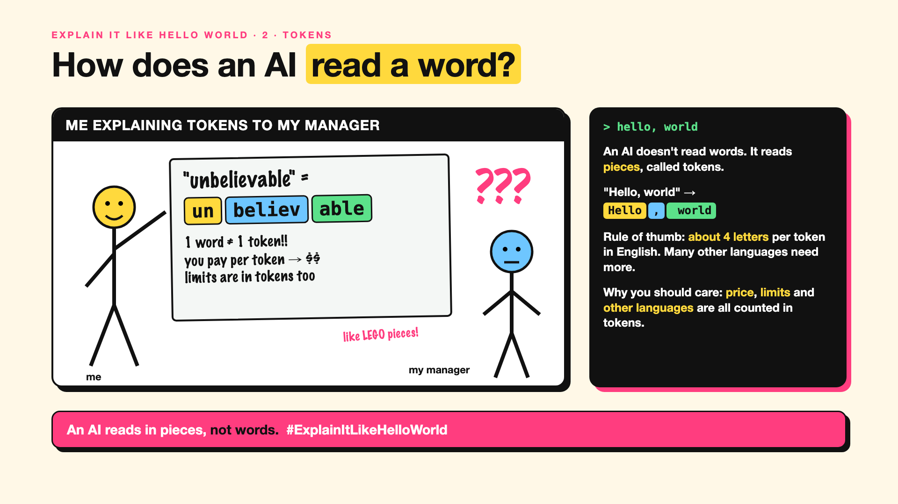

# 2. How Does an AI Read a Word? | Tokens



*Explain It Like Hello World series: Tokens*

"This model has a 200,000-token limit." "We pay per million tokens." Tokens are on every AI bill and every spec sheet. Most people quietly assume a token is a word. It isn't.

## The hello world

Give an AI the word "unbelievable". It doesn't see one word. It might see three pieces: **un**, **believ**, **able**.

That's the whole idea. An AI reads text as small pieces it already knows, like LEGO bricks. Common words are often one brick ("the", "cat"). Rare or long words are built from several. Even a space or a comma can be its own piece.

## One step further

Before training, the AI's makers build a fixed "brick set": a vocabulary of tens of thousands of pieces, chosen because they appear often in text. Every sentence you type is cut into those bricks, and each brick gets a number. The AI only ever works with the numbers.

A rough rule of thumb: in English, one token is about four letters, so 100 words is roughly 130 to 150 tokens. Many other languages, and code, need more tokens for the same meaning.

## Where you've already met it

Every AI price list ("per million tokens"), every "message too long" error, and every time an AI miscounted the letters in a word. It sees bricks, not letters.

## The real name

**Tokens**, made by a **tokenizer**.

- **Token:** one piece of text the AI reads, often part of a word.
- **Tokenizer:** the tool that cuts text into tokens.
- **Vocabulary:** the fixed set of pieces a model knows.

## What it's not

A token is not a word, and not a letter. Two AIs can split the same sentence differently, so "1,000 tokens" isn't the same amount of text everywhere.

## Take this to your next meeting

1. When you see a token limit or price, translate it: roughly three-quarters of a word per token in English.
2. Budget more tokens for Hindi, Tamil, Japanese or code.
3. Ask your vendor which tokenizer they use before comparing prices.

An AI doesn't read words. It reads bricks.

Next write-up (3): **How Does an AI Write a Sentence?**

Follow me for the next one. Did you think a token was a word?

**Earlier in this series:**

1. AI words everyone uses. Nobody explains. (the curtain raiser post) *(link added when published)*

**Previous series:**

- **Series 1, #JustAddRAG:** [start here](https://www.linkedin.com/pulse/why-does-just-add-rag-sound-like-2-weeks-take-6-months-arpit-jain-l4kkf/) or jump to [the grand finale](https://www.linkedin.com/pulse/15-so-should-you-really-just-add-rag-grand-finale-arpit-jain-ninmf/)
- **Series 2, Beyond Just RAG: From Answers to Actions:** [start here](https://www.linkedin.com/pulse/1-your-ai-can-answer-now-has-act-from-answers-actions-arpit-jain-po6lf/) or jump to [the finale](https://www.linkedin.com/pulse/8-so-should-your-ai-do-things-just-answer-finale-arpit-jain-x7cxf)

---

**Post text (copy and paste):**

```
"unbelievable" is one word to you.
To an AI, it might be three: un, believ, able.

An AI doesn't read words. It reads pieces, called tokens.

That's why AI prices and limits are counted in tokens, not words.

Did you think a token was a word?

#AI #GenAI #LearnAI #ExplainItLikeHelloWorld
```

**Series index (post as the first comment):**

```
Explain It Like Hello World

Start here: 1. AI words everyone uses. Nobody explains. [link]
You're here: 2. How Does an AI Read a Word?
Next: 3. How Does an AI Write a Sentence?

Full list: in the curtain raiser post.
```
