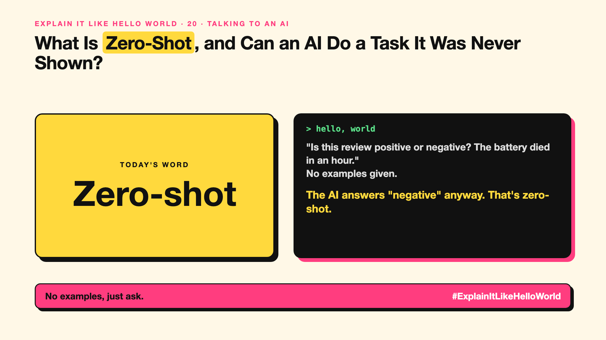

# 20. What Is Zero-Shot, and Can an AI Do a Task It Was Never Shown? | Zero-shot



*Explain It Like Hello World series: Zero-shot*

"Zero-shot." It appears in research papers and product launches. It sounds like a missed basketball throw.

## The hello world

Ask an AI: "Is this review positive or negative? 'The battery died in an hour.'" You gave no examples, no training, just the question. It answers "negative".

That's the hello world: **zero-shot** means asking an AI to do a task with **zero examples**, relying only on what it already learned.

## One step further

Older AI needed thousands of labelled examples for each task (write-up 3). Large models learned so much general language that they can follow a plain instruction for many new tasks straight away.

Zero-shot works well for common, clear tasks. For unusual formats or subtle judgement calls, adding a few examples (write-up 21) usually helps.

## Where you've already met it

Asking a chatbot to translate, classify or summarise something without showing it how.

## The real name

**Zero-shot** prompting.

- **Shot:** an example included in the prompt.
- **Zero-shot:** no examples, just the instruction.
- **Generalisation:** handling tasks it wasn't specifically trained on.

## What it's not

Zero-shot doesn't mean zero knowledge. The model learned from huge amounts of text. And it's not always reliable for niche tasks.

## Take this to your next meeting

1. Try zero-shot first; it's the simplest.
2. If results wobble, add two or three examples.
3. Test on real cases before trusting it at scale.

No examples, just ask.

Next write-up (21): **Why Does Few-Shot Prompting Work So Well?**

Follow me for the next one. Do you usually give the AI examples, or just ask?

**Earlier in this series:**

1. [AI words everyone uses. Nobody explains.](https://lnkd.in/p/d8abaPhq) (the curtain raiser post)
2. [What Actually Counts as Artificial Intelligence?](https://www.linkedin.com/pulse/2-what-actually-counts-artificial-intelligence-arpit-jain-su9lf)
3. [How Does Machine Learning Learn Without Being Told the Rules?](https://www.linkedin.com/pulse/3-how-does-machine-learning-learn-without-being-told-rules-arpit-jain-ppdyf)
4. [What's "Deep" About Deep Learning?](https://www.linkedin.com/pulse/4-whats-deep-learning-arpit-jain-rvlff)
5. Is a Neural Network Really Like a Brain? *(link added when published)*
6. What Makes Generative AI "Generative"? *(link added when published)*
7. Why Are They Called Foundation Models? *(link added when published)*
8. What Is AGI, and What Would Make AI "General"? *(link added when published)*
9. What Is Superintelligence, and Should We Worry? *(link added when published)*
10. What Are Tokens, and Why Does an AI Read in Pieces? *(link added when published)*
11. How Does an LLM Write a Sentence? *(link added when published)*
12. How Do Embeddings Know "King" Is Close to "Queen"? *(link added when published)*
13. How Does Attention Help an AI Know What "It" Means? *(link added when published)*
14. What Is a Transformer, the "T" in GPT? *(link added when published)*
15. What Is a Context Window, and Why Does an AI Forget? *(link added when published)*
16. Why Does Temperature Change the AI's Answer? *(link added when published)*
17. What Is a Prompt, and Why Does the Way You Ask Matter? *(link added when published)*
18. Is Prompt Engineering a Real Skill? *(link added when published)*
19. What's in a System Prompt, the Hidden Instruction Behind Every Chatbot? *(link added when published)*

**Previous series:**

- **Series 1, #JustAddRAG:** [start here](https://www.linkedin.com/pulse/why-does-just-add-rag-sound-like-2-weeks-take-6-months-arpit-jain-l4kkf/) or jump to [the grand finale](https://www.linkedin.com/pulse/15-so-should-you-really-just-add-rag-grand-finale-arpit-jain-ninmf/)
- **Series 2, Beyond Just RAG: From Answers to Actions:** [start here](https://www.linkedin.com/pulse/1-your-ai-can-answer-now-has-act-from-answers-actions-arpit-jain-po6lf/) or jump to [the finale](https://www.linkedin.com/pulse/8-so-should-your-ai-do-things-just-answer-finale-arpit-jain-x7cxf)
- **Series 20, Today in AI** (ongoing): [start here](https://www.linkedin.com/pulse/today-ai-001-what-happens-when-your-agent-visits-someone-arpit-jain-2vqmf/) or read [the latest issue](https://www.linkedin.com/pulse/today-ai-011-text-to-speech-fits-your-phone-internet-needed-jain-1ipuf)

---

**Post text (copy and paste):**

```
"Is this review positive or negative? The battery died in an hour."
No examples given.

The AI answers "negative" anyway. That's zero-shot.

Zero examples, just the instruction.

Do you usually give the AI examples, or just ask?

#AI #GenAI #LearnAI #ExplainItLikeHelloWorld
```

**Series index (post as the first comment):**

```
Explain It Like Hello World

Start here: AI words everyone uses. Nobody explains. https://lnkd.in/p/d8abaPhq
Previous: 19. What's in a System Prompt, the Hidden Instruction Behind Every Chatbot? [link]
You're here: 20. What Is Zero-Shot, and Can an AI Do a Task It Was Never Shown?
Next: 21. Why Does Few-Shot Prompting Work So Well?

Full list: in the curtain raiser post.
```
