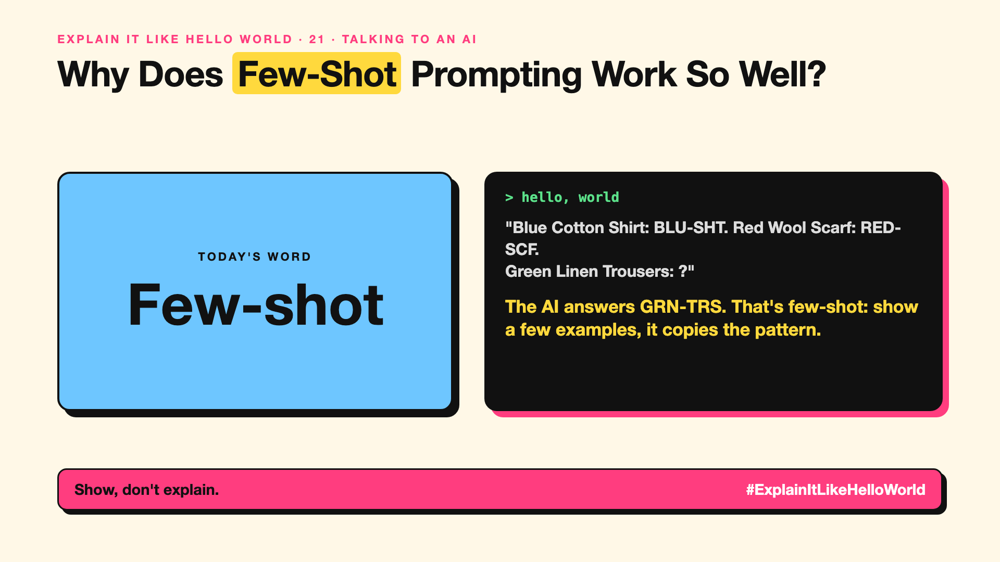

# 21. Why Does Few-Shot Prompting Work So Well? | Few-shot



*Explain It Like Hello World series: Few-shot*

"Few-shot prompting." A simple trick that often beats long instructions.

## The hello world

You want product names turned into short codes. Instead of explaining the rules, you show:
"Blue Cotton Shirt → BLU-SHT"
"Red Wool Scarf → RED-SCF"
"Green Linen Trousers → ?"

The AI answers "GRN-TRS". That's the hello world: **few-shot** means showing a few examples in the prompt so the AI copies the pattern.

## One step further

Examples show format, tone and edge cases faster than words can describe them. Two to five good examples usually do the job.

Choose them carefully: the AI copies everything, including mistakes and accidental patterns. If all examples are short, answers will be short.

## Where you've already met it

Prompt templates that include "Example 1, Example 2". Spreadsheet AI features that learn from the first few rows you fill in.

## The real name

**Few-shot** prompting, also called **in-context learning**.

- **Few-shot:** a handful of examples in the prompt.
- **In-context learning:** learning a pattern from the prompt, without retraining.
- **Edge case:** an unusual example worth showing.

## What it's not

Few-shot doesn't retrain or change the model. It only guides this one answer. Remove the examples, and the effect is gone.

## Take this to your next meeting

1. Show 2 to 5 examples instead of long rules.
2. Include one tricky case among them.
3. Check your examples are correct; they will be copied.

Show, don't explain.

Next write-up (22): **Why Does Chain of Thought ("Think Step by Step") Work?**

Follow me for the next one. Have examples ever fixed a prompt for you?

**Earlier in this series:**

1. [AI words everyone uses. Nobody explains.](https://lnkd.in/p/d8abaPhq) (the curtain raiser post)
2. [What Actually Counts as Artificial Intelligence?](https://www.linkedin.com/pulse/2-what-actually-counts-artificial-intelligence-arpit-jain-su9lf)
3. [How Does Machine Learning Learn Without Being Told the Rules?](https://www.linkedin.com/pulse/3-how-does-machine-learning-learn-without-being-told-rules-arpit-jain-ppdyf)
4. What's "Deep" About Deep Learning? *(link added when published)*
5. Is a Neural Network Really Like a Brain? *(link added when published)*
6. What Makes Generative AI "Generative"? *(link added when published)*
7. Why Are They Called Foundation Models? *(link added when published)*
8. What Is AGI, and What Would Make AI "General"? *(link added when published)*
9. What Is Superintelligence, and Should We Worry? *(link added when published)*
10. What Are Tokens, and Why Does an AI Read in Pieces? *(link added when published)*
11. How Does an LLM Write a Sentence? *(link added when published)*
12. How Do Embeddings Know "King" Is Close to "Queen"? *(link added when published)*
13. How Does Attention Help an AI Know What "It" Means? *(link added when published)*
14. What Is a Transformer, the "T" in GPT? *(link added when published)*
15. What Is a Context Window, and Why Does an AI Forget? *(link added when published)*
16. Why Does Temperature Change the AI's Answer? *(link added when published)*
17. What Is a Prompt, and Why Does the Way You Ask Matter? *(link added when published)*
18. Is Prompt Engineering a Real Skill? *(link added when published)*
19. What's in a System Prompt, the Hidden Instruction Behind Every Chatbot? *(link added when published)*
20. What Is Zero-Shot, and Can an AI Do a Task It Was Never Shown? *(link added when published)*

**Previous series:**

- **Series 1, #JustAddRAG:** [start here](https://www.linkedin.com/pulse/why-does-just-add-rag-sound-like-2-weeks-take-6-months-arpit-jain-l4kkf/) or jump to [the grand finale](https://www.linkedin.com/pulse/15-so-should-you-really-just-add-rag-grand-finale-arpit-jain-ninmf/)
- **Series 2, Beyond Just RAG: From Answers to Actions:** [start here](https://www.linkedin.com/pulse/1-your-ai-can-answer-now-has-act-from-answers-actions-arpit-jain-po6lf/) or jump to [the finale](https://www.linkedin.com/pulse/8-so-should-your-ai-do-things-just-answer-finale-arpit-jain-x7cxf)

---

**Post text (copy and paste):**

```
"Blue Cotton Shirt: BLU-SHT. Red Wool Scarf: RED-SCF.
Green Linen Trousers: ?"

The AI answers GRN-TRS. That's few-shot: show a few examples, it copies the pattern.

Often better than a page of rules.

Have examples ever fixed a prompt for you?

#AI #GenAI #LearnAI #ExplainItLikeHelloWorld
```

**Series index (post as the first comment):**

```
Explain It Like Hello World

Start here: AI words everyone uses. Nobody explains. https://lnkd.in/p/d8abaPhq
Previous: 20. What Is Zero-Shot, and Can an AI Do a Task It Was Never Shown? [link]
You're here: 21. Why Does Few-Shot Prompting Work So Well?
Next: 22. Why Does Chain of Thought ("Think Step by Step") Work?

Full list: in the curtain raiser post.
```
