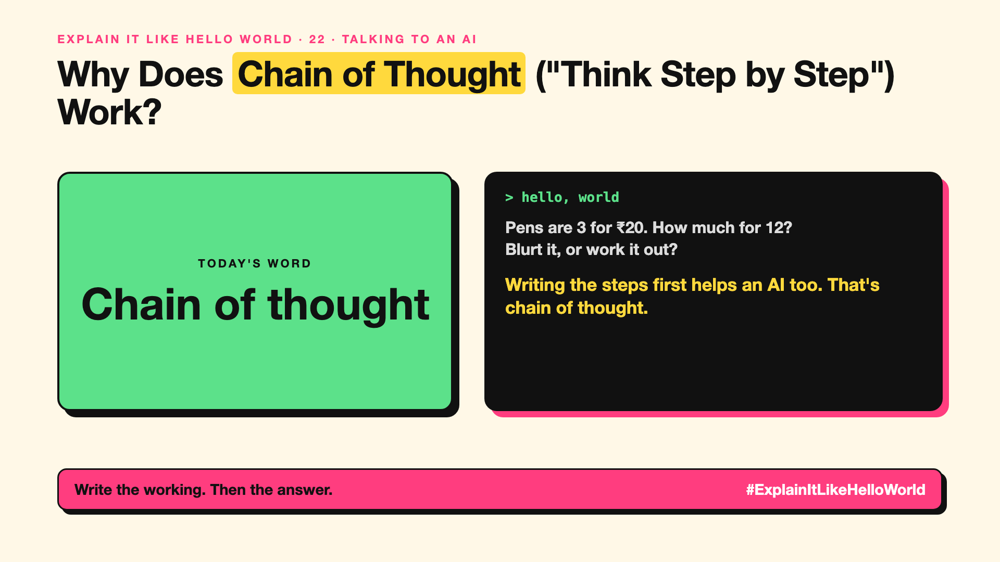

# 22. Why Does Chain of Thought ("Think Step by Step") Work? | Chain of thought



*Explain It Like Hello World series: Chain of thought*

"Chain of thought." Adding "let's think step by step" to a prompt famously made AIs better at maths. Why would that work?

## The hello world

Ask: "A shop sells pens at 3 for ₹20. How much for 12?" Blurt an answer and you might get it wrong. Write the steps: 12 pens is 4 groups of 3, 4 × ₹20 = ₹80.

That's the hello world: **chain of thought** means the AI writes its reasoning steps before the final answer.

## One step further

Remember write-up 11: an AI writes one token at a time. Each written step becomes part of the text it builds on, so it can use its own working, like scribbling on paper.

Researchers found in 2022 that simply asking models to "think step by step" improved results. Reasoning models (write-up 71) are now trained to do this automatically, often in a hidden "thinking" section.

## Where you've already met it

Chatbots that show their working on maths problems. "Thinking" sections in newer AI apps.

## The real name

**Chain-of-thought** prompting.

- **Chain of thought:** step-by-step reasoning written before the answer.
- **Intermediate step:** one part of the working.
- **Reasoning:** working something out rather than recalling it.

## What it's not

The written steps aren't always the real reason the AI chose its answer, and steps can look logical while containing a mistake. Check the answer, not just the working.

## Take this to your next meeting

1. Ask for steps on maths, logic and planning tasks.
2. Skip it for simple look-ups; it just costs more tokens.
3. Check the final answer independently when it matters.

Write the working. Then the answer.

Next write-up (23): **Is Context Engineering the New Prompt Engineering?**

Follow me for the next one. Do you ask AI to show its working?

**Earlier in this series:**

1. [AI words everyone uses. Nobody explains.](https://lnkd.in/p/d8abaPhq) (the curtain raiser post)
2. [What Actually Counts as Artificial Intelligence?](https://www.linkedin.com/pulse/2-what-actually-counts-artificial-intelligence-arpit-jain-su9lf)
3. [How Does Machine Learning Learn Without Being Told the Rules?](https://www.linkedin.com/pulse/3-how-does-machine-learning-learn-without-being-told-rules-arpit-jain-ppdyf)
4. [What's "Deep" About Deep Learning?](https://www.linkedin.com/pulse/4-whats-deep-learning-arpit-jain-rvlff)
5. Is a Neural Network Really Like a Brain? *(link added when published)*
6. What Makes Generative AI "Generative"? *(link added when published)*
7. Why Are They Called Foundation Models? *(link added when published)*
8. What Is AGI, and What Would Make AI "General"? *(link added when published)*
9. What Is Superintelligence, and Should We Worry? *(link added when published)*
10. What Are Tokens, and Why Does an AI Read in Pieces? *(link added when published)*
11. How Does an LLM Write a Sentence? *(link added when published)*
12. How Do Embeddings Know "King" Is Close to "Queen"? *(link added when published)*
13. How Does Attention Help an AI Know What "It" Means? *(link added when published)*
14. What Is a Transformer, the "T" in GPT? *(link added when published)*
15. What Is a Context Window, and Why Does an AI Forget? *(link added when published)*
16. Why Does Temperature Change the AI's Answer? *(link added when published)*
17. What Is a Prompt, and Why Does the Way You Ask Matter? *(link added when published)*
18. Is Prompt Engineering a Real Skill? *(link added when published)*
19. What's in a System Prompt, the Hidden Instruction Behind Every Chatbot? *(link added when published)*
20. What Is Zero-Shot, and Can an AI Do a Task It Was Never Shown? *(link added when published)*
21. Why Does Few-Shot Prompting Work So Well? *(link added when published)*

**Previous series:**

- **Series 1, #JustAddRAG:** [start here](https://www.linkedin.com/pulse/why-does-just-add-rag-sound-like-2-weeks-take-6-months-arpit-jain-l4kkf/) or jump to [the grand finale](https://www.linkedin.com/pulse/15-so-should-you-really-just-add-rag-grand-finale-arpit-jain-ninmf/)
- **Series 2, Beyond Just RAG: From Answers to Actions:** [start here](https://www.linkedin.com/pulse/1-your-ai-can-answer-now-has-act-from-answers-actions-arpit-jain-po6lf/) or jump to [the finale](https://www.linkedin.com/pulse/8-so-should-your-ai-do-things-just-answer-finale-arpit-jain-x7cxf)
- **Series 20, Today in AI** (ongoing): [start here](https://www.linkedin.com/pulse/today-ai-001-what-happens-when-your-agent-visits-someone-arpit-jain-2vqmf/) or read [the latest issue](https://www.linkedin.com/pulse/today-ai-011-text-to-speech-fits-your-phone-internet-needed-jain-1ipuf)

---

**Post text (copy and paste):**

```
Pens are 3 for ₹20. How much for 12?
Blurt it, or work it out?

Writing the steps first helps an AI too. That's chain of thought.

Its own working becomes something it can build on.

Do you ask AI to show its working?

#AI #GenAI #LearnAI #ExplainItLikeHelloWorld
```

**Series index (post as the first comment):**

```
Explain It Like Hello World

Start here: AI words everyone uses. Nobody explains. https://lnkd.in/p/d8abaPhq
Previous: 21. Why Does Few-Shot Prompting Work So Well? [link]
You're here: 22. Why Does Chain of Thought ("Think Step by Step") Work?
Next: 23. Is Context Engineering the New Prompt Engineering?

Full list: in the curtain raiser post.
```
