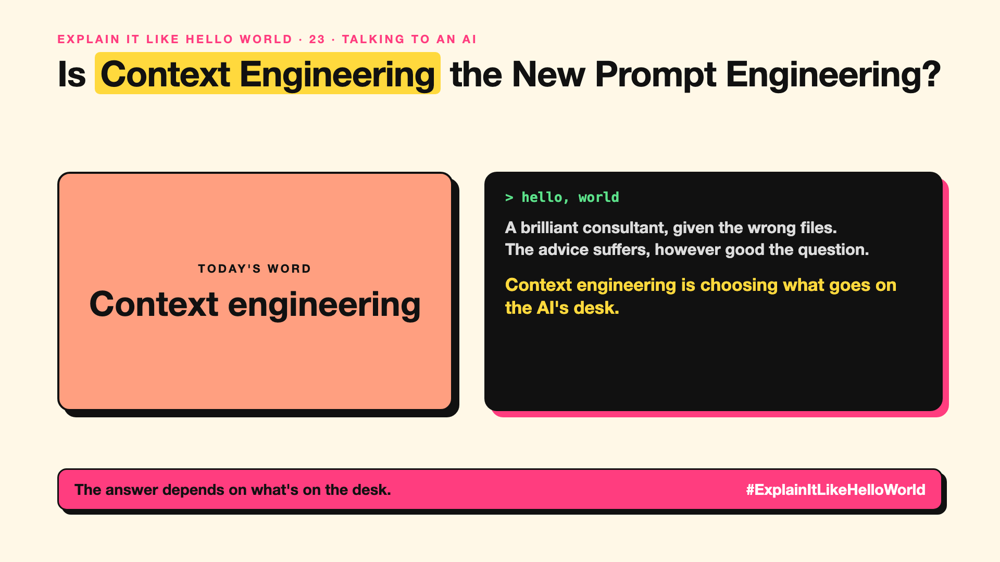

# 23. Is Context Engineering the New Prompt Engineering? | Context engineering



*Explain It Like Hello World series: Context engineering*

"Context engineering" became a buzzword in 2025. Some say it replaces prompt engineering. What's the difference?

## The hello world

A brilliant consultant is only as good as the briefing pack on their desk. Give them the wrong files, too many files, or files out of order, and the advice suffers, however good your question was.

That's the hello world: **context engineering** is choosing what goes on the AI's desk (write-up 15): which instructions, documents, history and tool results, in what order.

## One step further

Prompt engineering (write-up 18) is about the wording of the request. Context engineering is about everything around it: retrieved documents (write-up 53), memory (write-up 67), tool results, examples, and what to leave out.

In agents, the desk changes every step, so deciding what to keep, summarise or drop becomes the main job. Too little context and the AI guesses; too much and it gets confused and costs more.

## Where you've already met it

AI assistants that pull the right files before answering. Coding tools that decide which parts of your code to show the AI.

## The real name

**Context engineering**.

- **Context:** everything the AI sees for this answer.
- **Retrieval:** fetching relevant information to include.
- **Summarisation:** shrinking older context to save space.

## What it's not

It's not "stuff in everything". More context isn't better context. The skill is choosing the right, small set.

## Take this to your next meeting

1. List what the AI sees for each answer; you might be surprised.
2. Remove what isn't needed before adding more.
3. Put the most important facts close to the question.

The answer depends on what's on the desk.

Next write-up (24): **How Does Structured Output Get an AI to Fill In a Form?**

Follow me for the next one. Which matters more: the question or the briefing pack?

**Earlier in this series:**

1. [AI words everyone uses. Nobody explains.](https://lnkd.in/p/d8abaPhq) (the curtain raiser post)
2. [What Actually Counts as Artificial Intelligence?](https://www.linkedin.com/pulse/2-what-actually-counts-artificial-intelligence-arpit-jain-su9lf)
3. [How Does Machine Learning Learn Without Being Told the Rules?](https://www.linkedin.com/pulse/3-how-does-machine-learning-learn-without-being-told-rules-arpit-jain-ppdyf)
4. [What's "Deep" About Deep Learning?](https://www.linkedin.com/pulse/4-whats-deep-learning-arpit-jain-rvlff)
5. Is a Neural Network Really Like a Brain? *(link added when published)*
6. What Makes Generative AI "Generative"? *(link added when published)*
7. Why Are They Called Foundation Models? *(link added when published)*
8. What Is AGI, and What Would Make AI "General"? *(link added when published)*
9. What Is Superintelligence, and Should We Worry? *(link added when published)*
10. What Are Tokens, and Why Does an AI Read in Pieces? *(link added when published)*
11. How Does an LLM Write a Sentence? *(link added when published)*
12. How Do Embeddings Know "King" Is Close to "Queen"? *(link added when published)*
13. How Does Attention Help an AI Know What "It" Means? *(link added when published)*
14. What Is a Transformer, the "T" in GPT? *(link added when published)*
15. What Is a Context Window, and Why Does an AI Forget? *(link added when published)*
16. Why Does Temperature Change the AI's Answer? *(link added when published)*
17. What Is a Prompt, and Why Does the Way You Ask Matter? *(link added when published)*
18. Is Prompt Engineering a Real Skill? *(link added when published)*
19. What's in a System Prompt, the Hidden Instruction Behind Every Chatbot? *(link added when published)*
20. What Is Zero-Shot, and Can an AI Do a Task It Was Never Shown? *(link added when published)*
21. Why Does Few-Shot Prompting Work So Well? *(link added when published)*
22. Why Does Chain of Thought ("Think Step by Step") Work? *(link added when published)*

**Previous series:**

- **Series 1, #JustAddRAG:** [start here](https://www.linkedin.com/pulse/why-does-just-add-rag-sound-like-2-weeks-take-6-months-arpit-jain-l4kkf/) or jump to [the grand finale](https://www.linkedin.com/pulse/15-so-should-you-really-just-add-rag-grand-finale-arpit-jain-ninmf/)
- **Series 2, Beyond Just RAG: From Answers to Actions:** [start here](https://www.linkedin.com/pulse/1-your-ai-can-answer-now-has-act-from-answers-actions-arpit-jain-po6lf/) or jump to [the finale](https://www.linkedin.com/pulse/8-so-should-your-ai-do-things-just-answer-finale-arpit-jain-x7cxf)
- **Series 20, Today in AI** (ongoing): [start here](https://www.linkedin.com/pulse/today-ai-001-what-happens-when-your-agent-visits-someone-arpit-jain-2vqmf/) or read [the latest issue](https://www.linkedin.com/pulse/today-ai-011-text-to-speech-fits-your-phone-internet-needed-jain-1ipuf)

---

**Post text (copy and paste):**

```
A brilliant consultant, given the wrong files.
The advice suffers, however good the question.

Context engineering is choosing what goes on the AI's desk.

Not more context. The right context.

Which matters more: the question or the briefing pack?

#AI #GenAI #LearnAI #ExplainItLikeHelloWorld
```

**Series index (post as the first comment):**

```
Explain It Like Hello World

Start here: AI words everyone uses. Nobody explains. https://lnkd.in/p/d8abaPhq
Previous: 22. Why Does Chain of Thought ("Think Step by Step") Work? [link]
You're here: 23. Is Context Engineering the New Prompt Engineering?
Next: 24. How Does Structured Output Get an AI to Fill In a Form?

Full list: in the curtain raiser post.
```
