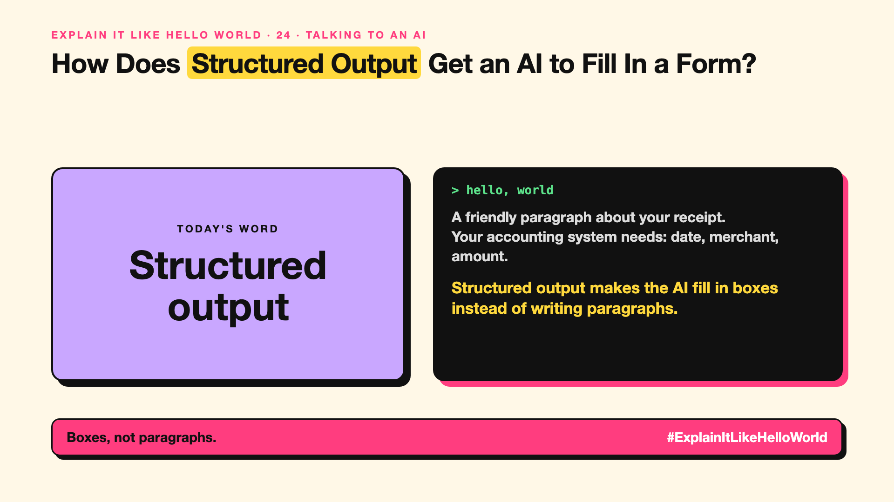

# 24. How Does Structured Output Get an AI to Fill In a Form? | Structured output



*Explain It Like Hello World series: Structured output*

"Structured output." "JSON mode." Developers love it. For everyone else, it's why AI can now fill in forms reliably.

## The hello world

Ask an AI to read a receipt and you get a friendly paragraph. Your accounting system can't read a paragraph. It needs boxes: date, merchant, amount.

That's the hello world: **structured output** means the AI answers in a fixed format, like a form with named boxes, instead of free text.

## One step further

You describe the form (called a schema): "date as a date, amount as a number, merchant as text". Many AI services can now guarantee the answer matches that form exactly, so software can use it directly.

The format being right doesn't mean the content is right. ₹1,180 can still be read as ₹118 (Series 2 covers exact data).

## Where you've already met it

Apps that turn a photo of a receipt or ID card into filled-in fields. AI features that create calendar events from emails.

## The real name

**Structured output**, often as **JSON**, defined by a **schema**.

- **Schema:** the description of the boxes and their types.
- **JSON:** a common text format for structured data.
- **Field:** one named box, like "amount".

## What it's not

A perfectly shaped answer can still be wrong inside. Check the values, not just the format.

## Take this to your next meeting

1. Ask for a fixed format whenever software will read the answer.
2. Validate the values: dates, totals, IDs.
3. Send unclear cases to a person instead of guessing.

Boxes, not paragraphs.

Next write-up (25): **Why Does Streaming Make the AI Type Word by Word?**

Follow me for the next one. Where would a form-filling AI save you time?

**Earlier in this series:**

1. [AI words everyone uses. Nobody explains.](https://lnkd.in/p/d8abaPhq) (the curtain raiser post)
2. [What Actually Counts as Artificial Intelligence?](https://www.linkedin.com/pulse/2-what-actually-counts-artificial-intelligence-arpit-jain-su9lf)
3. How Does Machine Learning Learn Without Being Told the Rules? *(link added when published)*
4. What's "Deep" About Deep Learning? *(link added when published)*
5. Is a Neural Network Really Like a Brain? *(link added when published)*
6. What Makes Generative AI "Generative"? *(link added when published)*
7. Why Are They Called Foundation Models? *(link added when published)*
8. What Is AGI, and What Would Make AI "General"? *(link added when published)*
9. What Is Superintelligence, and Should We Worry? *(link added when published)*
10. What Are Tokens, and Why Does an AI Read in Pieces? *(link added when published)*
11. How Does an LLM Write a Sentence? *(link added when published)*
12. How Do Embeddings Know "King" Is Close to "Queen"? *(link added when published)*
13. How Does Attention Help an AI Know What "It" Means? *(link added when published)*
14. What Is a Transformer, the "T" in GPT? *(link added when published)*
15. What Is a Context Window, and Why Does an AI Forget? *(link added when published)*
16. Why Does Temperature Change the AI's Answer? *(link added when published)*
17. What Is a Prompt, and Why Does the Way You Ask Matter? *(link added when published)*
18. Is Prompt Engineering a Real Skill? *(link added when published)*
19. What's in a System Prompt, the Hidden Instruction Behind Every Chatbot? *(link added when published)*
20. What Is Zero-Shot, and Can an AI Do a Task It Was Never Shown? *(link added when published)*
21. Why Does Few-Shot Prompting Work So Well? *(link added when published)*
22. Why Does Chain of Thought ("Think Step by Step") Work? *(link added when published)*
23. Is Context Engineering the New Prompt Engineering? *(link added when published)*

**Previous series:**

- **Series 1, #JustAddRAG:** [start here](https://www.linkedin.com/pulse/why-does-just-add-rag-sound-like-2-weeks-take-6-months-arpit-jain-l4kkf/) or jump to [the grand finale](https://www.linkedin.com/pulse/15-so-should-you-really-just-add-rag-grand-finale-arpit-jain-ninmf/)
- **Series 2, Beyond Just RAG: From Answers to Actions:** [start here](https://www.linkedin.com/pulse/1-your-ai-can-answer-now-has-act-from-answers-actions-arpit-jain-po6lf/) or jump to [the finale](https://www.linkedin.com/pulse/8-so-should-your-ai-do-things-just-answer-finale-arpit-jain-x7cxf)

---

**Post text (copy and paste):**

```
A friendly paragraph about your receipt.
Your accounting system needs: date, merchant, amount.

Structured output makes the AI fill in boxes instead of writing paragraphs.

Right format, still check the values.

Where would a form-filling AI save you time?

#AI #GenAI #LearnAI #ExplainItLikeHelloWorld
```

**Series index (post as the first comment):**

```
Explain It Like Hello World

Start here: AI words everyone uses. Nobody explains. https://lnkd.in/p/d8abaPhq
Previous: 23. Is Context Engineering the New Prompt Engineering? [link]
You're here: 24. How Does Structured Output Get an AI to Fill In a Form?
Next: 25. Why Does Streaming Make the AI Type Word by Word?

Full list: in the curtain raiser post.
```
