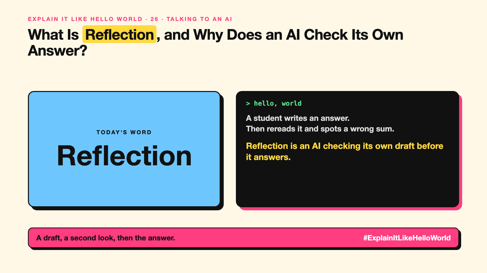

# 26. What Is Reflection, and Why Does an AI Check Its Own Answer? | Reflection



*Explain It Like Hello World series: Reflection*

"Reflection." An AI reviewing its own draft before it answers. It catches some mistakes, and misses others.

## The hello world

A student writes an answer, then rereads it before handing it in and spots a wrong sum.

That's the hello world: **reflection** is an AI looking back at its own draft, checking it against the question, and fixing what it finds.

## One step further

The model writes a draft, then runs a second pass that asks: is this correct, complete and in the right format? If not, it revises. Some systems use a second model as the critic, which can catch errors the first model can't see in its own work.

Reflection costs extra time and tokens. It helps most on tasks with clear checks, such as maths, code that must compile, or answers that must cite a source.

## Where you've already met it

Coding assistants that run their own tests and fix the errors, and AI tools that say "let me check that" before answering.

## The real name

**Reflection**, also called **self-critique** or **self-correction**.

- **Draft:** the first version an AI produces.
- **Critique:** a review that points out what is wrong.
- **Self-correction:** fixing your own output after checking it.

## What it's not

Reflection isn't a guarantee. An AI can review its own mistake and agree with it. A check against something outside the model, such as a test or a source, is more reliable.

## Take this to your next meeting

1. Use reflection where there is a clear check, such as tests or sources.
2. Don't rely on an AI's own review alone for high-stakes answers.
3. Compare answers with and without reflection on a sample.

A draft, a second look, then the answer.

Next write-up (27): **Is Context Engineering the New Prompt Engineering?**

Follow me for the next one. Has an AI ever fixed its own mistake after you asked it to check?

**Earlier in this series:**

1. [AI words everyone uses. Nobody explains.](https://lnkd.in/p/d8abaPhq) (the curtain raiser post)
2. [What Actually Counts as Artificial Intelligence?](https://www.linkedin.com/pulse/2-what-actually-counts-artificial-intelligence-arpit-jain-su9lf)
3. [How Does Machine Learning Learn Without Being Told the Rules?](https://www.linkedin.com/pulse/3-how-does-machine-learning-learn-without-being-told-rules-arpit-jain-ppdyf)
4. [What's "Deep" About Deep Learning?](https://www.linkedin.com/pulse/4-whats-deep-learning-arpit-jain-rvlff)
5. Is a Neural Network Really Like a Brain? *(link added when published)*
6. What Makes Generative AI "Generative"? *(link added when published)*
7. Why Are They Called Foundation Models? *(link added when published)*
8. What Is a Frontier Model, and Who Decides? *(link added when published)*
9. What Is AGI, and What Would Make AI "General"? *(link added when published)*
10. What Is Superintelligence, and Should We Worry? *(link added when published)*
11. What Are Tokens, and Why Does an AI Read in Pieces? *(link added when published)*
12. How Does an LLM Write a Sentence? *(link added when published)*
13. How Do Embeddings Know "King" Is Close to "Queen"? *(link added when published)*
14. How Does Attention Help an AI Know What "It" Means? *(link added when published)*
15. What Is a Transformer, the "T" in GPT? *(link added when published)*
16. What Is a Context Window, and Why Does an AI Forget? *(link added when published)*
17. What's a Knowledge Cutoff, and Why Is the AI Behind on News? *(link added when published)*
18. What Is Context Rot, and Why Do Long Chats Get Worse? *(link added when published)*
19. Why Does Temperature Change the AI's Answer? *(link added when published)*
20. What Is a Prompt, and Why Does the Way You Ask Matter? *(link added when published)*
21. Is Prompt Engineering a Real Skill? *(link added when published)*
22. What's in a System Prompt, the Hidden Instruction Behind Every Chatbot? *(link added when published)*
23. What Is Zero-Shot, and Can an AI Do a Task It Was Never Shown? *(link added when published)*
24. Why Does Few-Shot Prompting Work So Well? *(link added when published)*
25. Why Does Chain of Thought ("Think Step by Step") Work? *(link added when published)*

**Previous series:**

- **Series 1, #JustAddRAG:** [start here](https://www.linkedin.com/pulse/why-does-just-add-rag-sound-like-2-weeks-take-6-months-arpit-jain-l4kkf/) or jump to [the grand finale](https://www.linkedin.com/pulse/15-so-should-you-really-just-add-rag-grand-finale-arpit-jain-ninmf/)
- **Series 2, Beyond Just RAG: From Answers to Actions:** [start here](https://www.linkedin.com/pulse/1-your-ai-can-answer-now-has-act-from-answers-actions-arpit-jain-po6lf/) or jump to [the finale](https://www.linkedin.com/pulse/8-so-should-your-ai-do-things-just-answer-finale-arpit-jain-x7cxf)
- **Series 20, Today in AI** (ongoing): [start here](https://www.linkedin.com/pulse/today-ai-001-what-happens-when-your-agent-visits-someone-arpit-jain-2vqmf/) or read [the latest issue](https://www.linkedin.com/pulse/today-ai-011-text-to-speech-fits-your-phone-internet-needed-jain-1ipuf)

---

**Post text (copy and paste):**

```
A student writes an answer.
Then rereads it and spots a wrong sum.

Reflection is an AI checking its own draft before it answers.

A second look catches some mistakes.

Has an AI ever fixed its own mistake after you asked it to check?

#AI #GenAI #LearnAI #ExplainItLikeHelloWorld
```

**Series index (post as the first comment):**

```
Explain It Like Hello World

Start here: AI words everyone uses. Nobody explains. https://lnkd.in/p/d8abaPhq
Previous: 25. Why Does Chain of Thought ("Think Step by Step") Work? [link]
You're here: 26. What Is Reflection, and Why Does an AI Check Its Own Answer?
Next: 27. Is Context Engineering the New Prompt Engineering?

Full list: in the curtain raiser post.
```
