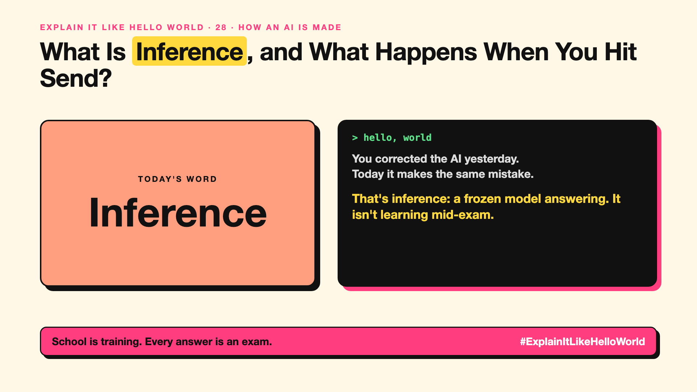

# 28. What Is Inference, and What Happens When You Hit Send? | Inference



*Explain It Like Hello World series: Inference*

"Inference costs." "Inference chips." Most of the AI bill now goes on it. Most people have never heard the word.

## The hello world

A student who has finished school sits an exam and answers one question. No more learning, just using what they know.

That's the hello world: **inference** is a trained, frozen AI answering your question. Every time you hit send, that's inference.

## One step further

The model reads your prompt as tokens (write-up 10), and then writes its answer one token at a time (write-up 11), using its frozen knobs. It doesn't learn from your chat.

Training happens once; inference happens billions of times a day, for every user. That's why cheaper, faster inference (quantization, caching, small models) gets so much attention.

## Where you've already met it

Every chatbot answer. "Price per million tokens" is mostly the price of inference.

## The real name

**Inference**.

- **Inference:** using a trained model to produce an answer.
- **Frozen model:** a model whose knobs no longer change.
- **Knowledge cutoff:** the date its training data ends.

## What it's not

Inference isn't learning. If an AI seems to remember you, that's chat history on its desk (write-up 15) or a memory feature (write-up 67), not new training.

## Take this to your next meeting

1. Expect most of your AI bill to be inference, paid per question.
2. Remember the AI won't learn from your corrections unless you build that in.
3. Use smaller or cached models where answers repeat.

School is training. Every answer is an exam.

Next write-up (29): **What Is Pretraining, and How Does an AI Learn Language?**

Follow me for the next one. Did you think the AI was learning from your chats?

**Earlier in this series:**

1. [AI words everyone uses. Nobody explains.](https://lnkd.in/p/d8abaPhq) (the curtain raiser post)
2. [What Actually Counts as Artificial Intelligence?](https://www.linkedin.com/pulse/2-what-actually-counts-artificial-intelligence-arpit-jain-su9lf)
3. [How Does Machine Learning Learn Without Being Told the Rules?](https://www.linkedin.com/pulse/3-how-does-machine-learning-learn-without-being-told-rules-arpit-jain-ppdyf)
4. What's "Deep" About Deep Learning? *(link added when published)*
5. Is a Neural Network Really Like a Brain? *(link added when published)*
6. What Makes Generative AI "Generative"? *(link added when published)*
7. Why Are They Called Foundation Models? *(link added when published)*
8. What Is AGI, and What Would Make AI "General"? *(link added when published)*
9. What Is Superintelligence, and Should We Worry? *(link added when published)*
10. What Are Tokens, and Why Does an AI Read in Pieces? *(link added when published)*
11. How Does an LLM Write a Sentence? *(link added when published)*
12. How Do Embeddings Know "King" Is Close to "Queen"? *(link added when published)*
13. How Does Attention Help an AI Know What "It" Means? *(link added when published)*
14. What Is a Transformer, the "T" in GPT? *(link added when published)*
15. What Is a Context Window, and Why Does an AI Forget? *(link added when published)*
16. Why Does Temperature Change the AI's Answer? *(link added when published)*
17. What Is a Prompt, and Why Does the Way You Ask Matter? *(link added when published)*
18. Is Prompt Engineering a Real Skill? *(link added when published)*
19. What's in a System Prompt, the Hidden Instruction Behind Every Chatbot? *(link added when published)*
20. What Is Zero-Shot, and Can an AI Do a Task It Was Never Shown? *(link added when published)*
21. Why Does Few-Shot Prompting Work So Well? *(link added when published)*
22. Why Does Chain of Thought ("Think Step by Step") Work? *(link added when published)*
23. Is Context Engineering the New Prompt Engineering? *(link added when published)*
24. How Does Structured Output Get an AI to Fill In a Form? *(link added when published)*
25. Why Does Streaming Make the AI Type Word by Word? *(link added when published)*
26. What Do Parameters, Like "70B", Actually Mean? *(link added when published)*
27. What Happens During Training, When an AI Goes to School? *(link added when published)*

**Previous series:**

- **Series 1, #JustAddRAG:** [start here](https://www.linkedin.com/pulse/why-does-just-add-rag-sound-like-2-weeks-take-6-months-arpit-jain-l4kkf/) or jump to [the grand finale](https://www.linkedin.com/pulse/15-so-should-you-really-just-add-rag-grand-finale-arpit-jain-ninmf/)
- **Series 2, Beyond Just RAG: From Answers to Actions:** [start here](https://www.linkedin.com/pulse/1-your-ai-can-answer-now-has-act-from-answers-actions-arpit-jain-po6lf/) or jump to [the finale](https://www.linkedin.com/pulse/8-so-should-your-ai-do-things-just-answer-finale-arpit-jain-x7cxf)
- **Series 20, Today in AI** (ongoing): [start here](https://www.linkedin.com/pulse/today-ai-001-what-happens-when-your-agent-visits-someone-arpit-jain-2vqmf/) or read [the latest issue](https://www.linkedin.com/pulse/today-ai-011-text-to-speech-fits-your-phone-internet-needed-jain-1ipuf)

---

**Post text (copy and paste):**

```
You corrected the AI yesterday.
Today it makes the same mistake.

That's inference: a frozen model answering. It isn't learning mid-exam.

Every time you hit send.

Did you think the AI was learning from your chats?

#AI #GenAI #LearnAI #ExplainItLikeHelloWorld
```

**Series index (post as the first comment):**

```
Explain It Like Hello World

Start here: AI words everyone uses. Nobody explains. https://lnkd.in/p/d8abaPhq
Previous: 27. What Happens During Training, When an AI Goes to School? [link]
You're here: 28. What Is Inference, and What Happens When You Hit Send?
Next: 29. What Is Pretraining, and How Does an AI Learn Language?

Full list: in the curtain raiser post.
```
