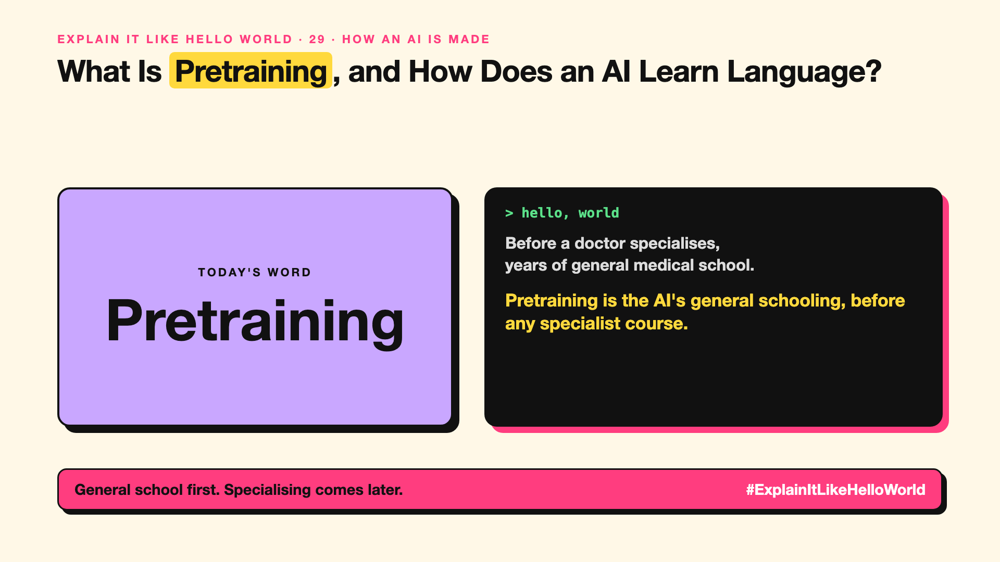

# 29. How Does an AI Learn Language in the First Place? | Pretraining



*Explain It Like Hello World series: Pretraining*

"Pre-trained" is the P in GPT. It's the most expensive step in all of AI. Pre-trained before what?

## The hello world

Before a doctor specialises, they spend years in general medical school learning everything: anatomy, chemistry, how to read and reason.

That's the hello world: **pretraining** is the AI's general schooling: reading a huge amount of text to learn language and knowledge in general, before any specialist training.

## One step further

During pretraining, the model plays the next-word game (write-up 11) across trillions of tokens from books, websites and code. It's the costliest step, done by only a few companies.

The result is a base model: it can continue text brilliantly but doesn't yet follow instructions or chat politely. That comes later with fine-tuning (write-up 30) and RLHF (write-up 32).

## Where you've already met it

The "P" in GPT. Model releases that offer a "base" version alongside a "chat" or "instruct" version.

## The real name

**Pretraining**, producing a **base model**.

- **Pretraining:** the first, huge general training run.
- **Base model:** the result: good at continuing text, not yet at chatting.
- **Corpus:** the body of text it learned from.

## What it's not

Pretraining isn't something most companies do. You start from someone else's pretrained model and adapt it.

## Take this to your next meeting

1. Don't plan to pretrain; adapt an existing model.
2. Ask what data a model was pretrained on; it shapes its blind spots.
3. Use "instruct" or "chat" versions for assistants, not base models.

General school first. Specialising comes later.

Next write-up (30): **How Do You Teach an AI Your Way of Doing Things?**

Follow me for the next one. Did you know what the P in GPT stood for?

**Earlier in this series:**

1. AI words everyone uses. Nobody explains. (the curtain raiser post) *(link added when published)*
2. What Actually Counts as AI? *(link added when published)*
3. How Does a Computer Learn Without Being Told the Rules? *(link added when published)*
4. What's "Deep" About Deep Learning? *(link added when published)*
5. Is a Neural Network Really Like a Brain? *(link added when published)*
6. What Makes AI "Generative"? *(link added when published)*
7. Why Are They Called Foundation Models? *(link added when published)*
8. What Would It Mean for AI to Be "General"? *(link added when published)*
9. What Is Superintelligence, and Should We Worry? *(link added when published)*
10. How Does an AI Read a Word? *(link added when published)*
11. How Does an AI Write a Sentence? *(link added when published)*
12. How Does an AI Know "King" Is Close to "Queen"? *(link added when published)*
13. How Does an AI Know What "It" Means? *(link added when published)*
14. What Is the "T" in GPT? *(link added when published)*
15. Why Does an AI Forget the Start of a Long Chat? *(link added when published)*
16. Why Does the Same Question Get Different Answers? *(link added when published)*
17. Why Does the Way You Ask Change the Answer? *(link added when published)*
18. Is Prompt Engineering a Real Skill? *(link added when published)*
19. What's the Hidden Instruction Behind Every Chatbot? *(link added when published)*
20. Can an AI Do a Task It Was Never Shown? *(link added when published)*
21. Why Do Examples Help an AI So Much? *(link added when published)*
22. Why Does "Think Step by Step" Work? *(link added when published)*
23. Is Context Engineering the New Prompt Engineering? *(link added when published)*
24. How Do You Get an AI to Fill In a Form? *(link added when published)*
25. Why Does the AI Type Its Answer Word by Word? *(link added when published)*
26. What Does "70B" Actually Mean? *(link added when published)*
27. How Does an AI Go to School? *(link added when published)*
28. What Happens When You Hit Send? *(link added when published)*

**Previous series:**

- **Series 1, #JustAddRAG:** [start here](https://www.linkedin.com/pulse/why-does-just-add-rag-sound-like-2-weeks-take-6-months-arpit-jain-l4kkf/) or jump to [the grand finale](https://www.linkedin.com/pulse/15-so-should-you-really-just-add-rag-grand-finale-arpit-jain-ninmf/)
- **Series 2, Beyond Just RAG: From Answers to Actions:** [start here](https://www.linkedin.com/pulse/1-your-ai-can-answer-now-has-act-from-answers-actions-arpit-jain-po6lf/) or jump to [the finale](https://www.linkedin.com/pulse/8-so-should-your-ai-do-things-just-answer-finale-arpit-jain-x7cxf)

---

**Post text (copy and paste):**

```
Before a doctor specialises,
years of general medical school.

Pretraining is the AI's general schooling, before any specialist course.

It's the P in GPT, and the costliest step.

Did you know what the P in GPT stood for?

#AI #GenAI #LearnAI #ExplainItLikeHelloWorld
```

**Series index (post as the first comment):**

```
Explain It Like Hello World

Start here: 1. AI words everyone uses. Nobody explains. [link]
Previous: 28. What Happens When You Hit Send? [link]
You're here: 29. How Does an AI Learn Language in the First Place?
Next: 30. How Do You Teach an AI Your Way of Doing Things?

Full list: in the curtain raiser post.
```
