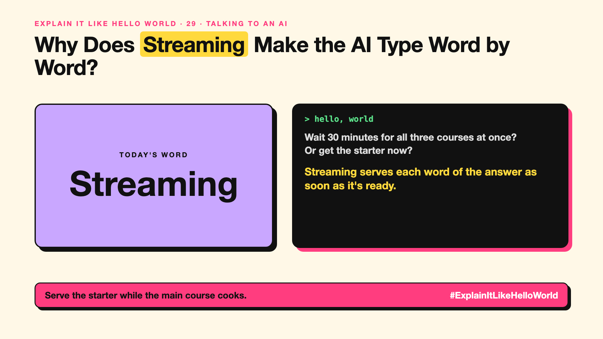

# 29. Why Does Streaming Make the AI Type Word by Word? | Streaming



*Explain It Like Hello World series: Streaming*

Chatbot answers appear word by word, like someone typing. Is it for show?

## The hello world

Order a three-course meal. Would you rather wait 30 minutes for everything at once, or get the starter in 2 minutes while the rest is cooked?

That's the hello world: **streaming** sends each piece of the answer the moment it's ready, instead of waiting for the whole thing.

## One step further

An AI writes one token at a time (write-up 12). Without streaming, you'd stare at a spinner until the last token is done. With streaming, the first words arrive in about a second and you start reading.

The total time is about the same; it just feels much faster. The time until the first word appears is a key speed measure (write-up 59).

## Where you've already met it

Every chatbot that "types" its reply. Voice assistants that start speaking before they've finished thinking.

## The real name

**Streaming** responses.

- **Streaming:** sending output piece by piece as it's made.
- **Time to first token:** how long until the first words appear.
- **Server-sent events:** a common web technique for streaming.

## What it's not

Streaming doesn't make the AI think faster, and it isn't typing for show. It's real: you're seeing the answer as it's written.

## Take this to your next meeting

1. Stream long answers in your AI apps; it feels much faster.
2. Measure time to first word, not just total time.
3. Don't stream where the whole answer must be checked first.

Serve the starter while the main course cooks.

Next write-up (30): **What Do Parameters, Like "70B", Actually Mean?**

Follow me for the next one. Would you rather wait, or watch it arrive?

**Earlier in this series:**

1. [AI words everyone uses. Nobody explains.](https://lnkd.in/p/d8abaPhq) (the curtain raiser post)
2. [What Actually Counts as Artificial Intelligence?](https://www.linkedin.com/pulse/2-what-actually-counts-artificial-intelligence-arpit-jain-su9lf)
3. [How Does Machine Learning Learn Without Being Told the Rules?](https://www.linkedin.com/pulse/3-how-does-machine-learning-learn-without-being-told-rules-arpit-jain-ppdyf)
4. [What's "Deep" About Deep Learning?](https://www.linkedin.com/pulse/4-whats-deep-learning-arpit-jain-rvlff)
5. Is a Neural Network Really Like a Brain? *(link added when published)*
6. What Makes Generative AI "Generative"? *(link added when published)*
7. Why Are They Called Foundation Models? *(link added when published)*
8. What Is a Frontier Model, and Who Decides? *(link added when published)*
9. What Is AGI, and What Would Make AI "General"? *(link added when published)*
10. What Is Superintelligence, and Should We Worry? *(link added when published)*
11. What Are Tokens, and Why Does an AI Read in Pieces? *(link added when published)*
12. How Does an LLM Write a Sentence? *(link added when published)*
13. How Do Embeddings Know "King" Is Close to "Queen"? *(link added when published)*
14. How Does Attention Help an AI Know What "It" Means? *(link added when published)*
15. What Is a Transformer, the "T" in GPT? *(link added when published)*
16. What Is a Context Window, and Why Does an AI Forget? *(link added when published)*
17. What's a Knowledge Cutoff, and Why Is the AI Behind on News? *(link added when published)*
18. What Is Context Rot, and Why Do Long Chats Get Worse? *(link added when published)*
19. Why Does Temperature Change the AI's Answer? *(link added when published)*
20. What Is a Prompt, and Why Does the Way You Ask Matter? *(link added when published)*
21. Is Prompt Engineering a Real Skill? *(link added when published)*
22. What's in a System Prompt, the Hidden Instruction Behind Every Chatbot? *(link added when published)*
23. What Is Zero-Shot, and Can an AI Do a Task It Was Never Shown? *(link added when published)*
24. Why Does Few-Shot Prompting Work So Well? *(link added when published)*
25. Why Does Chain of Thought ("Think Step by Step") Work? *(link added when published)*
26. What Is Reflection, and Why Does an AI Check Its Own Answer? *(link added when published)*
27. Is Context Engineering the New Prompt Engineering? *(link added when published)*
28. How Does Structured Output Get an AI to Fill In a Form? *(link added when published)*

**Previous series:**

- **Series 1, #JustAddRAG:** [start here](https://www.linkedin.com/pulse/why-does-just-add-rag-sound-like-2-weeks-take-6-months-arpit-jain-l4kkf/) or jump to [the grand finale](https://www.linkedin.com/pulse/15-so-should-you-really-just-add-rag-grand-finale-arpit-jain-ninmf/)
- **Series 2, Beyond Just RAG: From Answers to Actions:** [start here](https://www.linkedin.com/pulse/1-your-ai-can-answer-now-has-act-from-answers-actions-arpit-jain-po6lf/) or jump to [the finale](https://www.linkedin.com/pulse/8-so-should-your-ai-do-things-just-answer-finale-arpit-jain-x7cxf)
- **Series 20, Today in AI** (ongoing): [start here](https://www.linkedin.com/pulse/today-ai-001-what-happens-when-your-agent-visits-someone-arpit-jain-2vqmf/) or read [the latest issue](https://www.linkedin.com/pulse/today-ai-011-text-to-speech-fits-your-phone-internet-needed-jain-1ipuf)

---

**Post text (copy and paste):**

```
Wait 30 minutes for all three courses at once?
Or get the starter now?

Streaming serves each word of the answer as soon as it's ready.

Same total time, feels much faster.

Would you rather wait, or watch it arrive?

#AI #GenAI #LearnAI #ExplainItLikeHelloWorld
```

**Series index (post as the first comment):**

```
Explain It Like Hello World

Start here: AI words everyone uses. Nobody explains. https://lnkd.in/p/d8abaPhq
Previous: 28. How Does Structured Output Get an AI to Fill In a Form? [link]
You're here: 29. Why Does Streaming Make the AI Type Word by Word?
Next: 30. What Do Parameters, Like "70B", Actually Mean?

Full list: in the curtain raiser post.
```
