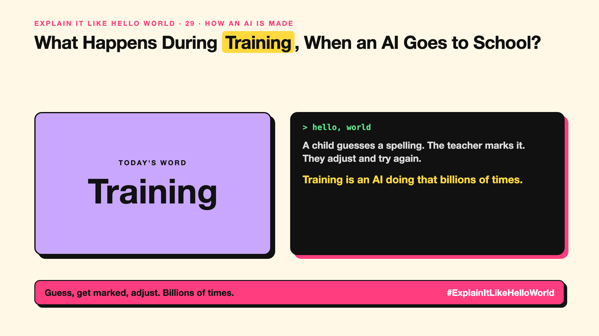

# 29. What Happens During Training, When an AI Goes to School? | Training



*Explain It Like Hello World series: Training*

"Training a model costs millions." "Trained on the internet." The word is everywhere. What happens during training?

## The hello world

A child learning to spell: they guess, a teacher marks it, they adjust, and try again. Thousands of times, they get better.

That's the hello world: **training** is an AI guessing, being told how wrong it was, and adjusting its knobs (write-up 28) to be a little less wrong. Repeat billions of times.

## One step further

For an LLM, the "test" is hiding the next word in real text and asking the AI to guess it (write-up 12). After every guess, each of its billions of knobs is nudged slightly. This needs huge amounts of text and computing power, running for weeks or months on thousands of GPUs (write-up 51).

At the end, the knobs are frozen. That frozen model is what you use.

## Where you've already met it

Announcements of how long and how expensive a model was to train. Privacy settings asking whether your data may be used to train future models.

## The real name

**Training**, also called **model training**.

- **Training:** teaching a model by adjusting its knobs on examples.
- **Loss:** how wrong the model's guesses are.
- **Training run:** one full training process.

## What it's not

Training isn't happening while you chat. That's inference (write-up 31). Your chats only matter if they're later used to train the next version.

## Take this to your next meeting

1. Know that training is the expensive, one-time part.
2. Check your vendor's policy on training with your data.
3. Remember the model's knowledge stops where its training data stops.

Guess, get marked, adjust. Billions of times.

Next write-up (30): **What's the Difference Between Supervised and Unsupervised Learning?**

Follow me for the next one. Did you know your chats might train the next model?

**Earlier in this series:**

1. [AI words everyone uses. Nobody explains.](https://lnkd.in/p/d8abaPhq) (the curtain raiser post)
2. [What Actually Counts as Artificial Intelligence?](https://www.linkedin.com/pulse/2-what-actually-counts-artificial-intelligence-arpit-jain-su9lf)
3. [How Does Machine Learning Learn Without Being Told the Rules?](https://www.linkedin.com/pulse/3-how-does-machine-learning-learn-without-being-told-rules-arpit-jain-ppdyf)
4. [What's "Deep" About Deep Learning?](https://www.linkedin.com/pulse/4-whats-deep-learning-arpit-jain-rvlff)
5. Is a Neural Network Really Like a Brain? *(link added when published)*
6. What Makes Generative AI "Generative"? *(link added when published)*
7. Why Are They Called Foundation Models? *(link added when published)*
8. What Is a Frontier Model, and Who Decides? *(link added when published)*
9. What Is AGI, and What Would Make AI "General"? *(link added when published)*
10. What Is Superintelligence, and Should We Worry? *(link added when published)*
11. What Are Tokens, and Why Does an AI Read in Pieces? *(link added when published)*
12. How Does an LLM Write a Sentence? *(link added when published)*
13. How Do Embeddings Know "King" Is Close to "Queen"? *(link added when published)*
14. How Does Attention Help an AI Know What "It" Means? *(link added when published)*
15. What Is a Transformer, the "T" in GPT? *(link added when published)*
16. What Is a Context Window, and Why Does an AI Forget? *(link added when published)*
17. What's a Knowledge Cutoff, and Why Is the AI Behind on News? *(link added when published)*
18. Why Does Temperature Change the AI's Answer? *(link added when published)*
19. What Is a Prompt, and Why Does the Way You Ask Matter? *(link added when published)*
20. Is Prompt Engineering a Real Skill? *(link added when published)*
21. What's in a System Prompt, the Hidden Instruction Behind Every Chatbot? *(link added when published)*
22. What Is Zero-Shot, and Can an AI Do a Task It Was Never Shown? *(link added when published)*
23. Why Does Few-Shot Prompting Work So Well? *(link added when published)*
24. Why Does Chain of Thought ("Think Step by Step") Work? *(link added when published)*
25. Is Context Engineering the New Prompt Engineering? *(link added when published)*
26. How Does Structured Output Get an AI to Fill In a Form? *(link added when published)*
27. Why Does Streaming Make the AI Type Word by Word? *(link added when published)*
28. What Do Parameters, Like "70B", Actually Mean? *(link added when published)*

**Previous series:**

- **Series 1, #JustAddRAG:** [start here](https://www.linkedin.com/pulse/why-does-just-add-rag-sound-like-2-weeks-take-6-months-arpit-jain-l4kkf/) or jump to [the grand finale](https://www.linkedin.com/pulse/15-so-should-you-really-just-add-rag-grand-finale-arpit-jain-ninmf/)
- **Series 2, Beyond Just RAG: From Answers to Actions:** [start here](https://www.linkedin.com/pulse/1-your-ai-can-answer-now-has-act-from-answers-actions-arpit-jain-po6lf/) or jump to [the finale](https://www.linkedin.com/pulse/8-so-should-your-ai-do-things-just-answer-finale-arpit-jain-x7cxf)
- **Series 20, Today in AI** (ongoing): [start here](https://www.linkedin.com/pulse/today-ai-001-what-happens-when-your-agent-visits-someone-arpit-jain-2vqmf/) or read [the latest issue](https://www.linkedin.com/pulse/today-ai-011-text-to-speech-fits-your-phone-internet-needed-jain-1ipuf)

---

**Post text (copy and paste):**

```
A child guesses a spelling. The teacher marks it.
They adjust and try again.

Training is an AI doing that billions of times.

Expensive, slow, and done before you ever use it.

Did you know your chats might train the next model?

#AI #GenAI #LearnAI #ExplainItLikeHelloWorld
```

**Series index (post as the first comment):**

```
Explain It Like Hello World

Start here: AI words everyone uses. Nobody explains. https://lnkd.in/p/d8abaPhq
Previous: 28. What Do Parameters, Like "70B", Actually Mean? [link]
You're here: 29. What Happens During Training, When an AI Goes to School?
Next: 30. What's the Difference Between Supervised and Unsupervised Learning?

Full list: in the curtain raiser post.
```
