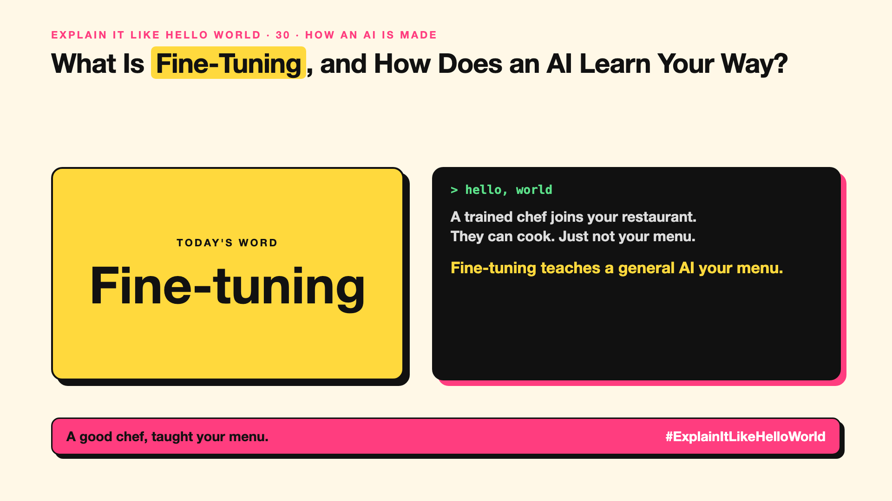

# 30. What Is Fine-Tuning, and How Does an AI Learn Your Way? | Fine-tuning



*Explain It Like Hello World series: Fine-tuning*

"We'll fine-tune it on our data." Teams say it when an AI doesn't behave the way they want. What changes?

## The hello world

A trained chef joins your restaurant. They can cook, but not your menu or your plating. So they spend two weeks cooking your dishes, corrected by your head chef.

That's the hello world: **fine-tuning** is extra training on your own examples, so a general model learns your style or task.

## One step further

You collect examples of inputs and the outputs you want, often hundreds or thousands. The model continues training on them, and its knobs (write-up 26) shift towards your style.

Fine-tuning is good at teaching format, tone and repeatable tasks. It's weaker at adding fresh facts that change often; for those, looking them up at question time (write-up 53) usually works better.

## Where you've already met it

Company chatbots that answer in a consistent brand voice. Models specialised for medical notes or legal drafting.

## The real name

**Fine-tuning**.

- **Fine-tuning:** extra training on focused examples.
- **Training examples:** input and ideal-output pairs.
- **Instruction tuning:** fine-tuning to follow instructions well.

## What it's not

Fine-tuning isn't the first fix to try. Better prompts and examples (write-up 21) cost nothing and often do the job.

## Take this to your next meeting

1. Try prompts and examples first.
2. Fine-tune for how it should answer, not for this week's facts.
3. Keep a test set to check it actually improved.

A good chef, taught your menu.

Next write-up (31): **What Is LoRA, and How Do You Customise an AI Cheaply?**

Follow me for the next one. Has your team fine-tuned when a better prompt would have done?

**Earlier in this series:**

1. [AI words everyone uses. Nobody explains.](https://lnkd.in/p/d8abaPhq) (the curtain raiser post)
2. [What Actually Counts as Artificial Intelligence?](https://www.linkedin.com/pulse/2-what-actually-counts-artificial-intelligence-arpit-jain-su9lf)
3. [How Does Machine Learning Learn Without Being Told the Rules?](https://www.linkedin.com/pulse/3-how-does-machine-learning-learn-without-being-told-rules-arpit-jain-ppdyf)
4. What's "Deep" About Deep Learning? *(link added when published)*
5. Is a Neural Network Really Like a Brain? *(link added when published)*
6. What Makes Generative AI "Generative"? *(link added when published)*
7. Why Are They Called Foundation Models? *(link added when published)*
8. What Is AGI, and What Would Make AI "General"? *(link added when published)*
9. What Is Superintelligence, and Should We Worry? *(link added when published)*
10. What Are Tokens, and Why Does an AI Read in Pieces? *(link added when published)*
11. How Does an LLM Write a Sentence? *(link added when published)*
12. How Do Embeddings Know "King" Is Close to "Queen"? *(link added when published)*
13. How Does Attention Help an AI Know What "It" Means? *(link added when published)*
14. What Is a Transformer, the "T" in GPT? *(link added when published)*
15. What Is a Context Window, and Why Does an AI Forget? *(link added when published)*
16. Why Does Temperature Change the AI's Answer? *(link added when published)*
17. What Is a Prompt, and Why Does the Way You Ask Matter? *(link added when published)*
18. Is Prompt Engineering a Real Skill? *(link added when published)*
19. What's in a System Prompt, the Hidden Instruction Behind Every Chatbot? *(link added when published)*
20. What Is Zero-Shot, and Can an AI Do a Task It Was Never Shown? *(link added when published)*
21. Why Does Few-Shot Prompting Work So Well? *(link added when published)*
22. Why Does Chain of Thought ("Think Step by Step") Work? *(link added when published)*
23. Is Context Engineering the New Prompt Engineering? *(link added when published)*
24. How Does Structured Output Get an AI to Fill In a Form? *(link added when published)*
25. Why Does Streaming Make the AI Type Word by Word? *(link added when published)*
26. What Do Parameters, Like "70B", Actually Mean? *(link added when published)*
27. What Happens During Training, When an AI Goes to School? *(link added when published)*
28. What Is Inference, and What Happens When You Hit Send? *(link added when published)*
29. What Is Pretraining, and How Does an AI Learn Language? *(link added when published)*

**Previous series:**

- **Series 1, #JustAddRAG:** [start here](https://www.linkedin.com/pulse/why-does-just-add-rag-sound-like-2-weeks-take-6-months-arpit-jain-l4kkf/) or jump to [the grand finale](https://www.linkedin.com/pulse/15-so-should-you-really-just-add-rag-grand-finale-arpit-jain-ninmf/)
- **Series 2, Beyond Just RAG: From Answers to Actions:** [start here](https://www.linkedin.com/pulse/1-your-ai-can-answer-now-has-act-from-answers-actions-arpit-jain-po6lf/) or jump to [the finale](https://www.linkedin.com/pulse/8-so-should-your-ai-do-things-just-answer-finale-arpit-jain-x7cxf)

---

**Post text (copy and paste):**

```
A trained chef joins your restaurant.
They can cook. Just not your menu.

Fine-tuning teaches a general AI your menu.

Great for style and format. Not for fresh facts.

Has your team fine-tuned when a better prompt would have done?

#AI #GenAI #LearnAI #ExplainItLikeHelloWorld
```

**Series index (post as the first comment):**

```
Explain It Like Hello World

Start here: AI words everyone uses. Nobody explains. https://lnkd.in/p/d8abaPhq
Previous: 29. What Is Pretraining, and How Does an AI Learn Language? [link]
You're here: 30. What Is Fine-Tuning, and How Does an AI Learn Your Way?
Next: 31. What Is LoRA, and How Do You Customise an AI Cheaply?

Full list: in the curtain raiser post.
```
