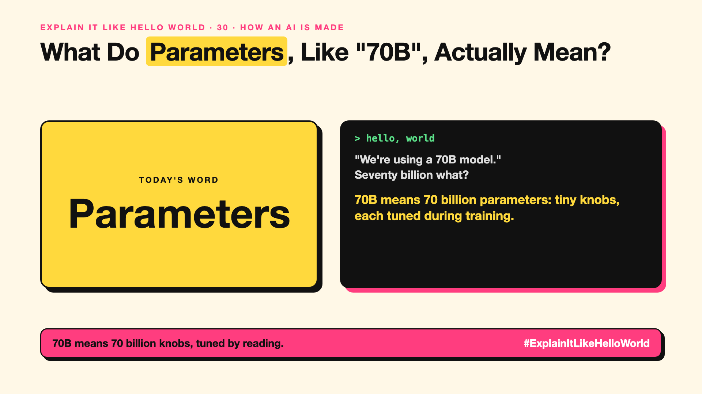

# 30. What Do Parameters, Like "70B", Actually Mean? | Parameters



*Explain It Like Hello World series: Parameters*

"A 70B model." "An 8B model." Model names come with numbers, and bigger numbers sound smarter. What is being counted?

## The hello world

Picture a mixing desk in a music studio, covered in tiny knobs. Turn the knobs one way and the song sounds muddy. Turn them right and it sounds great.

An AI is a mixing desk with billions of knobs. **70B means 70 billion knobs.** Training is the process of turning every knob, a tiny bit at a time, until the AI's next-word guesses (write-up 12) come out right.

## One step further

Each knob is a number, called a **parameter** or **weight**. Nobody sets them by hand. During training, the AI guesses, sees how wrong it was, and every knob is nudged slightly to be less wrong next time, over and over across a huge amount of text.

More knobs can hold more patterns, but they also need more memory and more computing power to run.

## Where you've already met it

Model names like "Llama 3 70B" or "8B". When an AI runs on your phone, it's usually one with a few billion knobs, not hundreds of billions.

## The real name

**Parameters**, also called **weights**.

- **Parameter:** one adjustable number inside the model.
- **Weights:** all those numbers together; the model's learned knowledge.
- **Model size:** how many parameters it has, like 8B or 70B.

## What it's not

More parameters isn't automatically better. Newer small models often beat older big ones, because training data and methods matter as much as size (write-up 44).

## Take this to your next meeting

1. Read "70B" as 70 billion learned knobs, not 70 billion facts.
2. Ask what size you actually need: smaller is cheaper and faster.
3. Compare models on your own tasks, not on size alone.

70B means 70 billion knobs, tuned by reading.

Next write-up (31): **What Happens During Training, When an AI Goes to School?**

Follow me for the next one. Did you think bigger always meant smarter?

**Earlier in this series:**

1. [AI words everyone uses. Nobody explains.](https://lnkd.in/p/d8abaPhq) (the curtain raiser post)
2. [What Actually Counts as Artificial Intelligence?](https://www.linkedin.com/pulse/2-what-actually-counts-artificial-intelligence-arpit-jain-su9lf)
3. [How Does Machine Learning Learn Without Being Told the Rules?](https://www.linkedin.com/pulse/3-how-does-machine-learning-learn-without-being-told-rules-arpit-jain-ppdyf)
4. [What's "Deep" About Deep Learning?](https://www.linkedin.com/pulse/4-whats-deep-learning-arpit-jain-rvlff)
5. [Is a Neural Network Really Like a Brain?](https://www.linkedin.com/pulse/5-neural-network-really-like-brain-arpit-jain-jpigf)
6. What Makes Generative AI "Generative"? *(link added when published)*
7. Why Are They Called Foundation Models? *(link added when published)*
8. What Is a Frontier Model, and Who Decides? *(link added when published)*
9. What Is AGI, and What Would Make AI "General"? *(link added when published)*
10. What Is Superintelligence, and Should We Worry? *(link added when published)*
11. What Are Tokens, and Why Does an AI Read in Pieces? *(link added when published)*
12. How Does an LLM Write a Sentence? *(link added when published)*
13. How Do Embeddings Know "King" Is Close to "Queen"? *(link added when published)*
14. How Does Attention Help an AI Know What "It" Means? *(link added when published)*
15. What Is a Transformer, the "T" in GPT? *(link added when published)*
16. What Is a Context Window, and Why Does an AI Forget? *(link added when published)*
17. What's a Knowledge Cutoff, and Why Is the AI Behind on News? *(link added when published)*
18. What Is Context Rot, and Why Do Long Chats Get Worse? *(link added when published)*
19. Why Does Temperature Change the AI's Answer? *(link added when published)*
20. What Is a Prompt, and Why Does the Way You Ask Matter? *(link added when published)*
21. Is Prompt Engineering a Real Skill? *(link added when published)*
22. What's in a System Prompt, the Hidden Instruction Behind Every Chatbot? *(link added when published)*
23. What Is Zero-Shot, and Can an AI Do a Task It Was Never Shown? *(link added when published)*
24. Why Does Few-Shot Prompting Work So Well? *(link added when published)*
25. Why Does Chain of Thought ("Think Step by Step") Work? *(link added when published)*
26. What Is Reflection, and Why Does an AI Check Its Own Answer? *(link added when published)*
27. Is Context Engineering the New Prompt Engineering? *(link added when published)*
28. How Does Structured Output Get an AI to Fill In a Form? *(link added when published)*
29. Why Does Streaming Make the AI Type Word by Word? *(link added when published)*

**Previous series:**

- **Series 1, #JustAddRAG:** [start here](https://www.linkedin.com/pulse/why-does-just-add-rag-sound-like-2-weeks-take-6-months-arpit-jain-l4kkf/) or jump to [the grand finale](https://www.linkedin.com/pulse/15-so-should-you-really-just-add-rag-grand-finale-arpit-jain-ninmf/)
- **Series 2, Beyond Just RAG: From Answers to Actions:** [start here](https://www.linkedin.com/pulse/1-your-ai-can-answer-now-has-act-from-answers-actions-arpit-jain-po6lf/) or jump to [the finale](https://www.linkedin.com/pulse/8-so-should-your-ai-do-things-just-answer-finale-arpit-jain-x7cxf)
- **Series 20, Today in AI** (ongoing): [start here](https://www.linkedin.com/pulse/today-ai-001-what-happens-when-your-agent-visits-someone-arpit-jain-2vqmf/) or read [the latest issue](https://www.linkedin.com/pulse/today-ai-011-text-to-speech-fits-your-phone-internet-needed-jain-1ipuf)

---

**Post text (copy and paste):**

```
"We're using a 70B model."
Seventy billion what?

70B means 70 billion parameters: tiny knobs, each tuned during training.

More knobs can hold more, but cost more to run.

Did you think bigger always meant smarter?

#AI #GenAI #LearnAI #ExplainItLikeHelloWorld
```

**Series index (post as the first comment):**

```
Explain It Like Hello World

Start here: AI words everyone uses. Nobody explains. https://lnkd.in/p/d8abaPhq
Previous: 29. Why Does Streaming Make the AI Type Word by Word? [link]
You're here: 30. What Do Parameters, Like "70B", Actually Mean?
Next: 31. What Happens During Training, When an AI Goes to School?

Full list: in the curtain raiser post.
```
