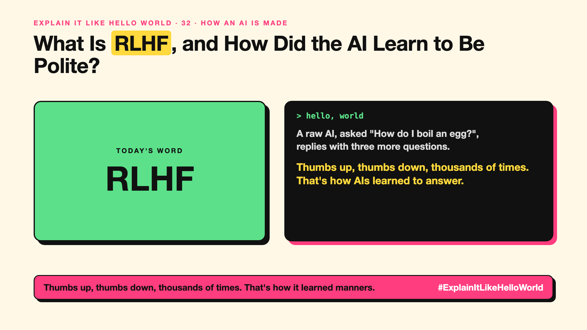

# 32. What Is RLHF, and How Did the AI Learn to Be Polite? | RLHF



*Explain It Like Hello World series: RLHF*

"RLHF." It's why chatbots answer helpfully instead of rambling. The acronym is a mouthful.

## The hello world

Ask a freshly trained AI "How do I boil an egg?" It might continue with three more questions, because it learned to continue text, not to answer.

Now show people two answers and ask: which is better? thumbs up or thumbs down. Do that thousands of times, and teach the AI to give more answers people prefer. That's the hello world: **learning from thumbs up and thumbs down.**

## One step further

First, people write example answers to teach the basic "question, then answer" habit. Then they compare pairs of AI answers and rank them. A second model learns to predict which answers people prefer, and the main AI is trained to score well with it.

Newer methods skip the second model and learn from the comparisons directly, but the idea is the same: human preferences shape behaviour.

## Where you've already met it

The thumbs up and down buttons under chatbot answers. Chatbots that politely decline harmful requests.

## The real name

**RLHF**: reinforcement learning from human feedback.

- **Human feedback:** people choosing which answer is better.
- **Reward model:** a model that learns to predict those choices.
- **Alignment:** shaping an AI to be helpful, honest and safe.

## What it's not

RLHF doesn't teach new facts, and it isn't a guarantee of truth. It teaches what answers people like, which can include sounding confident.

## Take this to your next meeting

1. Know that "helpful assistant" behaviour was trained, not built in.
2. Use feedback buttons; they can shape future versions.
3. Remember: preferred isn't always correct. Check facts that matter.

Thumbs up, thumbs down, thousands of times. That's how it learned manners.

Next write-up (33): **What Is Constitutional AI, and Can an AI Follow Principles?**

Follow me for the next one. Do you click the thumbs up and down buttons?

**Earlier in this series:**

1. [AI words everyone uses. Nobody explains.](https://lnkd.in/p/d8abaPhq) (the curtain raiser post)
2. [What Actually Counts as Artificial Intelligence?](https://www.linkedin.com/pulse/2-what-actually-counts-artificial-intelligence-arpit-jain-su9lf)
3. [How Does Machine Learning Learn Without Being Told the Rules?](https://www.linkedin.com/pulse/3-how-does-machine-learning-learn-without-being-told-rules-arpit-jain-ppdyf)
4. [What's "Deep" About Deep Learning?](https://www.linkedin.com/pulse/4-whats-deep-learning-arpit-jain-rvlff)
5. Is a Neural Network Really Like a Brain? *(link added when published)*
6. What Makes Generative AI "Generative"? *(link added when published)*
7. Why Are They Called Foundation Models? *(link added when published)*
8. What Is AGI, and What Would Make AI "General"? *(link added when published)*
9. What Is Superintelligence, and Should We Worry? *(link added when published)*
10. What Are Tokens, and Why Does an AI Read in Pieces? *(link added when published)*
11. How Does an LLM Write a Sentence? *(link added when published)*
12. How Do Embeddings Know "King" Is Close to "Queen"? *(link added when published)*
13. How Does Attention Help an AI Know What "It" Means? *(link added when published)*
14. What Is a Transformer, the "T" in GPT? *(link added when published)*
15. What Is a Context Window, and Why Does an AI Forget? *(link added when published)*
16. Why Does Temperature Change the AI's Answer? *(link added when published)*
17. What Is a Prompt, and Why Does the Way You Ask Matter? *(link added when published)*
18. Is Prompt Engineering a Real Skill? *(link added when published)*
19. What's in a System Prompt, the Hidden Instruction Behind Every Chatbot? *(link added when published)*
20. What Is Zero-Shot, and Can an AI Do a Task It Was Never Shown? *(link added when published)*
21. Why Does Few-Shot Prompting Work So Well? *(link added when published)*
22. Why Does Chain of Thought ("Think Step by Step") Work? *(link added when published)*
23. Is Context Engineering the New Prompt Engineering? *(link added when published)*
24. How Does Structured Output Get an AI to Fill In a Form? *(link added when published)*
25. Why Does Streaming Make the AI Type Word by Word? *(link added when published)*
26. What Do Parameters, Like "70B", Actually Mean? *(link added when published)*
27. What Happens During Training, When an AI Goes to School? *(link added when published)*
28. What Is Inference, and What Happens When You Hit Send? *(link added when published)*
29. What Is Pretraining, and How Does an AI Learn Language? *(link added when published)*
30. What Is Fine-Tuning, and How Does an AI Learn Your Way? *(link added when published)*
31. What Is LoRA, and How Do You Customise an AI Cheaply? *(link added when published)*

**Previous series:**

- **Series 1, #JustAddRAG:** [start here](https://www.linkedin.com/pulse/why-does-just-add-rag-sound-like-2-weeks-take-6-months-arpit-jain-l4kkf/) or jump to [the grand finale](https://www.linkedin.com/pulse/15-so-should-you-really-just-add-rag-grand-finale-arpit-jain-ninmf/)
- **Series 2, Beyond Just RAG: From Answers to Actions:** [start here](https://www.linkedin.com/pulse/1-your-ai-can-answer-now-has-act-from-answers-actions-arpit-jain-po6lf/) or jump to [the finale](https://www.linkedin.com/pulse/8-so-should-your-ai-do-things-just-answer-finale-arpit-jain-x7cxf)
- **Series 20, Today in AI** (ongoing): [start here](https://www.linkedin.com/pulse/today-ai-001-what-happens-when-your-agent-visits-someone-arpit-jain-2vqmf/) or read [the latest issue](https://www.linkedin.com/pulse/today-ai-011-text-to-speech-fits-your-phone-internet-needed-jain-1ipuf)

---

**Post text (copy and paste):**

```
A raw AI, asked "How do I boil an egg?",
replies with three more questions.

Thumbs up, thumbs down, thousands of times. That's how AIs learned to answer.

It's called RLHF.

Do you click the thumbs up and down buttons?

#AI #GenAI #LearnAI #ExplainItLikeHelloWorld
```

**Series index (post as the first comment):**

```
Explain It Like Hello World

Start here: AI words everyone uses. Nobody explains. https://lnkd.in/p/d8abaPhq
Previous: 31. What Is LoRA, and How Do You Customise an AI Cheaply? [link]
You're here: 32. What Is RLHF, and How Did the AI Learn to Be Polite?
Next: 33. What Is Constitutional AI, and Can an AI Follow Principles?

Full list: in the curtain raiser post.
```
