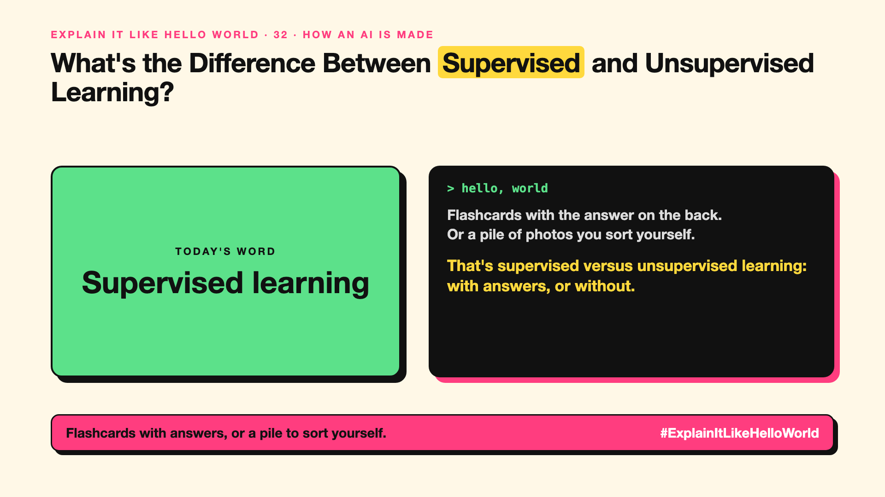

# 32. What's the Difference Between Supervised and Unsupervised Learning? | Supervised learning



*Explain It Like Hello World series: Supervised learning*

"Supervised learning." "Unsupervised learning." Two of the oldest terms in machine learning, still everywhere.

## The hello world

Learning with a teacher: flashcards with the answer on the back. Learning without one: a pile of photos you sort into groups yourself, because some just look alike.

That's the hello world: **supervised learning** learns from examples with the right answers attached; **unsupervised learning** finds patterns in data with no answers given.

## One step further

Supervised learning needs labelled data (write-up 42): emails marked spam or not, X-rays marked by doctors. It then predicts answers for new examples. Unsupervised learning groups customers by behaviour or spots unusual transactions, with no labels at all.

LLMs use a third trick, self-supervised learning: hide the next word and guess it, so the text itself provides the answers (write-up 34).

## Where you've already met it

Spam filters (supervised), "customers like you" groupings and many fraud alerts (often unsupervised).

## The real name

**Supervised learning** and **unsupervised learning**, with **self-supervised learning** in between.

- **Label:** the right answer attached to an example.
- **Clustering:** grouping similar things without labels.
- **Self-supervised:** the data provides its own answers.

## What it's not

Unsupervised doesn't mean no humans involved. People still choose the data, check the groups and decide what they mean.

## Take this to your next meeting

1. Ask whether your problem has labelled examples.
2. No labels? Start by looking for natural groups.
3. Budget for labelling if you need supervised learning.

Flashcards with answers, or a pile to sort yourself.

Next write-up (33): **What Is Inference, and What Happens When You Hit Send?**

Follow me for the next one. Which does your team's data allow: supervised or unsupervised learning?

**Earlier in this series:**

1. [AI words everyone uses. Nobody explains.](https://lnkd.in/p/d8abaPhq) (the curtain raiser post)
2. [What Actually Counts as Artificial Intelligence?](https://www.linkedin.com/pulse/2-what-actually-counts-artificial-intelligence-arpit-jain-su9lf)
3. [How Does Machine Learning Learn Without Being Told the Rules?](https://www.linkedin.com/pulse/3-how-does-machine-learning-learn-without-being-told-rules-arpit-jain-ppdyf)
4. [What's "Deep" About Deep Learning?](https://www.linkedin.com/pulse/4-whats-deep-learning-arpit-jain-rvlff)
5. Is a Neural Network Really Like a Brain? *(link added when published)*
6. What Makes Generative AI "Generative"? *(link added when published)*
7. Why Are They Called Foundation Models? *(link added when published)*
8. What Is a Frontier Model, and Who Decides? *(link added when published)*
9. What Is AGI, and What Would Make AI "General"? *(link added when published)*
10. What Is Superintelligence, and Should We Worry? *(link added when published)*
11. What Are Tokens, and Why Does an AI Read in Pieces? *(link added when published)*
12. How Does an LLM Write a Sentence? *(link added when published)*
13. How Do Embeddings Know "King" Is Close to "Queen"? *(link added when published)*
14. How Does Attention Help an AI Know What "It" Means? *(link added when published)*
15. What Is a Transformer, the "T" in GPT? *(link added when published)*
16. What Is a Context Window, and Why Does an AI Forget? *(link added when published)*
17. What's a Knowledge Cutoff, and Why Is the AI Behind on News? *(link added when published)*
18. What Is Context Rot, and Why Do Long Chats Get Worse? *(link added when published)*
19. Why Does Temperature Change the AI's Answer? *(link added when published)*
20. What Is a Prompt, and Why Does the Way You Ask Matter? *(link added when published)*
21. Is Prompt Engineering a Real Skill? *(link added when published)*
22. What's in a System Prompt, the Hidden Instruction Behind Every Chatbot? *(link added when published)*
23. What Is Zero-Shot, and Can an AI Do a Task It Was Never Shown? *(link added when published)*
24. Why Does Few-Shot Prompting Work So Well? *(link added when published)*
25. Why Does Chain of Thought ("Think Step by Step") Work? *(link added when published)*
26. What Is Reflection, and Why Does an AI Check Its Own Answer? *(link added when published)*
27. Is Context Engineering the New Prompt Engineering? *(link added when published)*
28. How Does Structured Output Get an AI to Fill In a Form? *(link added when published)*
29. Why Does Streaming Make the AI Type Word by Word? *(link added when published)*
30. What Do Parameters, Like "70B", Actually Mean? *(link added when published)*
31. What Happens During Training, When an AI Goes to School? *(link added when published)*

**Previous series:**

- **Series 1, #JustAddRAG:** [start here](https://www.linkedin.com/pulse/why-does-just-add-rag-sound-like-2-weeks-take-6-months-arpit-jain-l4kkf/) or jump to [the grand finale](https://www.linkedin.com/pulse/15-so-should-you-really-just-add-rag-grand-finale-arpit-jain-ninmf/)
- **Series 2, Beyond Just RAG: From Answers to Actions:** [start here](https://www.linkedin.com/pulse/1-your-ai-can-answer-now-has-act-from-answers-actions-arpit-jain-po6lf/) or jump to [the finale](https://www.linkedin.com/pulse/8-so-should-your-ai-do-things-just-answer-finale-arpit-jain-x7cxf)
- **Series 20, Today in AI** (ongoing): [start here](https://www.linkedin.com/pulse/today-ai-001-what-happens-when-your-agent-visits-someone-arpit-jain-2vqmf/) or read [the latest issue](https://www.linkedin.com/pulse/today-ai-011-text-to-speech-fits-your-phone-internet-needed-jain-1ipuf)

---

**Post text (copy and paste):**

```
Flashcards with the answer on the back.
Or a pile of photos you sort yourself.

That's supervised versus unsupervised learning: with answers, or without.

Most AI uses both.

Which does your team's data allow: supervised or unsupervised learning?

#AI #GenAI #LearnAI #ExplainItLikeHelloWorld
```

**Series index (post as the first comment):**

```
Explain It Like Hello World

Start here: AI words everyone uses. Nobody explains. https://lnkd.in/p/d8abaPhq
Previous: 31. What Happens During Training, When an AI Goes to School? [link]
You're here: 32. What's the Difference Between Supervised and Unsupervised Learning?
Next: 33. What Is Inference, and What Happens When You Hit Send?

Full list: in the curtain raiser post.
```
