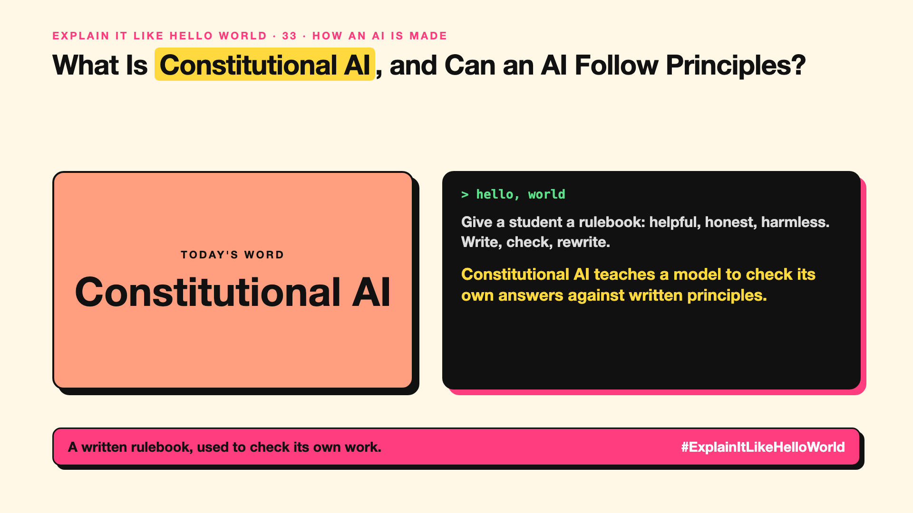

# 33. Can an AI Follow a Written Set of Principles? | Constitutional AI



*Explain It Like Hello World series: Constitutional AI*

"Constitutional AI." It sounds like AI with a parliament. It's one of the ways AI companies teach models to behave.

## The hello world

Give a student a short rulebook: "be helpful, be honest, don't help anyone cause harm". Ask them to write an answer, check it against the rulebook, and rewrite it if it breaks a rule.

That's the hello world: **constitutional AI** trains a model to critique and improve its own answers using a written list of principles.

## One step further

RLHF (write-up 32) relies on lots of human ratings. Constitutional AI, introduced by Anthropic in 2022, uses a written set of principles, the "constitution", and has the AI itself judge which answers follow them better. Those AI judgements then train the model.

It makes the rules visible and reduces how much harmful content human raters need to see.

## Where you've already met it

Claude was trained with this approach. Published model "constitutions" and behaviour guidelines from AI companies.

## The real name

**Constitutional AI**.

- **Constitution:** a written list of principles.
- **Self-critique:** the model reviewing its own answer.
- **RLAIF:** reinforcement learning from AI feedback.

## What it's not

It isn't a legal constitution, and it doesn't make a model perfectly safe. It's one training method among several.

## Take this to your next meeting

1. Read a model provider's published principles before choosing it.
2. Write down your own AI's principles, even informally.
3. Test behaviour; principles on paper aren't proof.

A written rulebook, used to check its own work.

Next write-up (34): **How Does a Small AI Learn From a Big One?**

Follow me for the next one. If you wrote a constitution for your AI, what would rule 1 be?

**Earlier in this series:**

1. AI words everyone uses. Nobody explains. (the curtain raiser post) *(link added when published)*
2. What Actually Counts as AI? *(link added when published)*
3. How Does a Computer Learn Without Being Told the Rules? *(link added when published)*
4. What's "Deep" About Deep Learning? *(link added when published)*
5. Is a Neural Network Really Like a Brain? *(link added when published)*
6. What Makes AI "Generative"? *(link added when published)*
7. Why Are They Called Foundation Models? *(link added when published)*
8. What Would It Mean for AI to Be "General"? *(link added when published)*
9. What Is Superintelligence, and Should We Worry? *(link added when published)*
10. How Does an AI Read a Word? *(link added when published)*
11. How Does an AI Write a Sentence? *(link added when published)*
12. How Does an AI Know "King" Is Close to "Queen"? *(link added when published)*
13. How Does an AI Know What "It" Means? *(link added when published)*
14. What Is the "T" in GPT? *(link added when published)*
15. Why Does an AI Forget the Start of a Long Chat? *(link added when published)*
16. Why Does the Same Question Get Different Answers? *(link added when published)*
17. Why Does the Way You Ask Change the Answer? *(link added when published)*
18. Is Prompt Engineering a Real Skill? *(link added when published)*
19. What's the Hidden Instruction Behind Every Chatbot? *(link added when published)*
20. Can an AI Do a Task It Was Never Shown? *(link added when published)*
21. Why Do Examples Help an AI So Much? *(link added when published)*
22. Why Does "Think Step by Step" Work? *(link added when published)*
23. Is Context Engineering the New Prompt Engineering? *(link added when published)*
24. How Do You Get an AI to Fill In a Form? *(link added when published)*
25. Why Does the AI Type Its Answer Word by Word? *(link added when published)*
26. What Does "70B" Actually Mean? *(link added when published)*
27. How Does an AI Go to School? *(link added when published)*
28. What Happens When You Hit Send? *(link added when published)*
29. How Does an AI Learn Language in the First Place? *(link added when published)*
30. How Do You Teach an AI Your Way of Doing Things? *(link added when published)*
31. How Do You Customise an AI Without Retraining It? *(link added when published)*
32. How Did the AI Learn to Be Polite? *(link added when published)*

**Previous series:**

- **Series 1, #JustAddRAG:** [start here](https://www.linkedin.com/pulse/why-does-just-add-rag-sound-like-2-weeks-take-6-months-arpit-jain-l4kkf/) or jump to [the grand finale](https://www.linkedin.com/pulse/15-so-should-you-really-just-add-rag-grand-finale-arpit-jain-ninmf/)
- **Series 2, Beyond Just RAG: From Answers to Actions:** [start here](https://www.linkedin.com/pulse/1-your-ai-can-answer-now-has-act-from-answers-actions-arpit-jain-po6lf/) or jump to [the finale](https://www.linkedin.com/pulse/8-so-should-your-ai-do-things-just-answer-finale-arpit-jain-x7cxf)

---

**Post text (copy and paste):**

```
Give a student a rulebook: helpful, honest, harmless.
Write, check, rewrite.

Constitutional AI teaches a model to check its own answers against written principles.

The rules are written down, not just implied.

If you wrote a constitution for your AI, what would rule 1 be?

#AI #GenAI #LearnAI #ExplainItLikeHelloWorld
```

**Series index (post as the first comment):**

```
Explain It Like Hello World

Start here: 1. AI words everyone uses. Nobody explains. [link]
Previous: 32. How Did the AI Learn to Be Polite? [link]
You're here: 33. Can an AI Follow a Written Set of Principles?
Next: 34. How Does a Small AI Learn From a Big One?

Full list: in the curtain raiser post.
```
