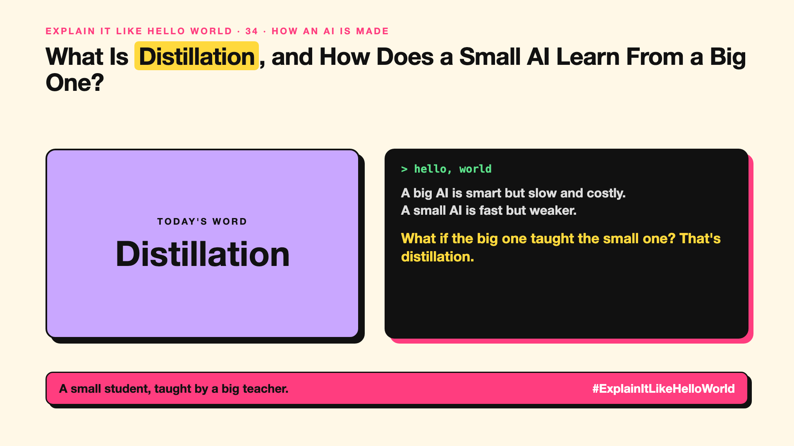

# 34. What Is Distillation, and How Does a Small AI Learn From a Big One? | Distillation



*Explain It Like Hello World series: Distillation*

"A distilled model." Small, fast AIs are often described this way. It sounds like whisky, and the idea isn't far off.

## The hello world

A senior doctor (the big AI) and a junior doctor (the small AI) see the same patients. The junior doesn't just learn the final diagnosis. They learn how the senior weighs every option: "probably flu, maybe a cold, unlikely anything worse".

That's the hello world: a small **student** model learns by copying a big **teacher** model's answers and reasoning.

## One step further

The teacher answers a large set of questions. The student is trained to match the teacher's outputs, including how likely it thought each option was, which carries more information than a single right answer.

The student ends up much smaller and cheaper, keeping much of the teacher's skill on the tasks it was taught.

## Where you've already met it

The "mini", "flash" or "lite" versions of popular models are often built this way. Fast on-device assistants too (write-up 49).

## The real name

**Distillation**, also called **knowledge distillation**.

- **Teacher model:** the big model being learned from.
- **Student model:** the small model doing the learning.
- **Distilled model:** the small model that results.

## What it's not

The student isn't a full copy. It loses some skill, especially outside what it was taught. Also check licences: some providers forbid using their outputs to train other models.

## Take this to your next meeting

1. Try the small, cheap version of a model before the big one.
2. Test it on your own hard cases; that's where students slip.
3. Check the licence before training on another model's outputs.

A small student, taught by a big teacher.

Next write-up (35): **What Is Synthetic Data, and Can an AI Learn From AI-Written Data?**

Follow me for the next one. Have you tried a model's mini version?

**Earlier in this series:**

1. [AI words everyone uses. Nobody explains.](https://lnkd.in/p/d8abaPhq) (the curtain raiser post)
2. [What Actually Counts as Artificial Intelligence?](https://www.linkedin.com/pulse/2-what-actually-counts-artificial-intelligence-arpit-jain-su9lf)
3. [How Does Machine Learning Learn Without Being Told the Rules?](https://www.linkedin.com/pulse/3-how-does-machine-learning-learn-without-being-told-rules-arpit-jain-ppdyf)
4. [What's "Deep" About Deep Learning?](https://www.linkedin.com/pulse/4-whats-deep-learning-arpit-jain-rvlff)
5. Is a Neural Network Really Like a Brain? *(link added when published)*
6. What Makes Generative AI "Generative"? *(link added when published)*
7. Why Are They Called Foundation Models? *(link added when published)*
8. What Is AGI, and What Would Make AI "General"? *(link added when published)*
9. What Is Superintelligence, and Should We Worry? *(link added when published)*
10. What Are Tokens, and Why Does an AI Read in Pieces? *(link added when published)*
11. How Does an LLM Write a Sentence? *(link added when published)*
12. How Do Embeddings Know "King" Is Close to "Queen"? *(link added when published)*
13. How Does Attention Help an AI Know What "It" Means? *(link added when published)*
14. What Is a Transformer, the "T" in GPT? *(link added when published)*
15. What Is a Context Window, and Why Does an AI Forget? *(link added when published)*
16. Why Does Temperature Change the AI's Answer? *(link added when published)*
17. What Is a Prompt, and Why Does the Way You Ask Matter? *(link added when published)*
18. Is Prompt Engineering a Real Skill? *(link added when published)*
19. What's in a System Prompt, the Hidden Instruction Behind Every Chatbot? *(link added when published)*
20. What Is Zero-Shot, and Can an AI Do a Task It Was Never Shown? *(link added when published)*
21. Why Does Few-Shot Prompting Work So Well? *(link added when published)*
22. Why Does Chain of Thought ("Think Step by Step") Work? *(link added when published)*
23. Is Context Engineering the New Prompt Engineering? *(link added when published)*
24. How Does Structured Output Get an AI to Fill In a Form? *(link added when published)*
25. Why Does Streaming Make the AI Type Word by Word? *(link added when published)*
26. What Do Parameters, Like "70B", Actually Mean? *(link added when published)*
27. What Happens During Training, When an AI Goes to School? *(link added when published)*
28. What Is Inference, and What Happens When You Hit Send? *(link added when published)*
29. What Is Pretraining, and How Does an AI Learn Language? *(link added when published)*
30. What Is Fine-Tuning, and How Does an AI Learn Your Way? *(link added when published)*
31. What Is LoRA, and How Do You Customise an AI Cheaply? *(link added when published)*
32. What Is RLHF, and How Did the AI Learn to Be Polite? *(link added when published)*
33. What Is Constitutional AI, and Can an AI Follow Principles? *(link added when published)*

**Previous series:**

- **Series 1, #JustAddRAG:** [start here](https://www.linkedin.com/pulse/why-does-just-add-rag-sound-like-2-weeks-take-6-months-arpit-jain-l4kkf/) or jump to [the grand finale](https://www.linkedin.com/pulse/15-so-should-you-really-just-add-rag-grand-finale-arpit-jain-ninmf/)
- **Series 2, Beyond Just RAG: From Answers to Actions:** [start here](https://www.linkedin.com/pulse/1-your-ai-can-answer-now-has-act-from-answers-actions-arpit-jain-po6lf/) or jump to [the finale](https://www.linkedin.com/pulse/8-so-should-your-ai-do-things-just-answer-finale-arpit-jain-x7cxf)
- **Series 20, Today in AI** (ongoing): [start here](https://www.linkedin.com/pulse/today-ai-001-what-happens-when-your-agent-visits-someone-arpit-jain-2vqmf/) or read [the latest issue](https://www.linkedin.com/pulse/today-ai-011-text-to-speech-fits-your-phone-internet-needed-jain-1ipuf)

---

**Post text (copy and paste):**

```
A big AI is smart but slow and costly.
A small AI is fast but weaker.

What if the big one taught the small one? That's distillation.

Many fast, cheap AIs are built this way.

Have you tried a model's mini version?

#AI #GenAI #LearnAI #ExplainItLikeHelloWorld
```

**Series index (post as the first comment):**

```
Explain It Like Hello World

Start here: AI words everyone uses. Nobody explains. https://lnkd.in/p/d8abaPhq
Previous: 33. What Is Constitutional AI, and Can an AI Follow Principles? [link]
You're here: 34. What Is Distillation, and How Does a Small AI Learn From a Big One?
Next: 35. What Is Synthetic Data, and Can an AI Learn From AI-Written Data?

Full list: in the curtain raiser post.
```
