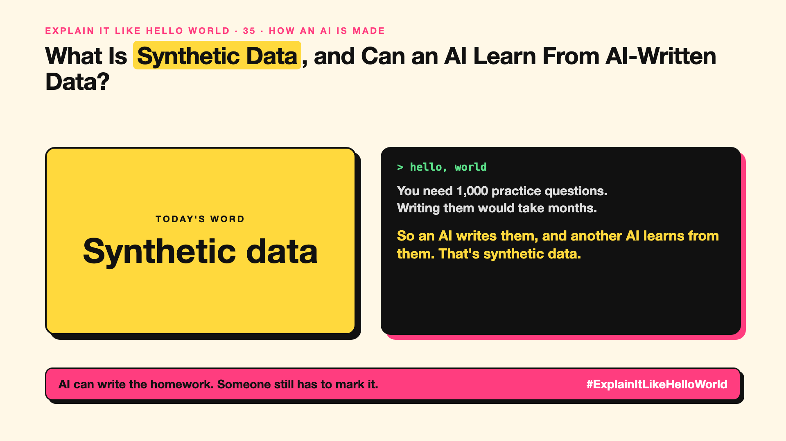

# 35. Can an AI Learn From Data Another AI Wrote? | Synthetic data



*Explain It Like Hello World series: Synthetic data*

"We trained on synthetic data." It sounds like fake data. In a way it is, on purpose.

## The hello world

A teacher needs 1,000 maths practice questions with worked answers. Writing them by hand would take months.

So an AI writes them, another check verifies the answers, and a new AI practises on them. That's the hello world: **training data written by an AI**, not collected from people.

## One step further

It's useful when real data is scarce, private or expensive: rare medical cases, new languages, tricky edge cases, or step-by-step reasoning examples.

The catch is quality. If an AI learns only from AI-written data, mistakes and blandness can pile up over generations. So teams check it, filter it, and mix it with real data.

## Where you've already met it

Practice questions in learning apps. Many newer models mention synthetic data in how they were trained, especially for maths and coding.

## The real name

**Synthetic data**.

- **Synthetic data:** data generated by a model or program, not collected.
- **Data augmentation:** making more examples by varying real ones.
- **Model collapse:** quality dropping when models train mostly on AI-made data.

## What it's not

Synthetic doesn't mean worthless or free. Unchecked, it can teach errors confidently. It's a tool, not a replacement for real data.

## Take this to your next meeting

1. Use synthetic data to fill gaps, not to replace real examples.
2. Always check a sample by hand.
3. Keep real-world test sets to catch drift.

AI can write the homework. Someone still has to mark it.

Next write-up (36): **Who Teaches the AI What's Right?**

Follow me for the next one. Would you trust a model trained on AI-written data?

**Earlier in this series:**

1. AI words everyone uses. Nobody explains. (the curtain raiser post) *(link added when published)*
2. What Actually Counts as AI? *(link added when published)*
3. How Does a Computer Learn Without Being Told the Rules? *(link added when published)*
4. What's "Deep" About Deep Learning? *(link added when published)*
5. Is a Neural Network Really Like a Brain? *(link added when published)*
6. What Makes AI "Generative"? *(link added when published)*
7. Why Are They Called Foundation Models? *(link added when published)*
8. What Would It Mean for AI to Be "General"? *(link added when published)*
9. What Is Superintelligence, and Should We Worry? *(link added when published)*
10. How Does an AI Read a Word? *(link added when published)*
11. How Does an AI Write a Sentence? *(link added when published)*
12. How Does an AI Know "King" Is Close to "Queen"? *(link added when published)*
13. How Does an AI Know What "It" Means? *(link added when published)*
14. What Is the "T" in GPT? *(link added when published)*
15. Why Does an AI Forget the Start of a Long Chat? *(link added when published)*
16. Why Does the Same Question Get Different Answers? *(link added when published)*
17. Why Does the Way You Ask Change the Answer? *(link added when published)*
18. Is Prompt Engineering a Real Skill? *(link added when published)*
19. What's the Hidden Instruction Behind Every Chatbot? *(link added when published)*
20. Can an AI Do a Task It Was Never Shown? *(link added when published)*
21. Why Do Examples Help an AI So Much? *(link added when published)*
22. Why Does "Think Step by Step" Work? *(link added when published)*
23. Is Context Engineering the New Prompt Engineering? *(link added when published)*
24. How Do You Get an AI to Fill In a Form? *(link added when published)*
25. Why Does the AI Type Its Answer Word by Word? *(link added when published)*
26. What Does "70B" Actually Mean? *(link added when published)*
27. How Does an AI Go to School? *(link added when published)*
28. What Happens When You Hit Send? *(link added when published)*
29. How Does an AI Learn Language in the First Place? *(link added when published)*
30. How Do You Teach an AI Your Way of Doing Things? *(link added when published)*
31. How Do You Customise an AI Without Retraining It? *(link added when published)*
32. How Did the AI Learn to Be Polite? *(link added when published)*
33. Can an AI Follow a Written Set of Principles? *(link added when published)*
34. How Does a Small AI Learn From a Big One? *(link added when published)*

**Previous series:**

- **Series 1, #JustAddRAG:** [start here](https://www.linkedin.com/pulse/why-does-just-add-rag-sound-like-2-weeks-take-6-months-arpit-jain-l4kkf/) or jump to [the grand finale](https://www.linkedin.com/pulse/15-so-should-you-really-just-add-rag-grand-finale-arpit-jain-ninmf/)
- **Series 2, Beyond Just RAG: From Answers to Actions:** [start here](https://www.linkedin.com/pulse/1-your-ai-can-answer-now-has-act-from-answers-actions-arpit-jain-po6lf/) or jump to [the finale](https://www.linkedin.com/pulse/8-so-should-your-ai-do-things-just-answer-finale-arpit-jain-x7cxf)

---

**Post text (copy and paste):**

```
You need 1,000 practice questions.
Writing them would take months.

So an AI writes them, and another AI learns from them. That's synthetic data.

Useful, as long as someone checks the answers.

Would you trust a model trained on AI-written data?

#AI #GenAI #LearnAI #ExplainItLikeHelloWorld
```

**Series index (post as the first comment):**

```
Explain It Like Hello World

Start here: 1. AI words everyone uses. Nobody explains. [link]
Previous: 34. How Does a Small AI Learn From a Big One? [link]
You're here: 35. Can an AI Learn From Data Another AI Wrote?
Next: 36. Who Teaches the AI What's Right?

Full list: in the curtain raiser post.
```
