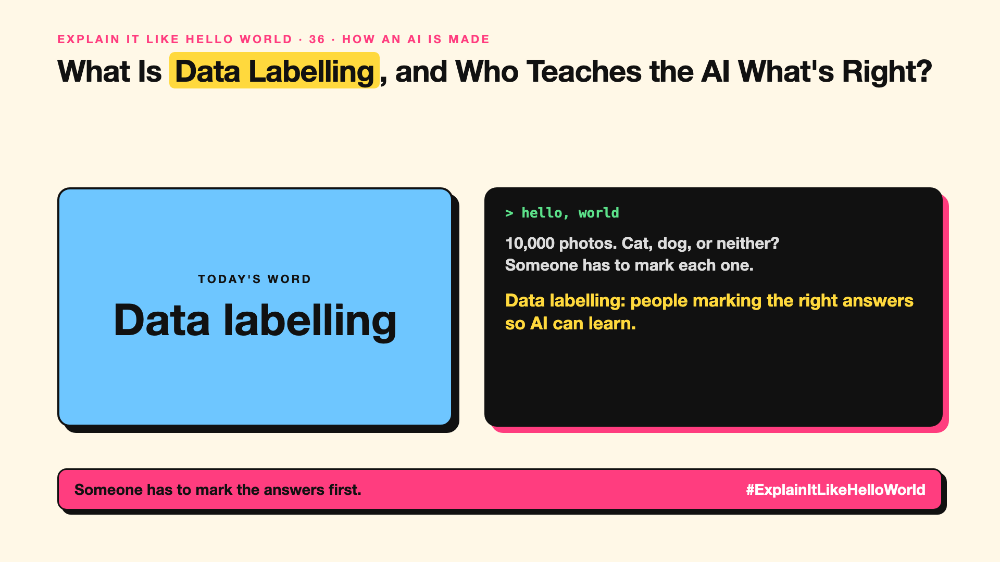

# 36. Who Teaches the AI What's Right? | Data labelling



*Explain It Like Hello World series: Data labelling*

"Data labelling." "Human in the loop." Behind every smart AI, there are people marking examples. It's rarely in the headlines.

## The hello world

Show a computer 10,000 photos. Someone has to mark each one: "cat", "dog", "neither". Without those marks, the computer can't learn which is which (write-up 3).

That's the hello world: **data labelling** is people (or tools) attaching the right answers to examples so AI can learn from them.

## One step further

Labels can be simple ("spam") or detailed: drawing boxes around cars, transcribing speech, rating which of two chatbot answers is better (write-up 32). Big AI projects use thousands of labellers, often through specialist companies.

Label quality is model quality. Inconsistent or biased labels teach the AI inconsistent or biased behaviour.

## Where you've already met it

"Select all squares with traffic lights" puzzles, which helped label images. Thumbs up and down buttons in chat apps.

## The real name

**Data labelling**, also called **annotation**.

- **Label:** the right answer attached to an example.
- **Annotator:** the person adding labels.
- **Gold set:** a carefully checked set of labels used for testing.

## What it's not

Labelling isn't unskilled busywork. Medical, legal and safety labels need experts, and clear guidelines matter as much as the people.

## Take this to your next meeting

1. Write clear labelling guidelines with examples.
2. Have two people label a sample and compare.
3. Budget for labelling; it's often the hidden cost of AI.

Someone has to mark the answers first.

Next write-up (37): **Why Can an AI Ace the Practice Test and Fail the Real One?**

Follow me for the next one. Did you know those traffic-light puzzles helped train AI?

**Earlier in this series:**

1. AI words everyone uses. Nobody explains. (the curtain raiser post) *(link added when published)*
2. What Actually Counts as AI? *(link added when published)*
3. How Does a Computer Learn Without Being Told the Rules? *(link added when published)*
4. What's "Deep" About Deep Learning? *(link added when published)*
5. Is a Neural Network Really Like a Brain? *(link added when published)*
6. What Makes AI "Generative"? *(link added when published)*
7. Why Are They Called Foundation Models? *(link added when published)*
8. What Would It Mean for AI to Be "General"? *(link added when published)*
9. What Is Superintelligence, and Should We Worry? *(link added when published)*
10. How Does an AI Read a Word? *(link added when published)*
11. How Does an AI Write a Sentence? *(link added when published)*
12. How Does an AI Know "King" Is Close to "Queen"? *(link added when published)*
13. How Does an AI Know What "It" Means? *(link added when published)*
14. What Is the "T" in GPT? *(link added when published)*
15. Why Does an AI Forget the Start of a Long Chat? *(link added when published)*
16. Why Does the Same Question Get Different Answers? *(link added when published)*
17. Why Does the Way You Ask Change the Answer? *(link added when published)*
18. Is Prompt Engineering a Real Skill? *(link added when published)*
19. What's the Hidden Instruction Behind Every Chatbot? *(link added when published)*
20. Can an AI Do a Task It Was Never Shown? *(link added when published)*
21. Why Do Examples Help an AI So Much? *(link added when published)*
22. Why Does "Think Step by Step" Work? *(link added when published)*
23. Is Context Engineering the New Prompt Engineering? *(link added when published)*
24. How Do You Get an AI to Fill In a Form? *(link added when published)*
25. Why Does the AI Type Its Answer Word by Word? *(link added when published)*
26. What Does "70B" Actually Mean? *(link added when published)*
27. How Does an AI Go to School? *(link added when published)*
28. What Happens When You Hit Send? *(link added when published)*
29. How Does an AI Learn Language in the First Place? *(link added when published)*
30. How Do You Teach an AI Your Way of Doing Things? *(link added when published)*
31. How Do You Customise an AI Without Retraining It? *(link added when published)*
32. How Did the AI Learn to Be Polite? *(link added when published)*
33. Can an AI Follow a Written Set of Principles? *(link added when published)*
34. How Does a Small AI Learn From a Big One? *(link added when published)*
35. Can an AI Learn From Data Another AI Wrote? *(link added when published)*

**Previous series:**

- **Series 1, #JustAddRAG:** [start here](https://www.linkedin.com/pulse/why-does-just-add-rag-sound-like-2-weeks-take-6-months-arpit-jain-l4kkf/) or jump to [the grand finale](https://www.linkedin.com/pulse/15-so-should-you-really-just-add-rag-grand-finale-arpit-jain-ninmf/)
- **Series 2, Beyond Just RAG: From Answers to Actions:** [start here](https://www.linkedin.com/pulse/1-your-ai-can-answer-now-has-act-from-answers-actions-arpit-jain-po6lf/) or jump to [the finale](https://www.linkedin.com/pulse/8-so-should-your-ai-do-things-just-answer-finale-arpit-jain-x7cxf)

---

**Post text (copy and paste):**

```
10,000 photos. Cat, dog, or neither?
Someone has to mark each one.

Data labelling: people marking the right answers so AI can learn.

Label quality is model quality.

Did you know those traffic-light puzzles helped train AI?

#AI #GenAI #LearnAI #ExplainItLikeHelloWorld
```

**Series index (post as the first comment):**

```
Explain It Like Hello World

Start here: 1. AI words everyone uses. Nobody explains. [link]
Previous: 35. Can an AI Learn From Data Another AI Wrote? [link]
You're here: 36. Who Teaches the AI What's Right?
Next: 37. Why Can an AI Ace the Practice Test and Fail the Real One?

Full list: in the curtain raiser post.
```
