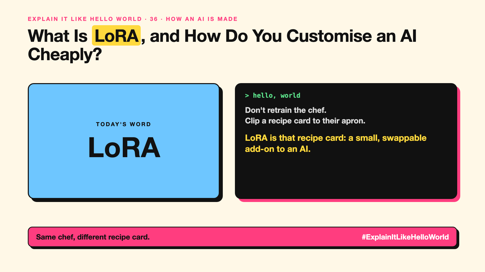

# 36. What Is LoRA, and How Do You Customise an AI Cheaply? | LoRA



*Explain It Like Hello World series: LoRA*

"Just use LoRA." It's how people customise AI cheaply, from company chatbots to image styles. The name sounds like a person.

## The hello world

Instead of retraining the chef (write-up 35), you clip a recipe card to their apron: "for our biryani, more saffron, less salt". The chef stays the same; the card changes a few dishes. Swap cards for different restaurants.

That's the hello world: **LoRA** adds a small, removable add-on to a model instead of changing the whole thing.

## One step further

Full fine-tuning adjusts all of a model's billions of knobs. LoRA freezes them and trains a tiny set of extra knobs alongside, often well under 1% of the size.

It's much cheaper, needs less memory, and you can keep many small add-ons for different tasks or customers and switch between them.

## Where you've already met it

Image apps that learn your face or art style from a few photos. Open-model communities sharing small style add-ons.

## The real name

**LoRA**, low-rank adaptation.

- **Adapter:** a small add-on trained for a task.
- **LoRA:** a popular, efficient kind of adapter.
- **Frozen weights:** the original knobs, left unchanged.

## What it's not

LoRA isn't a different model. It only works on top of the model it was trained for. Swap the base model and the add-on usually won't fit.

## Take this to your next meeting

1. Ask whether a LoRA add-on would do before full fine-tuning.
2. Keep separate add-ons for separate tasks.
3. Retest when the base model changes.

Same chef, different recipe card.

Next write-up (37): **How Does Reinforcement Learning Teach AI by Trial and Error?**

Follow me for the next one. Have you used a LoRA without knowing it?

**Earlier in this series:**

1. [AI words everyone uses. Nobody explains.](https://lnkd.in/p/d8abaPhq) (the curtain raiser post)
2. [What Actually Counts as Artificial Intelligence?](https://www.linkedin.com/pulse/2-what-actually-counts-artificial-intelligence-arpit-jain-su9lf)
3. [How Does Machine Learning Learn Without Being Told the Rules?](https://www.linkedin.com/pulse/3-how-does-machine-learning-learn-without-being-told-rules-arpit-jain-ppdyf)
4. [What's "Deep" About Deep Learning?](https://www.linkedin.com/pulse/4-whats-deep-learning-arpit-jain-rvlff)
5. [Is a Neural Network Really Like a Brain?](https://www.linkedin.com/pulse/5-neural-network-really-like-brain-arpit-jain-jpigf)
6. What Makes Generative AI "Generative"? *(link added when published)*
7. Why Are They Called Foundation Models? *(link added when published)*
8. What Is a Frontier Model, and Who Decides? *(link added when published)*
9. What Is AGI, and What Would Make AI "General"? *(link added when published)*
10. What Is Superintelligence, and Should We Worry? *(link added when published)*
11. What Are Tokens, and Why Does an AI Read in Pieces? *(link added when published)*
12. How Does an LLM Write a Sentence? *(link added when published)*
13. How Do Embeddings Know "King" Is Close to "Queen"? *(link added when published)*
14. How Does Attention Help an AI Know What "It" Means? *(link added when published)*
15. What Is a Transformer, the "T" in GPT? *(link added when published)*
16. What Is a Context Window, and Why Does an AI Forget? *(link added when published)*
17. What's a Knowledge Cutoff, and Why Is the AI Behind on News? *(link added when published)*
18. What Is Context Rot, and Why Do Long Chats Get Worse? *(link added when published)*
19. Why Does Temperature Change the AI's Answer? *(link added when published)*
20. What Is a Prompt, and Why Does the Way You Ask Matter? *(link added when published)*
21. Is Prompt Engineering a Real Skill? *(link added when published)*
22. What's in a System Prompt, the Hidden Instruction Behind Every Chatbot? *(link added when published)*
23. What Is Zero-Shot, and Can an AI Do a Task It Was Never Shown? *(link added when published)*
24. Why Does Few-Shot Prompting Work So Well? *(link added when published)*
25. Why Does Chain of Thought ("Think Step by Step") Work? *(link added when published)*
26. What Is Reflection, and Why Does an AI Check Its Own Answer? *(link added when published)*
27. Is Context Engineering the New Prompt Engineering? *(link added when published)*
28. How Does Structured Output Get an AI to Fill In a Form? *(link added when published)*
29. Why Does Streaming Make the AI Type Word by Word? *(link added when published)*
30. What Do Parameters, Like "70B", Actually Mean? *(link added when published)*
31. What Happens During Training, When an AI Goes to School? *(link added when published)*
32. What's the Difference Between Supervised and Unsupervised Learning? *(link added when published)*
33. What Is Inference, and What Happens When You Hit Send? *(link added when published)*
34. What Is Pretraining, and How Does an AI Learn Language? *(link added when published)*
35. What Is Fine-Tuning, and How Does an AI Learn Your Way? *(link added when published)*

**Previous series:**

- **Series 1, #JustAddRAG:** [start here](https://www.linkedin.com/pulse/why-does-just-add-rag-sound-like-2-weeks-take-6-months-arpit-jain-l4kkf/) or jump to [the grand finale](https://www.linkedin.com/pulse/15-so-should-you-really-just-add-rag-grand-finale-arpit-jain-ninmf/)
- **Series 2, Beyond Just RAG: From Answers to Actions:** [start here](https://www.linkedin.com/pulse/1-your-ai-can-answer-now-has-act-from-answers-actions-arpit-jain-po6lf/) or jump to [the finale](https://www.linkedin.com/pulse/8-so-should-your-ai-do-things-just-answer-finale-arpit-jain-x7cxf)
- **Series 20, Today in AI** (ongoing): [start here](https://www.linkedin.com/pulse/today-ai-001-what-happens-when-your-agent-visits-someone-arpit-jain-2vqmf/) or read [the latest issue](https://www.linkedin.com/pulse/today-ai-011-text-to-speech-fits-your-phone-internet-needed-jain-1ipuf)

---

**Post text (copy and paste):**

```
Don't retrain the chef.
Clip a recipe card to their apron.

LoRA is that recipe card: a small, swappable add-on to an AI.

Cheap, small, and easy to switch.

Have you used a LoRA without knowing it?

#AI #GenAI #LearnAI #ExplainItLikeHelloWorld
```

**Series index (post as the first comment):**

```
Explain It Like Hello World

Start here: AI words everyone uses. Nobody explains. https://lnkd.in/p/d8abaPhq
Previous: 35. What Is Fine-Tuning, and How Does an AI Learn Your Way? [link]
You're here: 36. What Is LoRA, and How Do You Customise an AI Cheaply?
Next: 37. How Does Reinforcement Learning Teach AI by Trial and Error?

Full list: in the curtain raiser post.
```
