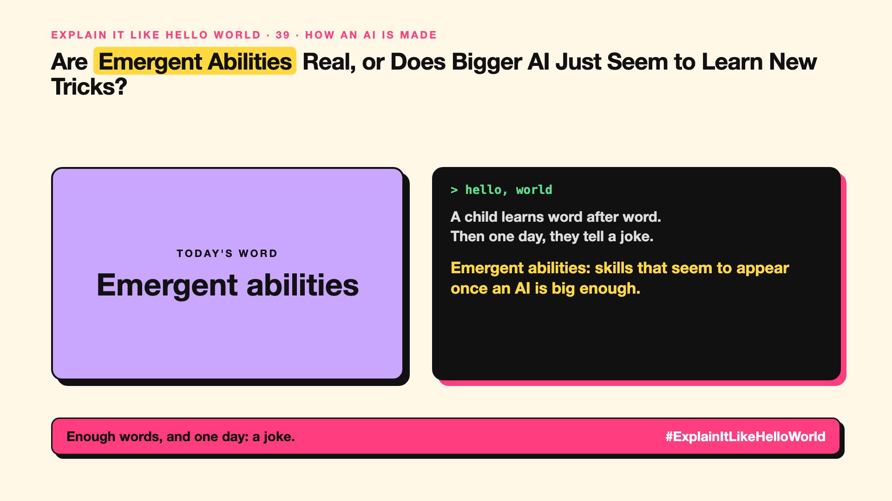

# 39. Are Emergent Abilities Real, or Does Bigger AI Just Seem to Learn New Tricks? | Emergent abilities



*Explain It Like Hello World series: Emergent abilities*

"Emergent abilities." The idea that bigger models suddenly gain skills nobody trained for. It's exciting, and debated.

## The hello world

A child learns words, words, more words... and then one day, they tell a joke. Nobody taught joke-telling directly; it appeared once enough pieces were in place.

That's the hello world: **emergent abilities** are skills that seem to appear in AI models only once they're big enough, without being trained for specifically.

## One step further

Researchers noticed that small models failed completely at some tasks, like multi-step arithmetic, while larger models suddenly did well. It looked like a switch flipping at a certain size.

Later research argued some of these jumps depend on how you measure: with a more gradual score, improvement looks smoother. So it's partly real, partly a measurement effect.

## Where you've already met it

Headlines about AI "unexpectedly" learning to translate, code or reason as models grew.

## The real name

**Emergent abilities**.

- **Emergence:** a new behaviour appearing from many simple parts.
- **Scale:** model size, data and compute (write-up 38).
- **Threshold:** the size at which a skill seems to appear.

## What it's not

Emergence doesn't mean the AI is secretly conscious or unpredictable in every way. And it doesn't guarantee new skills will keep appearing as models grow.

## Take this to your next meeting

1. Be careful with "it suddenly learned" headlines.
2. Test new models on your own tasks; abilities differ.
3. Don't plan on future emergent skills; plan on what works today.

Enough words, and one day: a joke.

Next write-up (40): **What Is Model Collapse, and What Happens When AI Learns From AI?**

Follow me for the next one. Do you think AI skills appear suddenly, or gradually?

**Earlier in this series:**

1. [AI words everyone uses. Nobody explains.](https://lnkd.in/p/d8abaPhq) (the curtain raiser post)
2. [What Actually Counts as Artificial Intelligence?](https://www.linkedin.com/pulse/2-what-actually-counts-artificial-intelligence-arpit-jain-su9lf)
3. [How Does Machine Learning Learn Without Being Told the Rules?](https://www.linkedin.com/pulse/3-how-does-machine-learning-learn-without-being-told-rules-arpit-jain-ppdyf)
4. What's "Deep" About Deep Learning? *(link added when published)*
5. Is a Neural Network Really Like a Brain? *(link added when published)*
6. What Makes Generative AI "Generative"? *(link added when published)*
7. Why Are They Called Foundation Models? *(link added when published)*
8. What Is AGI, and What Would Make AI "General"? *(link added when published)*
9. What Is Superintelligence, and Should We Worry? *(link added when published)*
10. What Are Tokens, and Why Does an AI Read in Pieces? *(link added when published)*
11. How Does an LLM Write a Sentence? *(link added when published)*
12. How Do Embeddings Know "King" Is Close to "Queen"? *(link added when published)*
13. How Does Attention Help an AI Know What "It" Means? *(link added when published)*
14. What Is a Transformer, the "T" in GPT? *(link added when published)*
15. What Is a Context Window, and Why Does an AI Forget? *(link added when published)*
16. Why Does Temperature Change the AI's Answer? *(link added when published)*
17. What Is a Prompt, and Why Does the Way You Ask Matter? *(link added when published)*
18. Is Prompt Engineering a Real Skill? *(link added when published)*
19. What's in a System Prompt, the Hidden Instruction Behind Every Chatbot? *(link added when published)*
20. What Is Zero-Shot, and Can an AI Do a Task It Was Never Shown? *(link added when published)*
21. Why Does Few-Shot Prompting Work So Well? *(link added when published)*
22. Why Does Chain of Thought ("Think Step by Step") Work? *(link added when published)*
23. Is Context Engineering the New Prompt Engineering? *(link added when published)*
24. How Does Structured Output Get an AI to Fill In a Form? *(link added when published)*
25. Why Does Streaming Make the AI Type Word by Word? *(link added when published)*
26. What Do Parameters, Like "70B", Actually Mean? *(link added when published)*
27. What Happens During Training, When an AI Goes to School? *(link added when published)*
28. What Is Inference, and What Happens When You Hit Send? *(link added when published)*
29. What Is Pretraining, and How Does an AI Learn Language? *(link added when published)*
30. What Is Fine-Tuning, and How Does an AI Learn Your Way? *(link added when published)*
31. What Is LoRA, and How Do You Customise an AI Cheaply? *(link added when published)*
32. What Is RLHF, and How Did the AI Learn to Be Polite? *(link added when published)*
33. What Is Constitutional AI, and Can an AI Follow Principles? *(link added when published)*
34. What Is Distillation, and How Does a Small AI Learn From a Big One? *(link added when published)*
35. What Is Synthetic Data, and Can an AI Learn From AI-Written Data? *(link added when published)*
36. What Is Data Labelling, and Who Teaches the AI What's Right? *(link added when published)*
37. What Is Overfitting, and Why Can an AI Ace the Practice Test and Fail? *(link added when published)*
38. What Are Scaling Laws, and Why Did Bigger AI Keep Getting Better? *(link added when published)*

**Previous series:**

- **Series 1, #JustAddRAG:** [start here](https://www.linkedin.com/pulse/why-does-just-add-rag-sound-like-2-weeks-take-6-months-arpit-jain-l4kkf/) or jump to [the grand finale](https://www.linkedin.com/pulse/15-so-should-you-really-just-add-rag-grand-finale-arpit-jain-ninmf/)
- **Series 2, Beyond Just RAG: From Answers to Actions:** [start here](https://www.linkedin.com/pulse/1-your-ai-can-answer-now-has-act-from-answers-actions-arpit-jain-po6lf/) or jump to [the finale](https://www.linkedin.com/pulse/8-so-should-your-ai-do-things-just-answer-finale-arpit-jain-x7cxf)
- **Series 20, Today in AI** (ongoing): [start here](https://www.linkedin.com/pulse/today-ai-001-what-happens-when-your-agent-visits-someone-arpit-jain-2vqmf/) or read [the latest issue](https://www.linkedin.com/pulse/today-ai-011-text-to-speech-fits-your-phone-internet-needed-jain-1ipuf)

---

**Post text (copy and paste):**

```
A child learns word after word.
Then one day, they tell a joke.

Emergent abilities: skills that seem to appear once an AI is big enough.

Real, debated, and partly about how we measure.

Do you think AI skills appear suddenly, or gradually?

#AI #GenAI #LearnAI #ExplainItLikeHelloWorld
```

**Series index (post as the first comment):**

```
Explain It Like Hello World

Start here: AI words everyone uses. Nobody explains. https://lnkd.in/p/d8abaPhq
Previous: 38. What Are Scaling Laws, and Why Did Bigger AI Keep Getting Better? [link]
You're here: 39. Are Emergent Abilities Real, or Does Bigger AI Just Seem to Learn New Tricks?
Next: 40. What Is Model Collapse, and What Happens When AI Learns From AI?

Full list: in the curtain raiser post.
```
