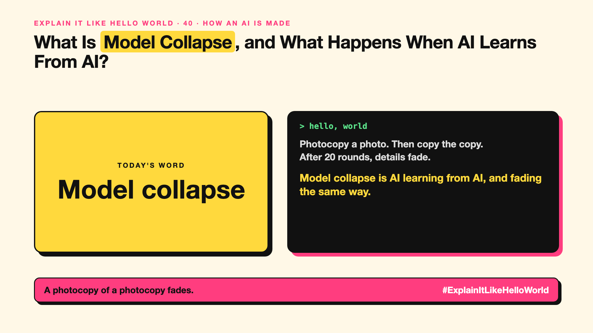

# 40. What Happens When AI Learns From AI? | Model collapse



*Explain It Like Hello World series: Model collapse*

"Model collapse." As AI-written text floods the internet, researchers worry future AIs will learn mostly from AI. What goes wrong?

## The hello world

Photocopy a photo. Then photocopy the copy. Then the copy of the copy. After 20 rounds, details fade and odd smudges grow.

That's the hello world: **model collapse** is quality slowly degrading when AI models are trained mostly on content made by other AIs.

## One step further

Each AI generation slightly over-represents common patterns and loses rare ones. Train the next model mostly on that output, and the losses compound: answers get blander, rare facts vanish, errors repeat.

Research suggests mixing in real human data and filtering carefully prevents most of it. That's why fresh, human-made data has become valuable (see synthetic data, write-up 35).

## Where you've already met it

Debates about AI-generated text and images filling the web, and AI companies licensing human-written content.

## The real name

**Model collapse**.

- **Model collapse:** quality loss from training on AI-made data.
- **Data provenance:** knowing where data came from.
- **Human data:** content created by people.

## What it's not

It doesn't mean AI is about to collapse. It's a risk that careful data mixing largely avoids.

## Take this to your next meeting

1. Keep track of which data is AI-made.
2. Mix in real data whenever you train or fine-tune.
3. Value your organisation's human-written content.

A photocopy of a photocopy fades.

Next write-up (41): **How Do You Fit a Giant AI on a Laptop?**

Follow me for the next one. How much of what you read online do you think is AI-written?

**Earlier in this series:**

1. AI words everyone uses. Nobody explains. (the curtain raiser post) *(link added when published)*
2. What Actually Counts as AI? *(link added when published)*
3. How Does a Computer Learn Without Being Told the Rules? *(link added when published)*
4. What's "Deep" About Deep Learning? *(link added when published)*
5. Is a Neural Network Really Like a Brain? *(link added when published)*
6. What Makes AI "Generative"? *(link added when published)*
7. Why Are They Called Foundation Models? *(link added when published)*
8. What Would It Mean for AI to Be "General"? *(link added when published)*
9. What Is Superintelligence, and Should We Worry? *(link added when published)*
10. How Does an AI Read a Word? *(link added when published)*
11. How Does an AI Write a Sentence? *(link added when published)*
12. How Does an AI Know "King" Is Close to "Queen"? *(link added when published)*
13. How Does an AI Know What "It" Means? *(link added when published)*
14. What Is the "T" in GPT? *(link added when published)*
15. Why Does an AI Forget the Start of a Long Chat? *(link added when published)*
16. Why Does the Same Question Get Different Answers? *(link added when published)*
17. Why Does the Way You Ask Change the Answer? *(link added when published)*
18. Is Prompt Engineering a Real Skill? *(link added when published)*
19. What's the Hidden Instruction Behind Every Chatbot? *(link added when published)*
20. Can an AI Do a Task It Was Never Shown? *(link added when published)*
21. Why Do Examples Help an AI So Much? *(link added when published)*
22. Why Does "Think Step by Step" Work? *(link added when published)*
23. Is Context Engineering the New Prompt Engineering? *(link added when published)*
24. How Do You Get an AI to Fill In a Form? *(link added when published)*
25. Why Does the AI Type Its Answer Word by Word? *(link added when published)*
26. What Does "70B" Actually Mean? *(link added when published)*
27. How Does an AI Go to School? *(link added when published)*
28. What Happens When You Hit Send? *(link added when published)*
29. How Does an AI Learn Language in the First Place? *(link added when published)*
30. How Do You Teach an AI Your Way of Doing Things? *(link added when published)*
31. How Do You Customise an AI Without Retraining It? *(link added when published)*
32. How Did the AI Learn to Be Polite? *(link added when published)*
33. Can an AI Follow a Written Set of Principles? *(link added when published)*
34. How Does a Small AI Learn From a Big One? *(link added when published)*
35. Can an AI Learn From Data Another AI Wrote? *(link added when published)*
36. Who Teaches the AI What's Right? *(link added when published)*
37. Why Can an AI Ace the Practice Test and Fail the Real One? *(link added when published)*
38. Why Did Bigger AI Keep Getting Better? *(link added when published)*
39. Can Bigger AI Suddenly Learn New Tricks? *(link added when published)*

**Previous series:**

- **Series 1, #JustAddRAG:** [start here](https://www.linkedin.com/pulse/why-does-just-add-rag-sound-like-2-weeks-take-6-months-arpit-jain-l4kkf/) or jump to [the grand finale](https://www.linkedin.com/pulse/15-so-should-you-really-just-add-rag-grand-finale-arpit-jain-ninmf/)
- **Series 2, Beyond Just RAG: From Answers to Actions:** [start here](https://www.linkedin.com/pulse/1-your-ai-can-answer-now-has-act-from-answers-actions-arpit-jain-po6lf/) or jump to [the finale](https://www.linkedin.com/pulse/8-so-should-your-ai-do-things-just-answer-finale-arpit-jain-x7cxf)

---

**Post text (copy and paste):**

```
Photocopy a photo. Then copy the copy.
After 20 rounds, details fade.

Model collapse is AI learning from AI, and fading the same way.

Real human data keeps it sharp.

How much of what you read online do you think is AI-written?

#AI #GenAI #LearnAI #ExplainItLikeHelloWorld
```

**Series index (post as the first comment):**

```
Explain It Like Hello World

Start here: 1. AI words everyone uses. Nobody explains. [link]
Previous: 39. Can Bigger AI Suddenly Learn New Tricks? [link]
You're here: 40. What Happens When AI Learns From AI?
Next: 41. How Do You Fit a Giant AI on a Laptop?

Full list: in the curtain raiser post.
```
