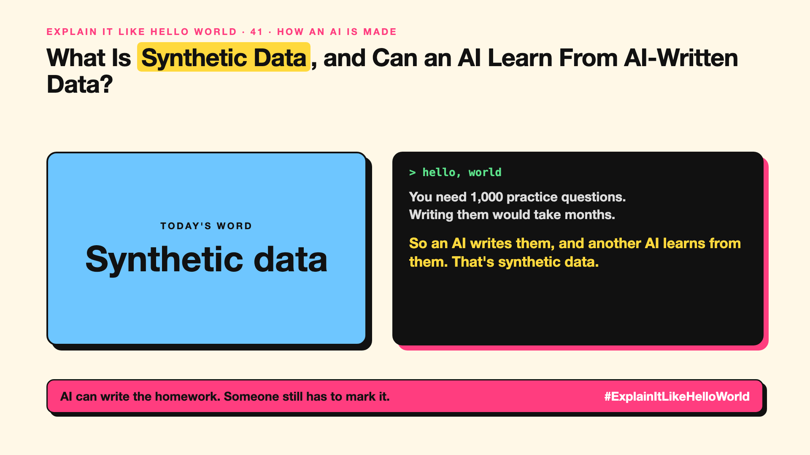

# 41. What Is Synthetic Data, and Can an AI Learn From AI-Written Data? | Synthetic data



*Explain It Like Hello World series: Synthetic data*

"We trained on synthetic data." It sounds like fake data. In a way it is, on purpose.

## The hello world

A teacher needs 1,000 maths practice questions with worked answers. Writing them by hand would take months.

So an AI writes them, another check verifies the answers, and a new AI practises on them. That's the hello world: **training data written by an AI**, not collected from people.

## One step further

It's useful when real data is scarce, private or expensive: rare medical cases, new languages, tricky edge cases, or step-by-step reasoning examples.

The catch is quality. If an AI learns only from AI-written data, mistakes and blandness can pile up over generations. So teams check it, filter it, and mix it with real data.

## Where you've already met it

Practice questions in learning apps. Many newer models mention synthetic data in how they were trained, especially for maths and coding.

## The real name

**Synthetic data**.

- **Synthetic data:** data generated by a model or program, not collected.
- **Data augmentation:** making more examples by varying real ones.
- **Model collapse:** quality dropping when models train mostly on AI-made data.

## What it's not

Synthetic doesn't mean worthless or free. Unchecked, it can teach errors confidently. It's a tool, not a replacement for real data.

## Take this to your next meeting

1. Use synthetic data to fill gaps, not to replace real examples.
2. Always check a sample by hand.
3. Keep real-world test sets to catch drift.

AI can write the homework. Someone still has to mark it.

Next write-up (42): **What Is Data Labelling, and Who Teaches the AI What's Right?**

Follow me for the next one. Would you trust a model trained on AI-written data?

**Earlier in this series:**

1. [AI words everyone uses. Nobody explains.](https://lnkd.in/p/d8abaPhq) (the curtain raiser post)
2. [What Actually Counts as Artificial Intelligence?](https://www.linkedin.com/pulse/2-what-actually-counts-artificial-intelligence-arpit-jain-su9lf)
3. [How Does Machine Learning Learn Without Being Told the Rules?](https://www.linkedin.com/pulse/3-how-does-machine-learning-learn-without-being-told-rules-arpit-jain-ppdyf)
4. [What's "Deep" About Deep Learning?](https://www.linkedin.com/pulse/4-whats-deep-learning-arpit-jain-rvlff)
5. [Is a Neural Network Really Like a Brain?](https://www.linkedin.com/pulse/5-neural-network-really-like-brain-arpit-jain-jpigf)
6. What Makes Generative AI "Generative"? *(link added when published)*
7. Why Are They Called Foundation Models? *(link added when published)*
8. What Is a Frontier Model, and Who Decides? *(link added when published)*
9. What Is AGI, and What Would Make AI "General"? *(link added when published)*
10. What Is Superintelligence, and Should We Worry? *(link added when published)*
11. What Are Tokens, and Why Does an AI Read in Pieces? *(link added when published)*
12. How Does an LLM Write a Sentence? *(link added when published)*
13. How Do Embeddings Know "King" Is Close to "Queen"? *(link added when published)*
14. How Does Attention Help an AI Know What "It" Means? *(link added when published)*
15. What Is a Transformer, the "T" in GPT? *(link added when published)*
16. What Is a Context Window, and Why Does an AI Forget? *(link added when published)*
17. What's a Knowledge Cutoff, and Why Is the AI Behind on News? *(link added when published)*
18. What Is Context Rot, and Why Do Long Chats Get Worse? *(link added when published)*
19. Why Does Temperature Change the AI's Answer? *(link added when published)*
20. What Is a Prompt, and Why Does the Way You Ask Matter? *(link added when published)*
21. Is Prompt Engineering a Real Skill? *(link added when published)*
22. What's in a System Prompt, the Hidden Instruction Behind Every Chatbot? *(link added when published)*
23. What Is Zero-Shot, and Can an AI Do a Task It Was Never Shown? *(link added when published)*
24. Why Does Few-Shot Prompting Work So Well? *(link added when published)*
25. Why Does Chain of Thought ("Think Step by Step") Work? *(link added when published)*
26. What Is Reflection, and Why Does an AI Check Its Own Answer? *(link added when published)*
27. Is Context Engineering the New Prompt Engineering? *(link added when published)*
28. How Does Structured Output Get an AI to Fill In a Form? *(link added when published)*
29. Why Does Streaming Make the AI Type Word by Word? *(link added when published)*
30. What Do Parameters, Like "70B", Actually Mean? *(link added when published)*
31. What Happens During Training, When an AI Goes to School? *(link added when published)*
32. What's the Difference Between Supervised and Unsupervised Learning? *(link added when published)*
33. What Is Inference, and What Happens When You Hit Send? *(link added when published)*
34. What Is Pretraining, and How Does an AI Learn Language? *(link added when published)*
35. What Is Fine-Tuning, and How Does an AI Learn Your Way? *(link added when published)*
36. What Is LoRA, and How Do You Customise an AI Cheaply? *(link added when published)*
37. How Does Reinforcement Learning Teach AI by Trial and Error? *(link added when published)*
38. What Is RLHF, and How Did the AI Learn to Be Polite? *(link added when published)*
39. What Is Constitutional AI, and Can an AI Follow Principles? *(link added when published)*
40. What Is Distillation, and How Does a Small AI Learn From a Big One? *(link added when published)*

**Previous series:**

- **Series 1, #JustAddRAG:** [start here](https://www.linkedin.com/pulse/why-does-just-add-rag-sound-like-2-weeks-take-6-months-arpit-jain-l4kkf/) or jump to [the grand finale](https://www.linkedin.com/pulse/15-so-should-you-really-just-add-rag-grand-finale-arpit-jain-ninmf/)
- **Series 2, Beyond Just RAG: From Answers to Actions:** [start here](https://www.linkedin.com/pulse/1-your-ai-can-answer-now-has-act-from-answers-actions-arpit-jain-po6lf/) or jump to [the finale](https://www.linkedin.com/pulse/8-so-should-your-ai-do-things-just-answer-finale-arpit-jain-x7cxf)
- **Series 20, Today in AI** (ongoing): [start here](https://www.linkedin.com/pulse/today-ai-001-what-happens-when-your-agent-visits-someone-arpit-jain-2vqmf/) or read [the latest issue](https://www.linkedin.com/pulse/today-ai-011-text-to-speech-fits-your-phone-internet-needed-jain-1ipuf)

---

**Post text (copy and paste):**

```
You need 1,000 practice questions.
Writing them would take months.

So an AI writes them, and another AI learns from them. That's synthetic data.

Useful, as long as someone checks the answers.

Would you trust a model trained on AI-written data?

#AI #GenAI #LearnAI #ExplainItLikeHelloWorld
```

**Series index (post as the first comment):**

```
Explain It Like Hello World

Start here: AI words everyone uses. Nobody explains. https://lnkd.in/p/d8abaPhq
Previous: 40. What Is Distillation, and How Does a Small AI Learn From a Big One? [link]
You're here: 41. What Is Synthetic Data, and Can an AI Learn From AI-Written Data?
Next: 42. What Is Data Labelling, and Who Teaches the AI What's Right?

Full list: in the curtain raiser post.
```
