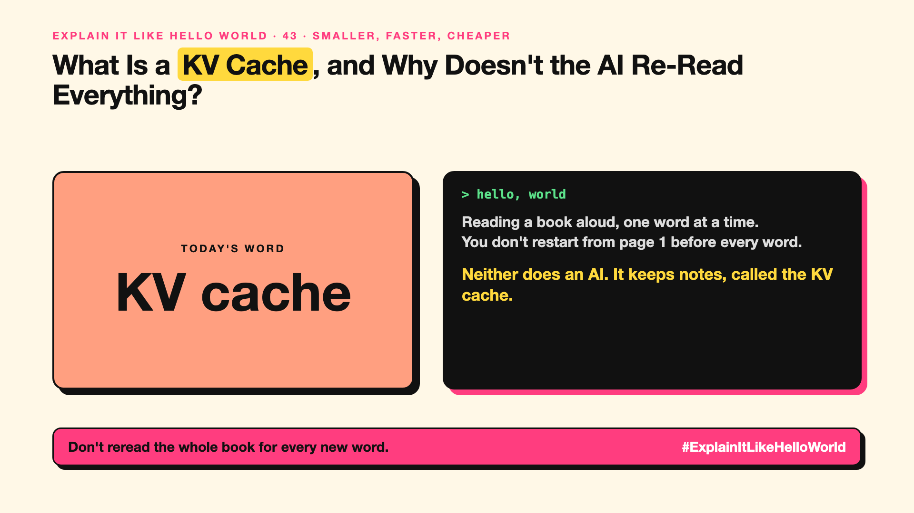

# 43. What Is a KV Cache, and Why Doesn't the AI Re-Read Everything? | KV cache



*Explain It Like Hello World series: KV cache*

"KV cache." It's in every article about making AI faster and cheaper. It sounds like a database setting.

## The hello world

You're reading a book aloud and adding one word at a time. Would you start again from page 1 before each new word? Of course not. You remember what you've read and just add the next word.

That's the hello world: the **KV cache** is the AI's notes on everything it has already read, so it doesn't redo the work for each new token (write-up 11).

## One step further

For every token, attention (write-up 13) works out some notes: what this word is about and how it relates to others. Without a cache, the AI would recalculate those notes for the whole text each time it writes one more word.

With the cache, it keeps the notes and only computes them for the new word. The cost: the notes take memory, and long chats mean big caches.

## Where you've already met it

Long answers that keep streaming smoothly. "Prompt caching" discounts from AI providers build on the same idea of reusing work (cost is covered in Series 8).

## The real name

The **KV cache** (key-value cache).

- **Cache:** saved work you can reuse instead of redoing.
- **Key and value:** the two kinds of notes attention keeps for each token.
- **Prompt caching:** reusing the cache for a repeated start of a prompt.

## What it's not

It's not memory of you or past chats. The cache lasts only while one answer (or one cached prompt) is being processed.

## Take this to your next meeting

1. Expect long chats to use more memory, partly because of the cache.
2. Put the fixed part of your prompt first, so providers can reuse it.
3. Know that "faster serving" headlines often mean smarter caching.

Don't reread the whole book for every new word.

Next write-up (44): **How Does Prompt Caching Make Repeated Prompts Cheaper?**

Follow me for the next one. Did you know AIs keep notes while they write?

**Earlier in this series:**

1. [AI words everyone uses. Nobody explains.](https://lnkd.in/p/d8abaPhq) (the curtain raiser post)
2. [What Actually Counts as Artificial Intelligence?](https://www.linkedin.com/pulse/2-what-actually-counts-artificial-intelligence-arpit-jain-su9lf)
3. How Does Machine Learning Learn Without Being Told the Rules? *(link added when published)*
4. What's "Deep" About Deep Learning? *(link added when published)*
5. Is a Neural Network Really Like a Brain? *(link added when published)*
6. What Makes Generative AI "Generative"? *(link added when published)*
7. Why Are They Called Foundation Models? *(link added when published)*
8. What Is AGI, and What Would Make AI "General"? *(link added when published)*
9. What Is Superintelligence, and Should We Worry? *(link added when published)*
10. What Are Tokens, and Why Does an AI Read in Pieces? *(link added when published)*
11. How Does an LLM Write a Sentence? *(link added when published)*
12. How Do Embeddings Know "King" Is Close to "Queen"? *(link added when published)*
13. How Does Attention Help an AI Know What "It" Means? *(link added when published)*
14. What Is a Transformer, the "T" in GPT? *(link added when published)*
15. What Is a Context Window, and Why Does an AI Forget? *(link added when published)*
16. Why Does Temperature Change the AI's Answer? *(link added when published)*
17. What Is a Prompt, and Why Does the Way You Ask Matter? *(link added when published)*
18. Is Prompt Engineering a Real Skill? *(link added when published)*
19. What's in a System Prompt, the Hidden Instruction Behind Every Chatbot? *(link added when published)*
20. What Is Zero-Shot, and Can an AI Do a Task It Was Never Shown? *(link added when published)*
21. Why Does Few-Shot Prompting Work So Well? *(link added when published)*
22. Why Does Chain of Thought ("Think Step by Step") Work? *(link added when published)*
23. Is Context Engineering the New Prompt Engineering? *(link added when published)*
24. How Does Structured Output Get an AI to Fill In a Form? *(link added when published)*
25. Why Does Streaming Make the AI Type Word by Word? *(link added when published)*
26. What Do Parameters, Like "70B", Actually Mean? *(link added when published)*
27. What Happens During Training, When an AI Goes to School? *(link added when published)*
28. What Is Inference, and What Happens When You Hit Send? *(link added when published)*
29. What Is Pretraining, and How Does an AI Learn Language? *(link added when published)*
30. What Is Fine-Tuning, and How Does an AI Learn Your Way? *(link added when published)*
31. What Is LoRA, and How Do You Customise an AI Cheaply? *(link added when published)*
32. What Is RLHF, and How Did the AI Learn to Be Polite? *(link added when published)*
33. What Is Constitutional AI, and Can an AI Follow Principles? *(link added when published)*
34. What Is Distillation, and How Does a Small AI Learn From a Big One? *(link added when published)*
35. What Is Synthetic Data, and Can an AI Learn From AI-Written Data? *(link added when published)*
36. What Is Data Labelling, and Who Teaches the AI What's Right? *(link added when published)*
37. What Is Overfitting, and Why Can an AI Ace the Practice Test and Fail? *(link added when published)*
38. What Are Scaling Laws, and Why Did Bigger AI Keep Getting Better? *(link added when published)*
39. Are Emergent Abilities Real, or Does Bigger AI Just Seem to Learn New Tricks? *(link added when published)*
40. What Is Model Collapse, and What Happens When AI Learns From AI? *(link added when published)*
41. What Is Quantization, and How Does a Giant AI Fit on a Laptop? *(link added when published)*
42. What Is a Mixture of Experts, and Why Doesn't the Whole AI Wake Up? *(link added when published)*

**Previous series:**

- **Series 1, #JustAddRAG:** [start here](https://www.linkedin.com/pulse/why-does-just-add-rag-sound-like-2-weeks-take-6-months-arpit-jain-l4kkf/) or jump to [the grand finale](https://www.linkedin.com/pulse/15-so-should-you-really-just-add-rag-grand-finale-arpit-jain-ninmf/)
- **Series 2, Beyond Just RAG: From Answers to Actions:** [start here](https://www.linkedin.com/pulse/1-your-ai-can-answer-now-has-act-from-answers-actions-arpit-jain-po6lf/) or jump to [the finale](https://www.linkedin.com/pulse/8-so-should-your-ai-do-things-just-answer-finale-arpit-jain-x7cxf)

---

**Post text (copy and paste):**

```
Reading a book aloud, one word at a time.
You don't restart from page 1 before every word.

Neither does an AI. It keeps notes, called the KV cache.

That's how long answers stay fast.

Did you know AIs keep notes while they write?

#AI #GenAI #LearnAI #ExplainItLikeHelloWorld
```

**Series index (post as the first comment):**

```
Explain It Like Hello World

Start here: AI words everyone uses. Nobody explains. https://lnkd.in/p/d8abaPhq
Previous: 42. What Is a Mixture of Experts, and Why Doesn't the Whole AI Wake Up? [link]
You're here: 43. What Is a KV Cache, and Why Doesn't the AI Re-Read Everything?
Next: 44. How Does Prompt Caching Make Repeated Prompts Cheaper?

Full list: in the curtain raiser post.
```
