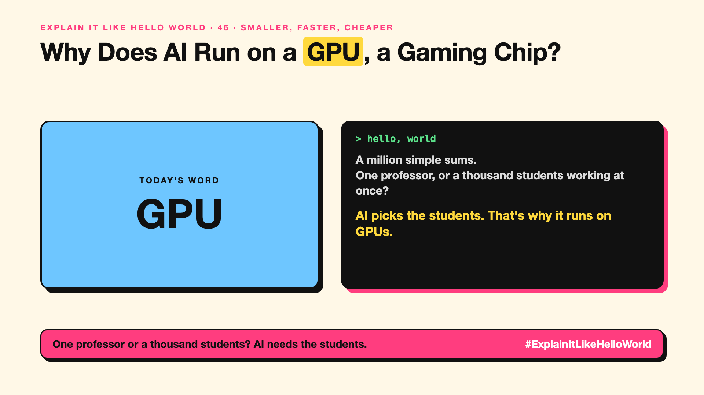

# 46. Why Does AI Run on a GPU, a Gaming Chip? | GPU



*Explain It Like Hello World series: GPU*

"We're short of GPUs." Chip makers became some of the world's most valuable companies. Why does AI need graphics chips?

## The hello world

You need to solve a million simple sums. One brilliant professor does them one at a time. A thousand students each do a thousand, all at once.

The students finish far sooner. That's the hello world: a **CPU** is the professor, a **GPU** is the room full of students. AI is mostly a mountain of simple sums.

## One step further

Every token an AI reads or writes means multiplying huge grids of numbers, its knobs (write-up 26), many times over. Each sum is easy, but there are billions, and most can be done at the same time.

GPUs were designed to colour millions of screen pixels at once for games, which is exactly this kind of work. AI chips today add lots of fast memory too, because the model's knobs have to sit right next to the sums.

## Where you've already met it

News about Nvidia, chip shortages and AI data centres. Gaming PCs that can also run AI models locally.

## The real name

**GPUs** (graphics processing units), and **parallel computing**.

- **CPU:** a general-purpose chip, great at one complex task at a time.
- **GPU:** a chip with thousands of small cores doing simple sums in parallel.
- **Parallel computing:** doing many calculations at the same time.

## What it's not

A GPU isn't smarter than a CPU. It's built for many simple sums at once. Other AI chips (like Google's TPUs) use the same idea.

## Take this to your next meeting

1. Read "GPU shortage" as "not enough rooms full of students".
2. Remember memory matters as much as speed for running big models.
3. For small models, a normal laptop can be enough.

One professor or a thousand students? AI needs the students.

Next write-up (47): **What Is a TPU, and Why Did Google Build One?**

Follow me for the next one. Did you know AI chips started as gaming chips?

**Earlier in this series:**

1. [AI words everyone uses. Nobody explains.](https://lnkd.in/p/d8abaPhq) (the curtain raiser post)
2. What Actually Counts as Artificial Intelligence? *(link added when published)*
3. How Does Machine Learning Learn Without Being Told the Rules? *(link added when published)*
4. What's "Deep" About Deep Learning? *(link added when published)*
5. Is a Neural Network Really Like a Brain? *(link added when published)*
6. What Makes Generative AI "Generative"? *(link added when published)*
7. Why Are They Called Foundation Models? *(link added when published)*
8. What Is AGI, and What Would Make AI "General"? *(link added when published)*
9. What Is Superintelligence, and Should We Worry? *(link added when published)*
10. What Are Tokens, and Why Does an AI Read in Pieces? *(link added when published)*
11. How Does an LLM Write a Sentence? *(link added when published)*
12. How Do Embeddings Know "King" Is Close to "Queen"? *(link added when published)*
13. How Does Attention Help an AI Know What "It" Means? *(link added when published)*
14. What Is a Transformer, the "T" in GPT? *(link added when published)*
15. What Is a Context Window, and Why Does an AI Forget? *(link added when published)*
16. Why Does Temperature Change the AI's Answer? *(link added when published)*
17. What Is a Prompt, and Why Does the Way You Ask Matter? *(link added when published)*
18. Is Prompt Engineering a Real Skill? *(link added when published)*
19. What's in a System Prompt, the Hidden Instruction Behind Every Chatbot? *(link added when published)*
20. What Is Zero-Shot, and Can an AI Do a Task It Was Never Shown? *(link added when published)*
21. Why Does Few-Shot Prompting Work So Well? *(link added when published)*
22. Why Does Chain of Thought ("Think Step by Step") Work? *(link added when published)*
23. Is Context Engineering the New Prompt Engineering? *(link added when published)*
24. How Does Structured Output Get an AI to Fill In a Form? *(link added when published)*
25. Why Does Streaming Make the AI Type Word by Word? *(link added when published)*
26. What Do Parameters, Like "70B", Actually Mean? *(link added when published)*
27. What Happens During Training, When an AI Goes to School? *(link added when published)*
28. What Is Inference, and What Happens When You Hit Send? *(link added when published)*
29. What Is Pretraining, and How Does an AI Learn Language? *(link added when published)*
30. What Is Fine-Tuning, and How Does an AI Learn Your Way? *(link added when published)*
31. What Is LoRA, and How Do You Customise an AI Cheaply? *(link added when published)*
32. What Is RLHF, and How Did the AI Learn to Be Polite? *(link added when published)*
33. What Is Constitutional AI, and Can an AI Follow Principles? *(link added when published)*
34. What Is Distillation, and How Does a Small AI Learn From a Big One? *(link added when published)*
35. What Is Synthetic Data, and Can an AI Learn From AI-Written Data? *(link added when published)*
36. What Is Data Labelling, and Who Teaches the AI What's Right? *(link added when published)*
37. What Is Overfitting, and Why Can an AI Ace the Practice Test and Fail? *(link added when published)*
38. What Are Scaling Laws, and Why Did Bigger AI Keep Getting Better? *(link added when published)*
39. Are Emergent Abilities Real, or Does Bigger AI Just Seem to Learn New Tricks? *(link added when published)*
40. What Is Model Collapse, and What Happens When AI Learns From AI? *(link added when published)*
41. What Is Quantization, and How Does a Giant AI Fit on a Laptop? *(link added when published)*
42. What Is a Mixture of Experts, and Why Doesn't the Whole AI Wake Up? *(link added when published)*
43. What Is a KV Cache, and Why Doesn't the AI Re-Read Everything? *(link added when published)*
44. How Does Prompt Caching Make Repeated Prompts Cheaper? *(link added when published)*
45. How Does Speculative Decoding Make a Big AI Faster? *(link added when published)*

**Previous series:**

- **Series 1, #JustAddRAG:** [start here](https://www.linkedin.com/pulse/why-does-just-add-rag-sound-like-2-weeks-take-6-months-arpit-jain-l4kkf/) or jump to [the grand finale](https://www.linkedin.com/pulse/15-so-should-you-really-just-add-rag-grand-finale-arpit-jain-ninmf/)
- **Series 2, Beyond Just RAG: From Answers to Actions:** [start here](https://www.linkedin.com/pulse/1-your-ai-can-answer-now-has-act-from-answers-actions-arpit-jain-po6lf/) or jump to [the finale](https://www.linkedin.com/pulse/8-so-should-your-ai-do-things-just-answer-finale-arpit-jain-x7cxf)

---

**Post text (copy and paste):**

```
A million simple sums.
One professor, or a thousand students working at once?

AI picks the students. That's why it runs on GPUs.

AI is mostly a mountain of simple sums.

Did you know AI chips started as gaming chips?

#AI #GenAI #LearnAI #ExplainItLikeHelloWorld
```

**Series index (post as the first comment):**

```
Explain It Like Hello World

Start here: AI words everyone uses. Nobody explains. https://lnkd.in/p/d8abaPhq
Previous: 45. How Does Speculative Decoding Make a Big AI Faster? [link]
You're here: 46. Why Does AI Run on a GPU, a Gaming Chip?
Next: 47. What Is a TPU, and Why Did Google Build One?

Full list: in the curtain raiser post.
```
