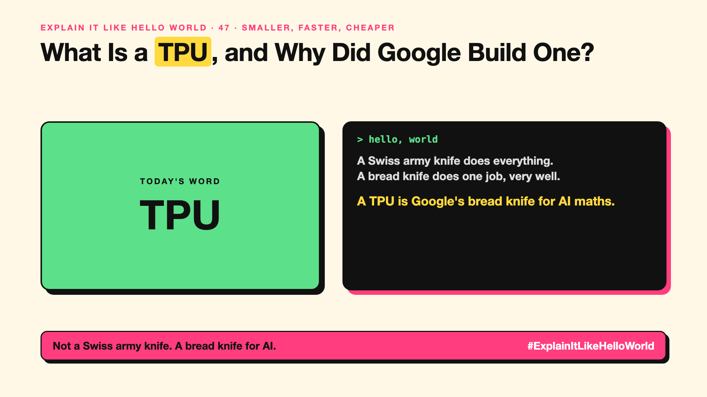

# 47. What Is a TPU, and Why Did Google Build One? | TPU



*Explain It Like Hello World series: TPU*

"Trained on TPUs." Google's models mention them. They're a different kind of AI chip from the GPUs in every headline.

## The hello world

A Swiss army knife does many jobs. A bread knife does one job, cutting bread, and does it very well.

GPUs (write-up 46) are the Swiss army knife: built for graphics, great for AI too. That's the hello world: a **TPU** is the bread knife, a chip Google designed only for the maths AI needs.

## One step further

AI is mostly multiplying big grids of numbers. TPUs (tensor processing units) are built around exactly that, packed into large connected groups for training and serving big models.

Google first used them in its own data centres around 2015 and now rents them through Google Cloud. Other companies build similar custom chips, such as AWS's Trainium and Inferentia.

## Where you've already met it

Google Search, Translate and Gemini run on TPUs. You meet them indirectly every time you use those.

## The real name

The **TPU** (tensor processing unit).

- **TPU:** Google's custom chip for AI maths.
- **Tensor:** a grid of numbers, the basic unit of AI maths.
- **Custom silicon:** chips designed for one company's needs.

## What it's not

A TPU isn't something you buy for your desk. It's rented in the cloud. And it isn't automatically faster than a GPU for every job.

## Take this to your next meeting

1. Know that GPUs aren't the only AI chips.
2. Compare cost per task, not chip names.
3. Expect more custom AI chips from cloud providers.

Not a Swiss army knife. A bread knife for AI.

Next write-up (48): **What Is an NPU, the AI Chip Inside Your New Laptop?**

Follow me for the next one. Did you know Google built its own AI chips?

**Earlier in this series:**

1. [AI words everyone uses. Nobody explains.](https://lnkd.in/p/d8abaPhq) (the curtain raiser post)
2. [What Actually Counts as Artificial Intelligence?](https://www.linkedin.com/pulse/2-what-actually-counts-artificial-intelligence-arpit-jain-su9lf)
3. [How Does Machine Learning Learn Without Being Told the Rules?](https://www.linkedin.com/pulse/3-how-does-machine-learning-learn-without-being-told-rules-arpit-jain-ppdyf)
4. What's "Deep" About Deep Learning? *(link added when published)*
5. Is a Neural Network Really Like a Brain? *(link added when published)*
6. What Makes Generative AI "Generative"? *(link added when published)*
7. Why Are They Called Foundation Models? *(link added when published)*
8. What Is AGI, and What Would Make AI "General"? *(link added when published)*
9. What Is Superintelligence, and Should We Worry? *(link added when published)*
10. What Are Tokens, and Why Does an AI Read in Pieces? *(link added when published)*
11. How Does an LLM Write a Sentence? *(link added when published)*
12. How Do Embeddings Know "King" Is Close to "Queen"? *(link added when published)*
13. How Does Attention Help an AI Know What "It" Means? *(link added when published)*
14. What Is a Transformer, the "T" in GPT? *(link added when published)*
15. What Is a Context Window, and Why Does an AI Forget? *(link added when published)*
16. Why Does Temperature Change the AI's Answer? *(link added when published)*
17. What Is a Prompt, and Why Does the Way You Ask Matter? *(link added when published)*
18. Is Prompt Engineering a Real Skill? *(link added when published)*
19. What's in a System Prompt, the Hidden Instruction Behind Every Chatbot? *(link added when published)*
20. What Is Zero-Shot, and Can an AI Do a Task It Was Never Shown? *(link added when published)*
21. Why Does Few-Shot Prompting Work So Well? *(link added when published)*
22. Why Does Chain of Thought ("Think Step by Step") Work? *(link added when published)*
23. Is Context Engineering the New Prompt Engineering? *(link added when published)*
24. How Does Structured Output Get an AI to Fill In a Form? *(link added when published)*
25. Why Does Streaming Make the AI Type Word by Word? *(link added when published)*
26. What Do Parameters, Like "70B", Actually Mean? *(link added when published)*
27. What Happens During Training, When an AI Goes to School? *(link added when published)*
28. What Is Inference, and What Happens When You Hit Send? *(link added when published)*
29. What Is Pretraining, and How Does an AI Learn Language? *(link added when published)*
30. What Is Fine-Tuning, and How Does an AI Learn Your Way? *(link added when published)*
31. What Is LoRA, and How Do You Customise an AI Cheaply? *(link added when published)*
32. What Is RLHF, and How Did the AI Learn to Be Polite? *(link added when published)*
33. What Is Constitutional AI, and Can an AI Follow Principles? *(link added when published)*
34. What Is Distillation, and How Does a Small AI Learn From a Big One? *(link added when published)*
35. What Is Synthetic Data, and Can an AI Learn From AI-Written Data? *(link added when published)*
36. What Is Data Labelling, and Who Teaches the AI What's Right? *(link added when published)*
37. What Is Overfitting, and Why Can an AI Ace the Practice Test and Fail? *(link added when published)*
38. What Are Scaling Laws, and Why Did Bigger AI Keep Getting Better? *(link added when published)*
39. Are Emergent Abilities Real, or Does Bigger AI Just Seem to Learn New Tricks? *(link added when published)*
40. What Is Model Collapse, and What Happens When AI Learns From AI? *(link added when published)*
41. What Is Quantization, and How Does a Giant AI Fit on a Laptop? *(link added when published)*
42. What Is a Mixture of Experts, and Why Doesn't the Whole AI Wake Up? *(link added when published)*
43. What Is a KV Cache, and Why Doesn't the AI Re-Read Everything? *(link added when published)*
44. How Does Prompt Caching Make Repeated Prompts Cheaper? *(link added when published)*
45. How Does Speculative Decoding Make a Big AI Faster? *(link added when published)*
46. Why Does AI Run on a GPU, a Gaming Chip? *(link added when published)*

**Previous series:**

- **Series 1, #JustAddRAG:** [start here](https://www.linkedin.com/pulse/why-does-just-add-rag-sound-like-2-weeks-take-6-months-arpit-jain-l4kkf/) or jump to [the grand finale](https://www.linkedin.com/pulse/15-so-should-you-really-just-add-rag-grand-finale-arpit-jain-ninmf/)
- **Series 2, Beyond Just RAG: From Answers to Actions:** [start here](https://www.linkedin.com/pulse/1-your-ai-can-answer-now-has-act-from-answers-actions-arpit-jain-po6lf/) or jump to [the finale](https://www.linkedin.com/pulse/8-so-should-your-ai-do-things-just-answer-finale-arpit-jain-x7cxf)

---

**Post text (copy and paste):**

```
A Swiss army knife does everything.
A bread knife does one job, very well.

A TPU is Google's bread knife for AI maths.

Built for one job: the sums AI needs.

Did you know Google built its own AI chips?

#AI #GenAI #LearnAI #ExplainItLikeHelloWorld
```

**Series index (post as the first comment):**

```
Explain It Like Hello World

Start here: AI words everyone uses. Nobody explains. https://lnkd.in/p/d8abaPhq
Previous: 46. Why Does AI Run on a GPU, a Gaming Chip? [link]
You're here: 47. What Is a TPU, and Why Did Google Build One?
Next: 48. What Is an NPU, the AI Chip Inside Your New Laptop?

Full list: in the curtain raiser post.
```
