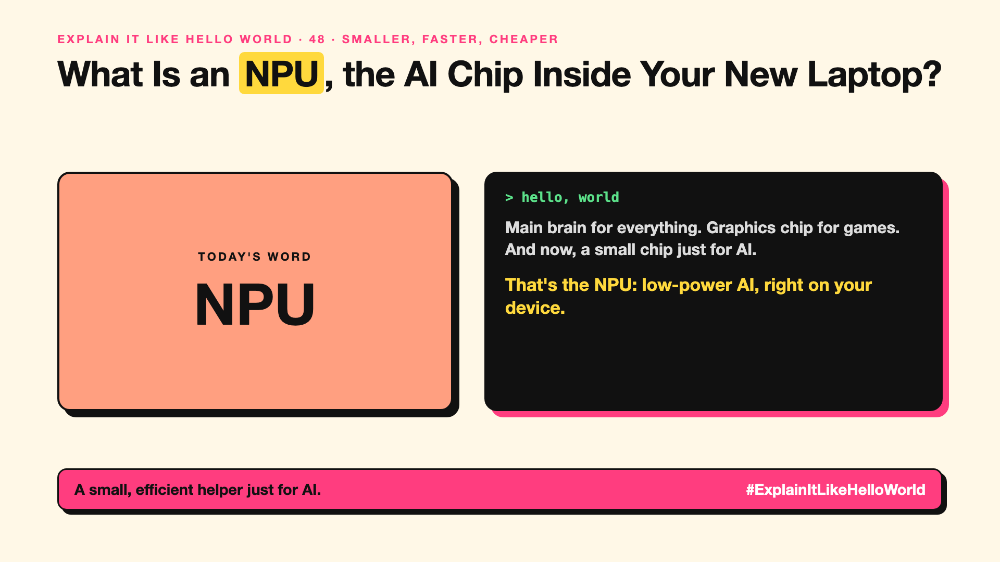

# 48. What Is an NPU, the AI Chip Inside Your New Laptop? | NPU



*Explain It Like Hello World series: NPU*

"AI PC." "Built-in NPU." New laptops and phones advertise a chip for AI. What does it do that the old ones didn't?

## The hello world

Your laptop has a main brain (CPU) for everything and a graphics chip for games. Now it also has a small, energy-saving helper for one kind of job: running AI features.

That's the hello world: an **NPU** (neural processing unit) is a low-power chip in your device built to run AI quickly without draining the battery.

## One step further

Running AI on the main chip is slow and drains power. An NPU handles the number-crunching of neural networks (write-up 5) efficiently, so features like background blur, live captions or on-device assistants (write-up 50) can run constantly.

NPUs are small compared with data-centre chips, so they run small models (write-up 49), not the biggest ones.

## Where you've already met it

"Copilot+ PC" and "AI PC" laptops, and phone chips with a "neural engine". Video-call background blur and live captions.

## The real name

The **NPU** (neural processing unit), sometimes called a **neural engine**.

- **NPU:** a power-efficient chip for running AI on devices.
- **TOPS:** trillions of operations per second, a common NPU speed figure.
- **On-device AI:** AI running locally (write-up 50).

## What it's not

An NPU won't run the largest AI models; those still need the cloud. And a big TOPS number doesn't guarantee useful features.

## Take this to your next meeting

1. Check which AI features actually use the NPU before paying extra.
2. Prefer devices where AI features work offline if privacy matters.
3. Don't buy on TOPS numbers alone.

A small, efficient helper just for AI.

Next write-up (49): **Can a Small Language Model Be Good Enough?**

Follow me for the next one. Does your laptop or phone have an NPU?

**Earlier in this series:**

1. AI words everyone uses. Nobody explains. (the curtain raiser post) *(link added when published)*
2. What Actually Counts as Artificial Intelligence? *(link added when published)*
3. How Does Machine Learning Learn Without Being Told the Rules? *(link added when published)*
4. What's "Deep" About Deep Learning? *(link added when published)*
5. Is a Neural Network Really Like a Brain? *(link added when published)*
6. What Makes Generative AI "Generative"? *(link added when published)*
7. Why Are They Called Foundation Models? *(link added when published)*
8. What Is AGI, and What Would Make AI "General"? *(link added when published)*
9. What Is Superintelligence, and Should We Worry? *(link added when published)*
10. What Are Tokens, and Why Does an AI Read in Pieces? *(link added when published)*
11. How Does an LLM Write a Sentence? *(link added when published)*
12. How Do Embeddings Know "King" Is Close to "Queen"? *(link added when published)*
13. How Does Attention Help an AI Know What "It" Means? *(link added when published)*
14. What Is a Transformer, the "T" in GPT? *(link added when published)*
15. What Is a Context Window, and Why Does an AI Forget? *(link added when published)*
16. Why Does Temperature Change the AI's Answer? *(link added when published)*
17. What Is a Prompt, and Why Does the Way You Ask Matter? *(link added when published)*
18. Is Prompt Engineering a Real Skill? *(link added when published)*
19. What's in a System Prompt, the Hidden Instruction Behind Every Chatbot? *(link added when published)*
20. What Is Zero-Shot, and Can an AI Do a Task It Was Never Shown? *(link added when published)*
21. Why Does Few-Shot Prompting Work So Well? *(link added when published)*
22. Why Does Chain of Thought ("Think Step by Step") Work? *(link added when published)*
23. Is Context Engineering the New Prompt Engineering? *(link added when published)*
24. How Does Structured Output Get an AI to Fill In a Form? *(link added when published)*
25. Why Does Streaming Make the AI Type Word by Word? *(link added when published)*
26. What Do Parameters, Like "70B", Actually Mean? *(link added when published)*
27. What Happens During Training, When an AI Goes to School? *(link added when published)*
28. What Is Inference, and What Happens When You Hit Send? *(link added when published)*
29. What Is Pretraining, and How Does an AI Learn Language? *(link added when published)*
30. What Is Fine-Tuning, and How Does an AI Learn Your Way? *(link added when published)*
31. What Is LoRA, and How Do You Customise an AI Cheaply? *(link added when published)*
32. What Is RLHF, and How Did the AI Learn to Be Polite? *(link added when published)*
33. What Is Constitutional AI, and Can an AI Follow Principles? *(link added when published)*
34. What Is Distillation, and How Does a Small AI Learn From a Big One? *(link added when published)*
35. What Is Synthetic Data, and Can an AI Learn From AI-Written Data? *(link added when published)*
36. What Is Data Labelling, and Who Teaches the AI What's Right? *(link added when published)*
37. What Is Overfitting, and Why Can an AI Ace the Practice Test and Fail? *(link added when published)*
38. What Are Scaling Laws, and Why Did Bigger AI Keep Getting Better? *(link added when published)*
39. Are Emergent Abilities Real, or Does Bigger AI Just Seem to Learn New Tricks? *(link added when published)*
40. What Is Model Collapse, and What Happens When AI Learns From AI? *(link added when published)*
41. What Is Quantization, and How Does a Giant AI Fit on a Laptop? *(link added when published)*
42. What Is a Mixture of Experts, and Why Doesn't the Whole AI Wake Up? *(link added when published)*
43. What Is a KV Cache, and Why Doesn't the AI Re-Read Everything? *(link added when published)*
44. How Does Prompt Caching Make Repeated Prompts Cheaper? *(link added when published)*
45. How Does Speculative Decoding Make a Big AI Faster? *(link added when published)*
46. Why Does AI Run on a GPU, a Gaming Chip? *(link added when published)*
47. What Is a TPU, and Why Did Google Build One? *(link added when published)*

**Previous series:**

- **Series 1, #JustAddRAG:** [start here](https://www.linkedin.com/pulse/why-does-just-add-rag-sound-like-2-weeks-take-6-months-arpit-jain-l4kkf/) or jump to [the grand finale](https://www.linkedin.com/pulse/15-so-should-you-really-just-add-rag-grand-finale-arpit-jain-ninmf/)
- **Series 2, Beyond Just RAG: From Answers to Actions:** [start here](https://www.linkedin.com/pulse/1-your-ai-can-answer-now-has-act-from-answers-actions-arpit-jain-po6lf/) or jump to [the finale](https://www.linkedin.com/pulse/8-so-should-your-ai-do-things-just-answer-finale-arpit-jain-x7cxf)

---

**Post text (copy and paste):**

```
Main brain for everything. Graphics chip for games.
And now, a small chip just for AI.

That's the NPU: low-power AI, right on your device.

It runs small models, not the giant ones.

Does your laptop or phone have an NPU?

#AI #GenAI #LearnAI #ExplainItLikeHelloWorld
```

**Series index (post as the first comment):**

```
Explain It Like Hello World

Start here: 1. AI words everyone uses. Nobody explains. [link]
Previous: 47. What Is a TPU, and Why Did Google Build One? [link]
You're here: 48. What Is an NPU, the AI Chip Inside Your New Laptop?
Next: 49. Can a Small Language Model Be Good Enough?

Full list: in the curtain raiser post.
```
