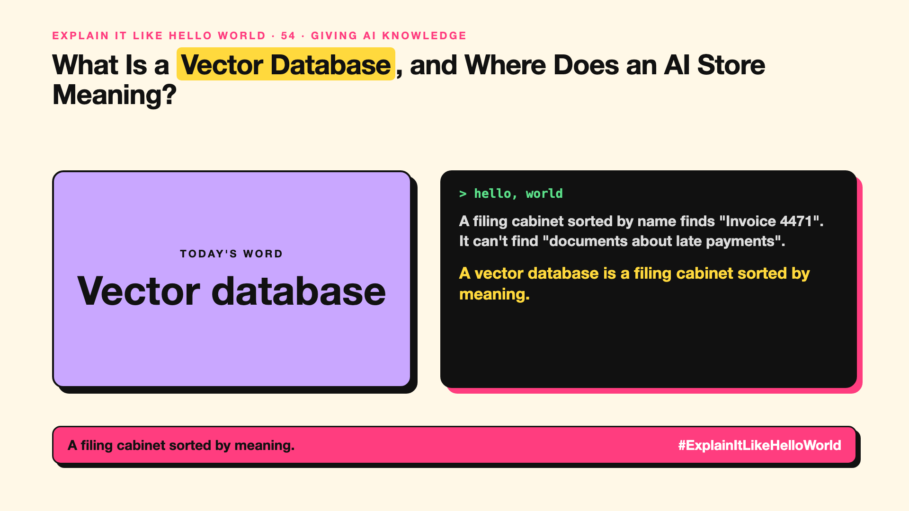

# 54. Where Does an AI Store Meaning? | Vector database



*Explain It Like Hello World series: Vector database*

"We need a vector database." Startups raised millions on it. It sounds like a maths warehouse.

## The hello world

A normal database is a filing cabinet sorted by name: find "Invoice 4471" instantly. But ask it for "documents about late payments" and it only finds exact words.

A vector database is a map of meaning (write-up 12). That's the hello world: it stores each piece of text as a point on that map, so you can find the points **closest in meaning** to your question.

## One step further

Every chunk of text is turned into an embedding, a long list of numbers, and stored. A question is turned into an embedding too. The database quickly finds the nearest points among millions, using clever shortcuts so it doesn't compare every single one.

It powers semantic search (write-up 55) and RAG (write-up 53). Many ordinary databases now add vector search too.

## Where you've already met it

Behind AI search in apps, "similar products" suggestions, and document chatbots.

## The real name

A **vector database**.

- **Vector:** a list of numbers representing meaning.
- **Nearest neighbour:** the closest stored point to your question.
- **Index:** the structure that makes searching fast.

## What it's not

A vector database doesn't understand or check facts. It finds similar-sounding text, which can be similar but wrong. And you may not need a separate one; your existing database might do vectors.

## Take this to your next meeting

1. Check if your current database already supports vector search.
2. Combine meaning search with keyword search for names and codes.
3. Test retrieval quality before blaming the AI.

A filing cabinet sorted by meaning.

Next write-up (55): **How Does Search Understand What You Meant?**

Follow me for the next one. Does your team really need a separate vector database?

**Earlier in this series:**

1. AI words everyone uses. Nobody explains. (the curtain raiser post) *(link added when published)*
2. What Actually Counts as AI? *(link added when published)*
3. How Does a Computer Learn Without Being Told the Rules? *(link added when published)*
4. What's "Deep" About Deep Learning? *(link added when published)*
5. Is a Neural Network Really Like a Brain? *(link added when published)*
6. What Makes AI "Generative"? *(link added when published)*
7. Why Are They Called Foundation Models? *(link added when published)*
8. What Would It Mean for AI to Be "General"? *(link added when published)*
9. What Is Superintelligence, and Should We Worry? *(link added when published)*
10. How Does an AI Read a Word? *(link added when published)*
11. How Does an AI Write a Sentence? *(link added when published)*
12. How Does an AI Know "King" Is Close to "Queen"? *(link added when published)*
13. How Does an AI Know What "It" Means? *(link added when published)*
14. What Is the "T" in GPT? *(link added when published)*
15. Why Does an AI Forget the Start of a Long Chat? *(link added when published)*
16. Why Does the Same Question Get Different Answers? *(link added when published)*
17. Why Does the Way You Ask Change the Answer? *(link added when published)*
18. Is Prompt Engineering a Real Skill? *(link added when published)*
19. What's the Hidden Instruction Behind Every Chatbot? *(link added when published)*
20. Can an AI Do a Task It Was Never Shown? *(link added when published)*
21. Why Do Examples Help an AI So Much? *(link added when published)*
22. Why Does "Think Step by Step" Work? *(link added when published)*
23. Is Context Engineering the New Prompt Engineering? *(link added when published)*
24. How Do You Get an AI to Fill In a Form? *(link added when published)*
25. Why Does the AI Type Its Answer Word by Word? *(link added when published)*
26. What Does "70B" Actually Mean? *(link added when published)*
27. How Does an AI Go to School? *(link added when published)*
28. What Happens When You Hit Send? *(link added when published)*
29. How Does an AI Learn Language in the First Place? *(link added when published)*
30. How Do You Teach an AI Your Way of Doing Things? *(link added when published)*
31. How Do You Customise an AI Without Retraining It? *(link added when published)*
32. How Did the AI Learn to Be Polite? *(link added when published)*
33. Can an AI Follow a Written Set of Principles? *(link added when published)*
34. How Does a Small AI Learn From a Big One? *(link added when published)*
35. Can an AI Learn From Data Another AI Wrote? *(link added when published)*
36. Who Teaches the AI What's Right? *(link added when published)*
37. Why Can an AI Ace the Practice Test and Fail the Real One? *(link added when published)*
38. Why Did Bigger AI Keep Getting Better? *(link added when published)*
39. Can Bigger AI Suddenly Learn New Tricks? *(link added when published)*
40. What Happens When AI Learns From AI? *(link added when published)*
41. How Do You Fit a Giant AI on a Laptop? *(link added when published)*
42. Why Doesn't the Whole AI Wake Up for Every Question? *(link added when published)*
43. Why Doesn't the AI Re-Read Everything for Every Word? *(link added when published)*
44. Why Do Repeated Prompts Get Cheaper? *(link added when published)*
45. How Can a Small AI Make a Big AI Faster? *(link added when published)*
46. Why Does AI Run on Gaming Chips? *(link added when published)*
47. What Is a TPU, and Why Did Google Build One? *(link added when published)*
48. What's the AI Chip Inside Your New Laptop? *(link added when published)*
49. Can a Small AI Be Good Enough? *(link added when published)*
50. Can an AI Live on Your Phone? *(link added when published)*
51. Why Does the AI Take So Long to Answer? *(link added when published)*
52. Why Does the First Word Matter Most? *(link added when published)*
53. How Does an AI Answer From Your Documents? *(link added when published)*

**Previous series:**

- **Series 1, #JustAddRAG:** [start here](https://www.linkedin.com/pulse/why-does-just-add-rag-sound-like-2-weeks-take-6-months-arpit-jain-l4kkf/) or jump to [the grand finale](https://www.linkedin.com/pulse/15-so-should-you-really-just-add-rag-grand-finale-arpit-jain-ninmf/)
- **Series 2, Beyond Just RAG: From Answers to Actions:** [start here](https://www.linkedin.com/pulse/1-your-ai-can-answer-now-has-act-from-answers-actions-arpit-jain-po6lf/) or jump to [the finale](https://www.linkedin.com/pulse/8-so-should-your-ai-do-things-just-answer-finale-arpit-jain-x7cxf)

---

**Post text (copy and paste):**

```
A filing cabinet sorted by name finds "Invoice 4471".
It can't find "documents about late payments".

A vector database is a filing cabinet sorted by meaning.

It finds what's closest in meaning, not in spelling.

Does your team really need a separate vector database?

#AI #GenAI #LearnAI #ExplainItLikeHelloWorld
```

**Series index (post as the first comment):**

```
Explain It Like Hello World

Start here: 1. AI words everyone uses. Nobody explains. [link]
Previous: 53. How Does an AI Answer From Your Documents? [link]
You're here: 54. Where Does an AI Store Meaning?
Next: 55. How Does Search Understand What You Meant?

Full list: in the curtain raiser post.
```
