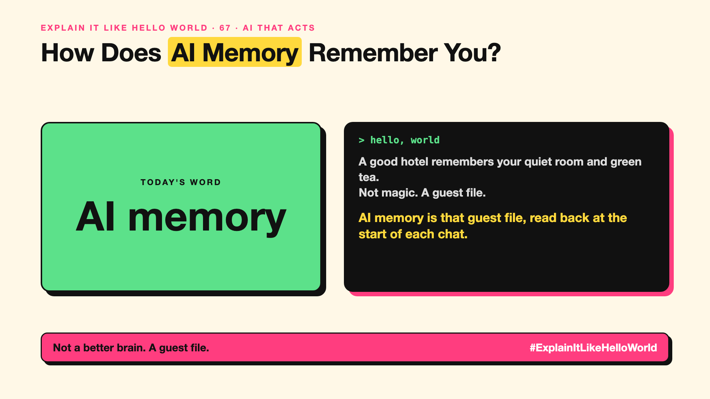

# 67. How Does AI Memory Remember You? | AI memory



*Explain It Like Hello World series: AI memory*

"Now with memory." Chat apps advertise that the AI remembers you. But write-up 28 said models don't learn from chats. So how?

## The hello world

A good hotel remembers you prefer a quiet room and green tea. The staff didn't change their brains; they wrote it in your guest file and check it when you arrive.

That's the hello world: **AI memory** saves useful facts about you outside the model and puts them back on its desk (write-up 15) in future chats.

## One step further

As you chat, the app picks out facts worth keeping ("vegetarian", "works in finance", "prefers short answers") and stores them. Next time, it fetches the relevant ones and adds them to the prompt. Some apps also keep summaries of past conversations.

The model itself is unchanged. Memory is a filing system around it, which means it can store wrong or outdated facts too.

## Where you've already met it

Chat apps that say "memory updated". Assistants that remember your name, preferences or ongoing projects.

## The real name

**AI memory**, also called **long-term memory** or **personalisation**.

- **Short-term memory:** the current chat on the AI's desk.
- **Long-term memory:** facts saved across chats.
- **Memory retrieval:** fetching the right saved facts when needed.

## What it's not

It isn't the AI learning or retraining. And it should be visible: good apps let you see, edit and delete what's remembered. (Series 12 covers memory pitfalls.)

## Take this to your next meeting

1. Check what your AI apps remember about you.
2. Delete outdated or sensitive memories.
3. For company assistants, decide what should never be remembered.

Not a better brain. A guest file.

Next write-up (68): **How Does Computer Use Let an AI Click Like You?**

Follow me for the next one. Do you know what your AI remembers about you?

**Earlier in this series:**

1. [AI words everyone uses. Nobody explains.](https://lnkd.in/p/d8abaPhq) (the curtain raiser post)
2. [What Actually Counts as Artificial Intelligence?](https://www.linkedin.com/pulse/2-what-actually-counts-artificial-intelligence-arpit-jain-su9lf)
3. [How Does Machine Learning Learn Without Being Told the Rules?](https://www.linkedin.com/pulse/3-how-does-machine-learning-learn-without-being-told-rules-arpit-jain-ppdyf)
4. [What's "Deep" About Deep Learning?](https://www.linkedin.com/pulse/4-whats-deep-learning-arpit-jain-rvlff)
5. Is a Neural Network Really Like a Brain? *(link added when published)*
6. What Makes Generative AI "Generative"? *(link added when published)*
7. Why Are They Called Foundation Models? *(link added when published)*
8. What Is AGI, and What Would Make AI "General"? *(link added when published)*
9. What Is Superintelligence, and Should We Worry? *(link added when published)*
10. What Are Tokens, and Why Does an AI Read in Pieces? *(link added when published)*
11. How Does an LLM Write a Sentence? *(link added when published)*
12. How Do Embeddings Know "King" Is Close to "Queen"? *(link added when published)*
13. How Does Attention Help an AI Know What "It" Means? *(link added when published)*
14. What Is a Transformer, the "T" in GPT? *(link added when published)*
15. What Is a Context Window, and Why Does an AI Forget? *(link added when published)*
16. Why Does Temperature Change the AI's Answer? *(link added when published)*
17. What Is a Prompt, and Why Does the Way You Ask Matter? *(link added when published)*
18. Is Prompt Engineering a Real Skill? *(link added when published)*
19. What's in a System Prompt, the Hidden Instruction Behind Every Chatbot? *(link added when published)*
20. What Is Zero-Shot, and Can an AI Do a Task It Was Never Shown? *(link added when published)*
21. Why Does Few-Shot Prompting Work So Well? *(link added when published)*
22. Why Does Chain of Thought ("Think Step by Step") Work? *(link added when published)*
23. Is Context Engineering the New Prompt Engineering? *(link added when published)*
24. How Does Structured Output Get an AI to Fill In a Form? *(link added when published)*
25. Why Does Streaming Make the AI Type Word by Word? *(link added when published)*
26. What Do Parameters, Like "70B", Actually Mean? *(link added when published)*
27. What Happens During Training, When an AI Goes to School? *(link added when published)*
28. What Is Inference, and What Happens When You Hit Send? *(link added when published)*
29. What Is Pretraining, and How Does an AI Learn Language? *(link added when published)*
30. What Is Fine-Tuning, and How Does an AI Learn Your Way? *(link added when published)*
31. What Is LoRA, and How Do You Customise an AI Cheaply? *(link added when published)*
32. What Is RLHF, and How Did the AI Learn to Be Polite? *(link added when published)*
33. What Is Constitutional AI, and Can an AI Follow Principles? *(link added when published)*
34. What Is Distillation, and How Does a Small AI Learn From a Big One? *(link added when published)*
35. What Is Synthetic Data, and Can an AI Learn From AI-Written Data? *(link added when published)*
36. What Is Data Labelling, and Who Teaches the AI What's Right? *(link added when published)*
37. What Is Overfitting, and Why Can an AI Ace the Practice Test and Fail? *(link added when published)*
38. What Are Scaling Laws, and Why Did Bigger AI Keep Getting Better? *(link added when published)*
39. Are Emergent Abilities Real, or Does Bigger AI Just Seem to Learn New Tricks? *(link added when published)*
40. What Is Model Collapse, and What Happens When AI Learns From AI? *(link added when published)*
41. What Is Quantization, and How Does a Giant AI Fit on a Laptop? *(link added when published)*
42. What Is a Mixture of Experts, and Why Doesn't the Whole AI Wake Up? *(link added when published)*
43. What Is a KV Cache, and Why Doesn't the AI Re-Read Everything? *(link added when published)*
44. How Does Prompt Caching Make Repeated Prompts Cheaper? *(link added when published)*
45. How Does Speculative Decoding Make a Big AI Faster? *(link added when published)*
46. Why Does AI Run on a GPU, a Gaming Chip? *(link added when published)*
47. What Is a TPU, and Why Did Google Build One? *(link added when published)*
48. What Is an NPU, the AI Chip Inside Your New Laptop? *(link added when published)*
49. Can a Small Language Model Be Good Enough? *(link added when published)*
50. What Is On-Device AI, and Can an AI Live on Your Phone? *(link added when published)*
51. What Is Latency, and Why Does the AI Take So Long to Answer? *(link added when published)*
52. What Is Time to First Token, and Why Does the First Word Matter Most? *(link added when published)*
53. What Is RAG, and How Does an AI Answer From Your Documents? *(link added when published)*
54. What Is a Vector Database, and Where Does an AI Store Meaning? *(link added when published)*
55. How Does Semantic Search Understand What You Meant? *(link added when published)*
56. What Is a Knowledge Graph, and Who Is Connected to Whom? *(link added when published)*
57. What Is GraphRAG, and How Does an AI Answer About a Whole Pile of Documents? *(link added when published)*
58. What Is Grounding, and How Do You Keep an AI Tied to the Facts? *(link added when published)*
59. How Do Citations Show Where an AI Got Its Answer? *(link added when published)*
60. Can Deep Research Do Your Research for You? *(link added when published)*
61. What Makes an AI Agent an "Agent"? *(link added when published)*
62. What Does "Agentic AI" Really Mean? *(link added when published)*
63. How Does Tool Calling Let an AI Check the Weather? *(link added when published)*
64. What Is MCP, and Why Is Everyone Talking About It? *(link added when published)*
65. What Is A2A, and How Do AI Agents Talk to Each Other? *(link added when published)*
66. Is a Multi-Agent System Better Than One AI Agent? *(link added when published)*

**Previous series:**

- **Series 1, #JustAddRAG:** [start here](https://www.linkedin.com/pulse/why-does-just-add-rag-sound-like-2-weeks-take-6-months-arpit-jain-l4kkf/) or jump to [the grand finale](https://www.linkedin.com/pulse/15-so-should-you-really-just-add-rag-grand-finale-arpit-jain-ninmf/)
- **Series 2, Beyond Just RAG: From Answers to Actions:** [start here](https://www.linkedin.com/pulse/1-your-ai-can-answer-now-has-act-from-answers-actions-arpit-jain-po6lf/) or jump to [the finale](https://www.linkedin.com/pulse/8-so-should-your-ai-do-things-just-answer-finale-arpit-jain-x7cxf)
- **Series 20, Today in AI** (ongoing): [start here](https://www.linkedin.com/pulse/today-ai-001-what-happens-when-your-agent-visits-someone-arpit-jain-2vqmf/) or read [the latest issue](https://www.linkedin.com/pulse/today-ai-011-text-to-speech-fits-your-phone-internet-needed-jain-1ipuf)

---

**Post text (copy and paste):**

```
A good hotel remembers your quiet room and green tea.
Not magic. A guest file.

AI memory is that guest file, read back at the start of each chat.

The model doesn't change. The file does.

Do you know what your AI remembers about you?

#AI #GenAI #LearnAI #ExplainItLikeHelloWorld
```

**Series index (post as the first comment):**

```
Explain It Like Hello World

Start here: AI words everyone uses. Nobody explains. https://lnkd.in/p/d8abaPhq
Previous: 66. Is a Multi-Agent System Better Than One AI Agent? [link]
You're here: 67. How Does AI Memory Remember You?
Next: 68. How Does Computer Use Let an AI Click Like You?

Full list: in the curtain raiser post.
```
