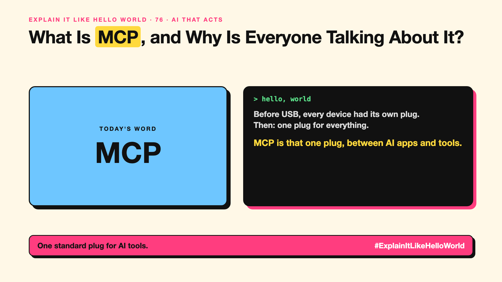

# 76. What Is MCP, and Why Is Everyone Talking About It? | MCP



*Explain It Like Hello World series: MCP*

"MCP." "Model Context Protocol." It went from unknown to everywhere in under a year. What problem does it solve?

## The hello world

Before USB, every printer, camera and keyboard had its own plug. Then USB: one standard plug for everything.

That's the hello world: **MCP** is a standard plug between AI apps and tools or data. Build a connector once, and any AI app that supports MCP can use it.

## One step further

Without MCP, every AI app needed its own custom code for every tool: Slack, Google Drive, a database. With MCP, a tool provider builds one MCP server, and any compatible AI app can connect to it and discover what it offers.

Anthropic introduced MCP in late 2024, and it's now supported widely across AI tools. It makes connecting easy; deciding what's safe to connect is still your job.

## Where you've already met it

AI apps and coding tools with a list of "connectors" or "MCP servers" you can switch on.

## The real name

**MCP**, the Model Context Protocol.

- **MCP server:** a connector that exposes a tool or data source.
- **MCP client:** the AI app that connects to servers.
- **Protocol:** an agreed way of talking.

## What it's not

MCP isn't a security system or an AI model. A connected tool can still leak data or take wrong actions. What MCP doesn't solve is the theme of my Series 11.

## Take this to your next meeting

1. Think of MCP as USB for AI tools.
2. Review third-party MCP servers before connecting them.
3. Give each connection only the access it needs.

One standard plug for AI tools.

Next write-up (77): **What Are Agent Skills, and Why Do Agents Need a Playbook?**

Follow me for the next one. Which tool would you plug into your AI first?

**Earlier in this series:**

1. [AI words everyone uses. Nobody explains.](https://lnkd.in/p/d8abaPhq) (the curtain raiser post)
2. [What Actually Counts as Artificial Intelligence?](https://www.linkedin.com/pulse/2-what-actually-counts-artificial-intelligence-arpit-jain-su9lf)
3. [How Does Machine Learning Learn Without Being Told the Rules?](https://www.linkedin.com/pulse/3-how-does-machine-learning-learn-without-being-told-rules-arpit-jain-ppdyf)
4. [What's "Deep" About Deep Learning?](https://www.linkedin.com/pulse/4-whats-deep-learning-arpit-jain-rvlff)
5. [Is a Neural Network Really Like a Brain?](https://www.linkedin.com/pulse/5-neural-network-really-like-brain-arpit-jain-jpigf)
6. What Makes Generative AI "Generative"? *(link added when published)*
7. Why Are They Called Foundation Models? *(link added when published)*
8. What Is a Frontier Model, and Who Decides? *(link added when published)*
9. What Is AGI, and What Would Make AI "General"? *(link added when published)*
10. What Is Superintelligence, and Should We Worry? *(link added when published)*
11. What Are Tokens, and Why Does an AI Read in Pieces? *(link added when published)*
12. How Does an LLM Write a Sentence? *(link added when published)*
13. How Do Embeddings Know "King" Is Close to "Queen"? *(link added when published)*
14. How Does Attention Help an AI Know What "It" Means? *(link added when published)*
15. What Is a Transformer, the "T" in GPT? *(link added when published)*
16. What Is a Context Window, and Why Does an AI Forget? *(link added when published)*
17. What's a Knowledge Cutoff, and Why Is the AI Behind on News? *(link added when published)*
18. What Is Context Rot, and Why Do Long Chats Get Worse? *(link added when published)*
19. Why Does Temperature Change the AI's Answer? *(link added when published)*
20. What Is a Prompt, and Why Does the Way You Ask Matter? *(link added when published)*
21. Is Prompt Engineering a Real Skill? *(link added when published)*
22. What's in a System Prompt, the Hidden Instruction Behind Every Chatbot? *(link added when published)*
23. What Is Zero-Shot, and Can an AI Do a Task It Was Never Shown? *(link added when published)*
24. Why Does Few-Shot Prompting Work So Well? *(link added when published)*
25. Why Does Chain of Thought ("Think Step by Step") Work? *(link added when published)*
26. What Is Reflection, and Why Does an AI Check Its Own Answer? *(link added when published)*
27. Is Context Engineering the New Prompt Engineering? *(link added when published)*
28. How Does Structured Output Get an AI to Fill In a Form? *(link added when published)*
29. Why Does Streaming Make the AI Type Word by Word? *(link added when published)*
30. What Do Parameters, Like "70B", Actually Mean? *(link added when published)*
31. What Happens During Training, When an AI Goes to School? *(link added when published)*
32. What's the Difference Between Supervised and Unsupervised Learning? *(link added when published)*
33. What Is Inference, and What Happens When You Hit Send? *(link added when published)*
34. What Is Pretraining, and How Does an AI Learn Language? *(link added when published)*
35. What Is Fine-Tuning, and How Does an AI Learn Your Way? *(link added when published)*
36. What Is LoRA, and How Do You Customise an AI Cheaply? *(link added when published)*
37. How Does Reinforcement Learning Teach AI by Trial and Error? *(link added when published)*
38. What Is RLHF, and How Did the AI Learn to Be Polite? *(link added when published)*
39. What Is Constitutional AI, and Can an AI Follow Principles? *(link added when published)*
40. What Is Distillation, and How Does a Small AI Learn From a Big One? *(link added when published)*
41. What Is Synthetic Data, and Can an AI Learn From AI-Written Data? *(link added when published)*
42. What Is Data Labelling, and Who Teaches the AI What's Right? *(link added when published)*
43. What Is Overfitting, and Why Can an AI Ace the Practice Test and Fail? *(link added when published)*
44. What Are Scaling Laws, and Why Did Bigger AI Keep Getting Better? *(link added when published)*
45. Are Emergent Abilities Real, or Does Bigger AI Just Seem to Learn New Tricks? *(link added when published)*
46. What Is Model Collapse, and What Happens When AI Learns From AI? *(link added when published)*
47. What Is Quantization, and How Does a Giant AI Fit on a Laptop? *(link added when published)*
48. What Is a Mixture of Experts, and Why Doesn't the Whole AI Wake Up? *(link added when published)*
49. What Is a KV Cache, and Why Doesn't the AI Re-Read Everything? *(link added when published)*
50. How Does Prompt Caching Make Repeated Prompts Cheaper? *(link added when published)*
51. How Does Speculative Decoding Make a Big AI Faster? *(link added when published)*
52. What Is Test-Time Compute, and Why Does Thinking Cost More? *(link added when published)*
53. Why Does AI Run on a GPU, a Gaming Chip? *(link added when published)*
54. What Is a TPU, and Why Did Google Build One? *(link added when published)*
55. What Is an NPU, the AI Chip Inside Your New Laptop? *(link added when published)*
56. Can a Small Language Model Be Good Enough? *(link added when published)*
57. What Is On-Device AI, and Can an AI Live on Your Phone? *(link added when published)*
58. What Is Latency, and Why Does the AI Take So Long to Answer? *(link added when published)*
59. What Is Time to First Token, and Why Does the First Word Matter Most? *(link added when published)*
60. What Is RAG, and How Does an AI Answer From Your Documents? *(link added when published)*
61. Why Does AI Cut Your Documents Into Chunks? *(link added when published)*
62. What Is a Vector Database, and Where Does an AI Store Meaning? *(link added when published)*
63. How Does Semantic Search Understand What You Meant? *(link added when published)*
64. What Is Reranking, and Why Does AI Search Look Twice? *(link added when published)*
65. What Is Hybrid Search, and Why Use Two Ways to Search? *(link added when published)*
66. What Is a Knowledge Graph, and Who Is Connected to Whom? *(link added when published)*
67. What Is GraphRAG, and How Does an AI Answer About a Whole Pile of Documents? *(link added when published)*
68. What Is Grounding, and How Do You Keep an AI Tied to the Facts? *(link added when published)*
69. How Do Citations Show Where an AI Got Its Answer? *(link added when published)*
70. Can Deep Research Do Your Research for You? *(link added when published)*
71. What Makes an AI Agent an "Agent"? *(link added when published)*
72. What Is an Agent Harness, and Why Does Every Agent Need One? *(link added when published)*
73. What Does "Agentic AI" Really Mean? *(link added when published)*
74. What Is Loop Engineering, and Why Is It the Next Step After Prompts? *(link added when published)*
75. How Does Tool Calling Let an AI Check the Weather? *(link added when published)*

**Previous series:**

- **Series 1, #JustAddRAG:** [start here](https://www.linkedin.com/pulse/why-does-just-add-rag-sound-like-2-weeks-take-6-months-arpit-jain-l4kkf/) or jump to [the grand finale](https://www.linkedin.com/pulse/15-so-should-you-really-just-add-rag-grand-finale-arpit-jain-ninmf/)
- **Series 2, Beyond Just RAG: From Answers to Actions:** [start here](https://www.linkedin.com/pulse/1-your-ai-can-answer-now-has-act-from-answers-actions-arpit-jain-po6lf/) or jump to [the finale](https://www.linkedin.com/pulse/8-so-should-your-ai-do-things-just-answer-finale-arpit-jain-x7cxf)
- **Series 20, Today in AI** (ongoing): [start here](https://www.linkedin.com/pulse/today-ai-001-what-happens-when-your-agent-visits-someone-arpit-jain-2vqmf/) or read [the latest issue](https://www.linkedin.com/pulse/today-ai-011-text-to-speech-fits-your-phone-internet-needed-jain-1ipuf)

---

**Post text (copy and paste):**

```
Before USB, every device had its own plug.
Then: one plug for everything.

MCP is that one plug, between AI apps and tools.

Connecting gets easy. Deciding what's safe is still yours.

Which tool would you plug into your AI first?

#AI #GenAI #LearnAI #ExplainItLikeHelloWorld
```

**Series index (post as the first comment):**

```
Explain It Like Hello World

Start here: AI words everyone uses. Nobody explains. https://lnkd.in/p/d8abaPhq
Previous: 75. How Does Tool Calling Let an AI Check the Weather? [link]
You're here: 76. What Is MCP, and Why Is Everyone Talking About It?
Next: 77. What Are Agent Skills, and Why Do Agents Need a Playbook?

Full list: in the curtain raiser post.
```
