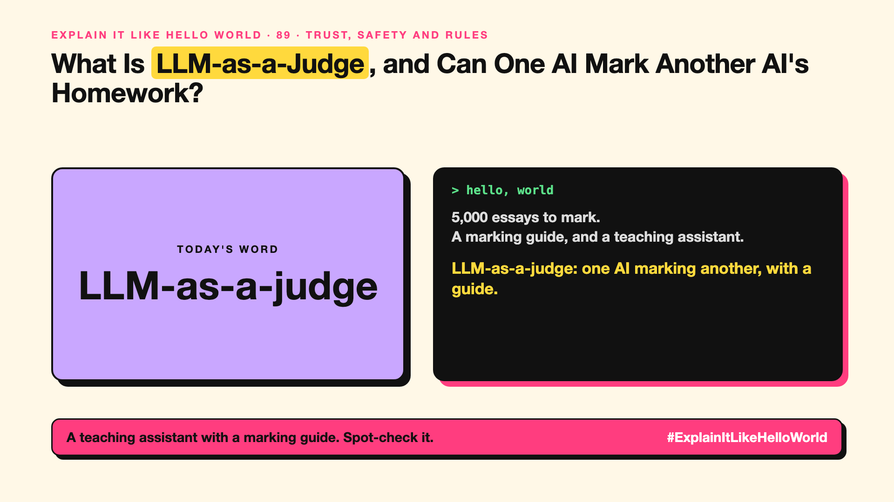

# 89. Can One AI Mark Another AI's Homework? | LLM-as-a-judge



*Explain It Like Hello World series: LLM-as-a-judge*

"LLM-as-a-judge." Teams use an AI to grade another AI's answers. It sounds circular.

## The hello world

A teacher has 5,000 essays to mark. Instead of marking every one, they write a clear marking guide and ask a teaching assistant to apply it, then spot-check the assistant.

That's the hello world: **LLM-as-a-judge** uses one AI, with a clear marking guide, to score another AI's answers at scale.

## One step further

Many answers can't be checked by exact match: summaries, explanations, tone. So a judge model gets the question, the answer, sometimes a reference answer, and a rubric ("is it accurate, complete, polite?") and gives a score.

Judges have biases: they may prefer longer answers, the first answer shown, or answers in their own style. So teams check the judge against human marks and swap answer order in comparisons.

## Where you've already met it

Behind most AI quality dashboards and many public leaderboards.

## The real name

**LLM-as-a-judge**.

- **Rubric:** the marking guide the judge follows.
- **Calibration:** checking the judge agrees with people.
- **Position bias:** favouring the first or second answer shown.

## What it's not

A judge AI isn't ground truth. It's a fast, imperfect marker that needs checking against human judgement regularly.

## Take this to your next meeting

1. Give the judge a clear rubric with examples.
2. Compare a sample of its scores with human scores.
3. Swap the order of answers when comparing two.

A teaching assistant with a marking guide. Spot-check it.

Next write-up (90): **How Does an AI End Up Unfair?**

Follow me for the next one. Would you trust an AI to grade your AI?

**Earlier in this series:**

1. AI words everyone uses. Nobody explains. (the curtain raiser post) *(link added when published)*
2. What Actually Counts as AI? *(link added when published)*
3. How Does a Computer Learn Without Being Told the Rules? *(link added when published)*
4. What's "Deep" About Deep Learning? *(link added when published)*
5. Is a Neural Network Really Like a Brain? *(link added when published)*
6. What Makes AI "Generative"? *(link added when published)*
7. Why Are They Called Foundation Models? *(link added when published)*
8. What Would It Mean for AI to Be "General"? *(link added when published)*
9. What Is Superintelligence, and Should We Worry? *(link added when published)*
10. How Does an AI Read a Word? *(link added when published)*
11. How Does an AI Write a Sentence? *(link added when published)*
12. How Does an AI Know "King" Is Close to "Queen"? *(link added when published)*
13. How Does an AI Know What "It" Means? *(link added when published)*
14. What Is the "T" in GPT? *(link added when published)*
15. Why Does an AI Forget the Start of a Long Chat? *(link added when published)*
16. Why Does the Same Question Get Different Answers? *(link added when published)*
17. Why Does the Way You Ask Change the Answer? *(link added when published)*
18. Is Prompt Engineering a Real Skill? *(link added when published)*
19. What's the Hidden Instruction Behind Every Chatbot? *(link added when published)*
20. Can an AI Do a Task It Was Never Shown? *(link added when published)*
21. Why Do Examples Help an AI So Much? *(link added when published)*
22. Why Does "Think Step by Step" Work? *(link added when published)*
23. Is Context Engineering the New Prompt Engineering? *(link added when published)*
24. How Do You Get an AI to Fill In a Form? *(link added when published)*
25. Why Does the AI Type Its Answer Word by Word? *(link added when published)*
26. What Does "70B" Actually Mean? *(link added when published)*
27. How Does an AI Go to School? *(link added when published)*
28. What Happens When You Hit Send? *(link added when published)*
29. How Does an AI Learn Language in the First Place? *(link added when published)*
30. How Do You Teach an AI Your Way of Doing Things? *(link added when published)*
31. How Do You Customise an AI Without Retraining It? *(link added when published)*
32. How Did the AI Learn to Be Polite? *(link added when published)*
33. Can an AI Follow a Written Set of Principles? *(link added when published)*
34. How Does a Small AI Learn From a Big One? *(link added when published)*
35. Can an AI Learn From Data Another AI Wrote? *(link added when published)*
36. Who Teaches the AI What's Right? *(link added when published)*
37. Why Can an AI Ace the Practice Test and Fail the Real One? *(link added when published)*
38. Why Did Bigger AI Keep Getting Better? *(link added when published)*
39. Can Bigger AI Suddenly Learn New Tricks? *(link added when published)*
40. What Happens When AI Learns From AI? *(link added when published)*
41. How Do You Fit a Giant AI on a Laptop? *(link added when published)*
42. Why Doesn't the Whole AI Wake Up for Every Question? *(link added when published)*
43. Why Doesn't the AI Re-Read Everything for Every Word? *(link added when published)*
44. Why Do Repeated Prompts Get Cheaper? *(link added when published)*
45. How Can a Small AI Make a Big AI Faster? *(link added when published)*
46. Why Does AI Run on Gaming Chips? *(link added when published)*
47. What Is a TPU, and Why Did Google Build One? *(link added when published)*
48. What's the AI Chip Inside Your New Laptop? *(link added when published)*
49. Can a Small AI Be Good Enough? *(link added when published)*
50. Can an AI Live on Your Phone? *(link added when published)*
51. Why Does the AI Take So Long to Answer? *(link added when published)*
52. Why Does the First Word Matter Most? *(link added when published)*
53. How Does an AI Answer From Your Documents? *(link added when published)*
54. Where Does an AI Store Meaning? *(link added when published)*
55. How Does Search Understand What You Meant? *(link added when published)*
56. How Do You Teach an AI Who Is Connected to Whom? *(link added when published)*
57. How Does an AI Answer Questions About a Whole Pile of Documents? *(link added when published)*
58. How Do You Keep an AI Tied to the Facts? *(link added when published)*
59. How Do You Check Where an AI Got Its Answer? *(link added when published)*
60. Can an AI Do Your Research for You? *(link added when published)*
61. What Makes an AI an "Agent"? *(link added when published)*
62. What Does "Agentic" Really Mean? *(link added when published)*
63. How Does an AI Check the Weather? *(link added when published)*
64. Why Is Everyone Talking About MCP? *(link added when published)*
65. How Do AI Agents Talk to Each Other? *(link added when published)*
66. Are Several AI Agents Better Than One? *(link added when published)*
67. How Does an AI Remember You? *(link added when published)*
68. How Does an AI Use a Computer Like You? *(link added when published)*
69. What's the Difference Between a Copilot and an Agent? *(link added when published)*
70. Where Should an AI Agent Do Its Work? *(link added when published)*
71. Why Does the AI Think Before It Answers Now? *(link added when published)*
72. How Can One AI Read, See and Listen? *(link added when published)*
73. How Does an AI Draw a Picture From Noise? *(link added when published)*
74. How Does an AI Talk Back Without a Pause? *(link added when published)*
75. How Does an AI Make a Video From a Sentence? *(link added when published)*
76. How Can a Video of Someone Be Fake? *(link added when published)*
77. Can an AI Copy Your Voice From a Few Seconds of Audio? *(link added when published)*
78. Who Is That Presenter, If Nobody Filmed Them? *(link added when published)*
79. What's a Digital Twin, and Why Do Factories Want One? *(link added when published)*
80. What Does "Open" Mean in Open AI Models? *(link added when published)*
81. Can an AI Imagine What Happens Next? *(link added when published)*
82. When Does AI Get a Body? *(link added when published)*
83. Why Does an AI Sound Sure When It's Wrong? *(link added when published)*
84. How Do You Stop an AI Saying the Wrong Thing? *(link added when published)*
85. How Do People Trick an AI Into Breaking Its Rules? *(link added when published)*
86. Can a Web Page Give Orders to Your AI? *(link added when published)*
87. Who Attacks an AI on Purpose? *(link added when published)*
88. How Do You Know an AI Is Getting Better? *(link added when published)*

**Previous series:**

- **Series 1, #JustAddRAG:** [start here](https://www.linkedin.com/pulse/why-does-just-add-rag-sound-like-2-weeks-take-6-months-arpit-jain-l4kkf/) or jump to [the grand finale](https://www.linkedin.com/pulse/15-so-should-you-really-just-add-rag-grand-finale-arpit-jain-ninmf/)
- **Series 2, Beyond Just RAG: From Answers to Actions:** [start here](https://www.linkedin.com/pulse/1-your-ai-can-answer-now-has-act-from-answers-actions-arpit-jain-po6lf/) or jump to [the finale](https://www.linkedin.com/pulse/8-so-should-your-ai-do-things-just-answer-finale-arpit-jain-x7cxf)

---

**Post text (copy and paste):**

```
5,000 essays to mark.
A marking guide, and a teaching assistant.

LLM-as-a-judge: one AI marking another, with a guide.

Fast. Still spot-check the marker.

Would you trust an AI to grade your AI?

#AI #GenAI #LearnAI #ExplainItLikeHelloWorld
```

**Series index (post as the first comment):**

```
Explain It Like Hello World

Start here: 1. AI words everyone uses. Nobody explains. [link]
Previous: 88. How Do You Know an AI Is Getting Better? [link]
You're here: 89. Can One AI Mark Another AI's Homework?
Next: 90. How Does an AI End Up Unfair?

Full list: in the curtain raiser post.
```
