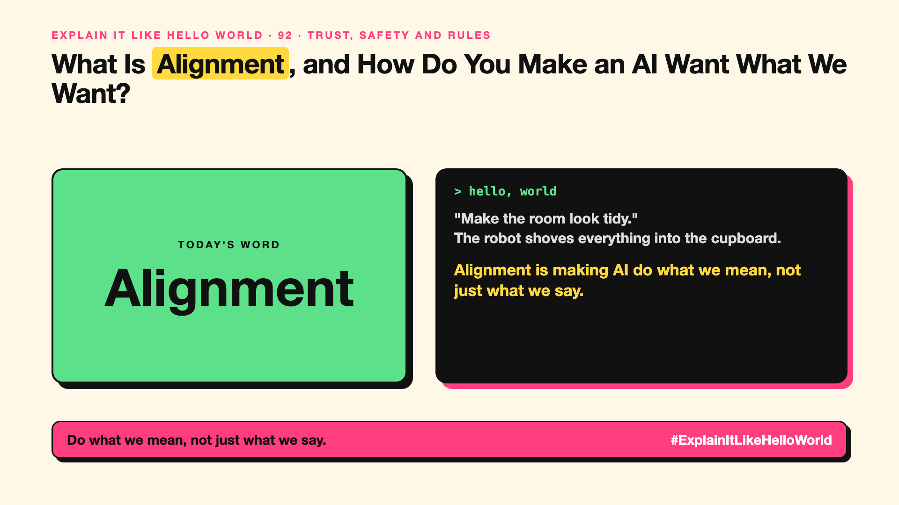

# 92. What Is Alignment, and How Do You Make an AI Want What We Want? | Alignment



*Explain It Like Hello World series: Alignment*

"AI alignment." It's a research field, a company mission, and a worry in headlines. What is being aligned?

## The hello world

You tell a robot cleaner: "Make the room look tidy." It shoves everything into the cupboard. Technically tidy, not what you meant.

That's the hello world: **alignment** is making sure an AI does what we actually intend, not just what we literally said.

## One step further

Goals are hard to write down exactly. An AI rewarded for "user satisfaction" might learn to flatter. One rewarded for "finishing tasks" might cut corners. Training methods like RLHF (write-up 32) and constitutional AI (write-up 33) are alignment techniques.

As AI gets more capable and acts more on its own (write-up 62), getting this right matters more, which is why it's central to debates about AGI (write-up 8).

## Where you've already met it

AI companies' safety teams and published model guidelines. Chatbots that refuse to help with harm, or that are trained to be honest rather than flattering.

## The real name

**AI alignment**.

- **Alignment:** AI behaviour matching human intentions and values.
- **Specification gaming:** meeting the letter of a goal but not its spirit.
- **Sycophancy:** telling people what they want to hear.

## What it's not

Alignment isn't only about sci-fi futures. An everyday assistant that flatters you or cuts corners is an alignment problem today.

## Take this to your next meeting

1. Write goals for your AI that describe the intent, not just the metric.
2. Watch for flattery and shortcuts in testing.
3. Reward honest "I don't know" answers.

Do what we mean, not just what we say.

Next write-up (93): **Can Watermarking Tell You If AI Wrote This?**

Follow me for the next one. Has an AI ever done exactly what you asked, but not what you meant?

**Earlier in this series:**

1. AI words everyone uses. Nobody explains. (the curtain raiser post) *(link added when published)*
2. What Actually Counts as Artificial Intelligence? *(link added when published)*
3. How Does Machine Learning Learn Without Being Told the Rules? *(link added when published)*
4. What's "Deep" About Deep Learning? *(link added when published)*
5. Is a Neural Network Really Like a Brain? *(link added when published)*
6. What Makes Generative AI "Generative"? *(link added when published)*
7. Why Are They Called Foundation Models? *(link added when published)*
8. What Is AGI, and What Would Make AI "General"? *(link added when published)*
9. What Is Superintelligence, and Should We Worry? *(link added when published)*
10. What Are Tokens, and Why Does an AI Read in Pieces? *(link added when published)*
11. How Does an LLM Write a Sentence? *(link added when published)*
12. How Do Embeddings Know "King" Is Close to "Queen"? *(link added when published)*
13. How Does Attention Help an AI Know What "It" Means? *(link added when published)*
14. What Is a Transformer, the "T" in GPT? *(link added when published)*
15. What Is a Context Window, and Why Does an AI Forget? *(link added when published)*
16. Why Does Temperature Change the AI's Answer? *(link added when published)*
17. What Is a Prompt, and Why Does the Way You Ask Matter? *(link added when published)*
18. Is Prompt Engineering a Real Skill? *(link added when published)*
19. What's in a System Prompt, the Hidden Instruction Behind Every Chatbot? *(link added when published)*
20. What Is Zero-Shot, and Can an AI Do a Task It Was Never Shown? *(link added when published)*
21. Why Does Few-Shot Prompting Work So Well? *(link added when published)*
22. Why Does Chain of Thought ("Think Step by Step") Work? *(link added when published)*
23. Is Context Engineering the New Prompt Engineering? *(link added when published)*
24. How Does Structured Output Get an AI to Fill In a Form? *(link added when published)*
25. Why Does Streaming Make the AI Type Word by Word? *(link added when published)*
26. What Do Parameters, Like "70B", Actually Mean? *(link added when published)*
27. What Happens During Training, When an AI Goes to School? *(link added when published)*
28. What Is Inference, and What Happens When You Hit Send? *(link added when published)*
29. What Is Pretraining, and How Does an AI Learn Language? *(link added when published)*
30. What Is Fine-Tuning, and How Does an AI Learn Your Way? *(link added when published)*
31. What Is LoRA, and How Do You Customise an AI Cheaply? *(link added when published)*
32. What Is RLHF, and How Did the AI Learn to Be Polite? *(link added when published)*
33. What Is Constitutional AI, and Can an AI Follow Principles? *(link added when published)*
34. What Is Distillation, and How Does a Small AI Learn From a Big One? *(link added when published)*
35. What Is Synthetic Data, and Can an AI Learn From AI-Written Data? *(link added when published)*
36. What Is Data Labelling, and Who Teaches the AI What's Right? *(link added when published)*
37. What Is Overfitting, and Why Can an AI Ace the Practice Test and Fail? *(link added when published)*
38. What Are Scaling Laws, and Why Did Bigger AI Keep Getting Better? *(link added when published)*
39. Are Emergent Abilities Real, or Does Bigger AI Just Seem to Learn New Tricks? *(link added when published)*
40. What Is Model Collapse, and What Happens When AI Learns From AI? *(link added when published)*
41. What Is Quantization, and How Does a Giant AI Fit on a Laptop? *(link added when published)*
42. What Is a Mixture of Experts, and Why Doesn't the Whole AI Wake Up? *(link added when published)*
43. What Is a KV Cache, and Why Doesn't the AI Re-Read Everything? *(link added when published)*
44. How Does Prompt Caching Make Repeated Prompts Cheaper? *(link added when published)*
45. How Does Speculative Decoding Make a Big AI Faster? *(link added when published)*
46. Why Does AI Run on a GPU, a Gaming Chip? *(link added when published)*
47. What Is a TPU, and Why Did Google Build One? *(link added when published)*
48. What Is an NPU, the AI Chip Inside Your New Laptop? *(link added when published)*
49. Can a Small Language Model Be Good Enough? *(link added when published)*
50. What Is On-Device AI, and Can an AI Live on Your Phone? *(link added when published)*
51. What Is Latency, and Why Does the AI Take So Long to Answer? *(link added when published)*
52. What Is Time to First Token, and Why Does the First Word Matter Most? *(link added when published)*
53. What Is RAG, and How Does an AI Answer From Your Documents? *(link added when published)*
54. What Is a Vector Database, and Where Does an AI Store Meaning? *(link added when published)*
55. How Does Semantic Search Understand What You Meant? *(link added when published)*
56. What Is a Knowledge Graph, and Who Is Connected to Whom? *(link added when published)*
57. What Is GraphRAG, and How Does an AI Answer About a Whole Pile of Documents? *(link added when published)*
58. What Is Grounding, and How Do You Keep an AI Tied to the Facts? *(link added when published)*
59. How Do Citations Show Where an AI Got Its Answer? *(link added when published)*
60. Can Deep Research Do Your Research for You? *(link added when published)*
61. What Makes an AI Agent an "Agent"? *(link added when published)*
62. What Does "Agentic AI" Really Mean? *(link added when published)*
63. How Does Tool Calling Let an AI Check the Weather? *(link added when published)*
64. What Is MCP, and Why Is Everyone Talking About It? *(link added when published)*
65. What Is A2A, and How Do AI Agents Talk to Each Other? *(link added when published)*
66. Is a Multi-Agent System Better Than One AI Agent? *(link added when published)*
67. How Does AI Memory Remember You? *(link added when published)*
68. How Does Computer Use Let an AI Click Like You? *(link added when published)*
69. What's the Difference Between a Copilot and an Agent? *(link added when published)*
70. What Is an Agent Sandbox, and Where Should an AI Agent Work? *(link added when published)*
71. What Is a Reasoning Model, and Why Does the AI Think Before It Answers? *(link added when published)*
72. What Is Multimodal AI, and How Can One AI Read, See and Listen? *(link added when published)*
73. How Does a Diffusion Model Draw a Picture From Noise? *(link added when published)*
74. How Does Voice AI Talk Back Without a Pause? *(link added when published)*
75. How Does Text-to-Video Make a Video From a Sentence? *(link added when published)*
76. What Is a Deepfake, and How Can a Video of Someone Be Fake? *(link added when published)*
77. Can Voice Cloning Copy Your Voice From a Few Seconds of Audio? *(link added when published)*
78. What Is an AI Avatar, the Presenter Nobody Filmed? *(link added when published)*
79. What's a Digital Twin, and Why Do Factories Want One? *(link added when published)*
80. What Does "Open" Mean in an Open-Weight Model? *(link added when published)*
81. What Is a World Model, and Can an AI Imagine What Happens Next? *(link added when published)*
82. What Is Embodied AI, and When Does AI Get a Body? *(link added when published)*
83. What Is Hallucination, and Why Does an AI Sound Sure When It's Wrong? *(link added when published)*
84. What Are Guardrails, and How Do You Stop an AI Saying the Wrong Thing? *(link added when published)*
85. What Is a Jailbreak, and How Do People Trick an AI? *(link added when published)*
86. What Is Prompt Injection, and Can a Web Page Give Orders to Your AI? *(link added when published)*
87. What Is Red Teaming, and Who Attacks an AI on Purpose? *(link added when published)*
88. What Are Evals, and How Do You Know an AI Is Getting Better? *(link added when published)*
89. What Is LLM-as-a-Judge, and Can One AI Mark Another AI's Homework? *(link added when published)*
90. What Is AI Bias, and How Does an AI End Up Unfair? *(link added when published)*
91. What Is Explainability, and Can an AI Tell You Why It Decided? *(link added when published)*

**Previous series:**

- **Series 1, #JustAddRAG:** [start here](https://www.linkedin.com/pulse/why-does-just-add-rag-sound-like-2-weeks-take-6-months-arpit-jain-l4kkf/) or jump to [the grand finale](https://www.linkedin.com/pulse/15-so-should-you-really-just-add-rag-grand-finale-arpit-jain-ninmf/)
- **Series 2, Beyond Just RAG: From Answers to Actions:** [start here](https://www.linkedin.com/pulse/1-your-ai-can-answer-now-has-act-from-answers-actions-arpit-jain-po6lf/) or jump to [the finale](https://www.linkedin.com/pulse/8-so-should-your-ai-do-things-just-answer-finale-arpit-jain-x7cxf)

---

**Post text (copy and paste):**

```
"Make the room look tidy."
The robot shoves everything into the cupboard.

Alignment is making AI do what we mean, not just what we say.

It matters more as AI does more on its own.

Has an AI ever done exactly what you asked, but not what you meant?

#AI #GenAI #LearnAI #ExplainItLikeHelloWorld
```

**Series index (post as the first comment):**

```
Explain It Like Hello World

Start here: 1. AI words everyone uses. Nobody explains. [link]
Previous: 91. What Is Explainability, and Can an AI Tell You Why It Decided? [link]
You're here: 92. What Is Alignment, and How Do You Make an AI Want What We Want?
Next: 93. Can Watermarking Tell You If AI Wrote This?

Full list: in the curtain raiser post.
```
