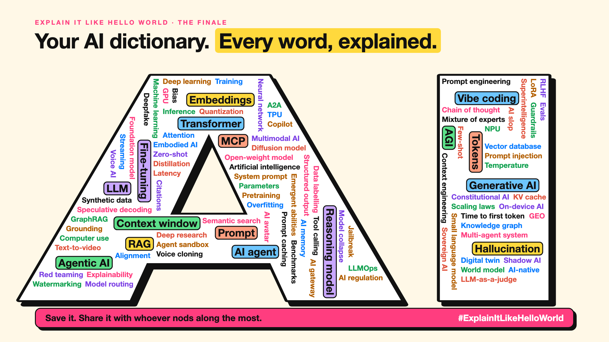

# 105. Your AI Dictionary, One Line per Word | The Finale



*Explain It Like Hello World series: the finale*

Remember the meeting from the curtain raiser? "We'll use a quantized mixture-of-experts model with a bigger context window."

Now you can explain every word in it. Quantized: the same photo saved as a smaller file. Mixture of experts: a hospital where you only see the specialists you need. Context window: the AI's desk.

That was the whole idea of this series: every AI word has a hello world, a tiny example that makes it click. Here are all 103, one line each.

## Your AI dictionary

**The basics**

- **Artificial intelligence** (2): AI is a computer doing something we'd say needs human intelligence.
- **Machine learning** (3): Machine learning learns the patterns from examples instead.
- **Deep learning** (4): Deep learning learns in layers, just like that.
- **Neural network** (5): A neural network is billions of tiny voters adding up numbers.
- **Generative AI** (6): Generative AI makes new things instead of just labelling old ones.
- **Foundation model** (7): A foundation model is one big base that many AI products are built on.
- **AGI** (8): AGI means one AI that can learn most tasks a person can.
- **Superintelligence** (9): Superintelligence means AI smarter than the best humans in almost every field.

**How an AI reads and writes**

- **Tokens** (10): An AI doesn't read words. It reads pieces, called tokens.
- **LLM** (11): An AI writes by guessing the next word, again and again.
- **Embeddings** (12): An embedding is a word's address on a map of meaning.
- **Attention** (13): You glanced back at the other words. So does an AI. That's attention.
- **Transformer** (14): A transformer lays the whole sentence out and reads it all at once.
- **Context window** (15): An AI's context window is its desk. When it's full, something falls off.
- **Temperature** (16): Temperature is how adventurous the AI's next word is.

**Talking to an AI**

- **Prompt** (17): A prompt is your brief to the AI. Vague brief, vague answer.
- **Prompt engineering** (18): Prompt engineering is the second person.
- **System prompt** (19): A system prompt is that briefing, given to the AI before you type.
- **Zero-shot** (20): The AI answers "negative" anyway. That's zero-shot.
- **Few-shot** (21): The AI answers GRN-TRS. That's few-shot: show a few examples, it copies the pattern.
- **Chain of thought** (22): Writing the steps first helps an AI too. That's chain of thought.
- **Context engineering** (23): Context engineering is choosing what goes on the AI's desk.
- **Structured output** (24): Structured output makes the AI fill in boxes instead of writing paragraphs.
- **Streaming** (25): Streaming serves each word of the answer as soon as it's ready.

**How an AI is made**

- **Parameters** (26): 70B means 70 billion tiny knobs, each tuned during training.
- **Training** (27): Training is an AI doing that billions of times.
- **Inference** (28): That's inference: a frozen model answering. It isn't learning mid-exam.
- **Pretraining** (29): Pretraining is the AI's general schooling, before any specialist course.
- **Fine-tuning** (30): Fine-tuning teaches a general AI your menu.
- **LoRA** (31): LoRA is that recipe card: a small, swappable add-on to an AI.
- **RLHF** (32): Thumbs up, thumbs down, thousands of times. That's how AIs learned to answer.
- **Constitutional AI** (33): Constitutional AI teaches a model to check its own answers against written principles.
- **Distillation** (34): What if the big one taught the small one? That's distillation.
- **Synthetic data** (35): So an AI writes them, and another AI learns from them. That's synthetic data.
- **Data labelling** (36): Data labelling: people marking the right answers so AI can learn.
- **Overfitting** (37): That's overfitting: memorising examples instead of learning the pattern.
- **Scaling laws** (38): AI improved the same way. Researchers call it scaling laws.
- **Emergent abilities** (39): Emergent abilities: skills that seem to appear once an AI is big enough.
- **Model collapse** (40): Model collapse is AI learning from AI, and fading the same way.

**Smaller, faster, cheaper**

- **Quantization** (41): Quantization is saving the same photo as a smaller file.
- **Mixture of experts** (42): A mixture of experts sends each word to only a few specialists.
- **KV cache** (43): Neither does an AI. It keeps notes, called the KV cache.
- **Prompt caching** (44): Prompt caching reads it once and reuses the notes.
- **Speculative decoding** (45): That's speculative decoding: guess ahead, check in one go.
- **GPU** (46): AI picks the students. That's why it runs on GPUs.
- **TPU** (47): A TPU is Google's bread knife for AI maths.
- **NPU** (48): That's the NPU: low-power AI, right on your device.
- **Small language model** (49): A small language model is the pocket dictionary.
- **On-device AI** (50): That's on-device AI: answers without the call.
- **Latency** (51): That wait is latency: every step between asking and answering.
- **Time to first token** (52): Time to first token is the AI's bread basket.

**Giving AI knowledge**

- **RAG** (53): RAG is an AI doing an open-book exam on your documents.
- **Vector database** (54): A vector database is a filing cabinet sorted by meaning.
- **Semantic search** (55): Semantic search finds results by meaning, not just matching words.
- **Knowledge graph** (56): A knowledge graph stores facts as things and the links between them.
- **GraphRAG** (57): GraphRAG maps everything first, then answers from the map.
- **Grounding** (58): Grounding makes the AI the second student.
- **Citations** (59): Citations give every AI answer a receipt.
- **Deep research** (60): Deep research is an AI doing that whole loop on its own.

**AI that acts**

- **AI agent** (61): A chatbot is the librarian. An AI agent is the assistant who gets it done.
- **Agentic AI** (62): Agentic is how far along that scale an AI system sits.
- **Tool calling** (63): So it asks your app to run a weather tool. That's tool calling.
- **MCP** (64): MCP is that one plug, between AI apps and tools.
- **A2A** (65): A2A is how AI agents swap business cards and hand over tasks.
- **Multi-agent system** (66): A multi-agent system is that team, made of AI agents.
- **AI memory** (67): AI memory is that guest file, read back at the start of each chat.
- **Computer use** (68): Look, decide, click, look again. That's computer use.
- **Copilot** (69): An AI copilot suggests. You decide. An agent acts.
- **Agent sandbox** (70): An agent sandbox is that tray, for AI agents running code.

**New kinds of AI**

- **Reasoning model** (71): Most people blurt ₹10. Thinking step by step gets ₹5. Reasoning models do the same.
- **Multimodal AI** (72): One AI that reads, sees and listens. That's multimodal.
- **Diffusion model** (73): Now run it backwards. That's how AI draws: diffusion.
- **Voice AI** (74): New voice AI hears, thinks and speaks in one breath.
- **Text-to-video** (75): Text-to-video AI draws that flipbook from a single sentence.
- **Deepfake** (76): It might not be your CFO. That's a deepfake.
- **Voice cloning** (77): A few seconds of audio can be enough to clone a voice.
- **AI avatar** (78): That's an AI avatar: a presenter who was never filmed for this video.
- **Digital twin** (79): A digital twin is a live copy you can safely experiment on.
- **Open-weight model** (80): That's the difference between closed and open-weight AI models.
- **World model** (81): A world model is an AI that imagines what happens next.
- **Embodied AI** (82): Embodied AI is AI with a body, learning the hard part.

**Trust, safety and rules**

- **Hallucination** (83): An AI guesses likely words. Likely isn't always true. That's a hallucination.
- **Guardrails** (84): AI guardrails are checks on what goes in and what comes out.
- **Jailbreak** (85): A jailbreak is clever wording that talks an AI out of its rules.
- **Prompt injection** (86): That's prompt injection: orders hidden in what the AI reads.
- **Red teaming** (87): Red teaming is attacking your own AI before anyone else does.
- **Evals** (88): Evals are that list, for AI.
- **LLM-as-a-judge** (89): LLM-as-a-judge: one AI marking another, with a guide.
- **Bias** (90): So the AI picks men too. That's AI bias.
- **Explainability** (91): Explainability is being able to say why, in plain words.
- **Alignment** (92): Alignment is making AI do what we mean, not just what we say.
- **Watermarking** (93): AI watermarks work the same way: invisible, until you check.
- **AI regulation** (94): AI regulation works the same way: rules by level of risk.
- **Shadow AI** (95): That's shadow AI: AI use nobody approved or knows about.
- **Sovereign AI** (96): Sovereign AI is the same idea, for AI models, data and computing.

**Reading the headlines**

- **Benchmarks** (97): A benchmark is a school exam for AI. Your work is a different exam.
- **Vibe coding** (98): Describe it, test it, ask for changes. That's vibe coding.
- **AI slop** (99): That's AI slop: content made cheaply, for clicks, not for you.
- **GEO** (100): GEO is making sure that answer can find and quote you.
- **AI-native** (101): AI-native means built around AI from the start, not AI added later.
- **LLMOps** (102): LLMOps is running the AI restaurant every day.
- **AI gateway** (103): An AI gateway is that reception desk, for every AI request.
- **Model routing** (104): Model routing sends each AI question to the right-sized model.

## How to learn the next AI word

1. Find the smallest example that shows it working.
2. Add one step to get to the real thing.
3. Find it in a product you already use.
4. Only then learn the technical name.

## Take this to your next meeting

1. Save this list. Share it with whoever nods along the most.
2. When a new AI word appears, ask for its hello world.
3. Send me the words this series missed. They might start the next season.

The words sound hard. The ideas never were.

Thank you for reading, commenting and sharing along the way.

Which word finally clicked for you?

**Earlier in this series:**

1. AI words everyone uses. Nobody explains. (the curtain raiser post) *(link added when published)*
2. What Actually Counts as AI? *(link added when published)*
3. How Does a Computer Learn Without Being Told the Rules? *(link added when published)*
4. What's "Deep" About Deep Learning? *(link added when published)*
5. Is a Neural Network Really Like a Brain? *(link added when published)*
6. What Makes AI "Generative"? *(link added when published)*
7. Why Are They Called Foundation Models? *(link added when published)*
8. What Would It Mean for AI to Be "General"? *(link added when published)*
9. What Is Superintelligence, and Should We Worry? *(link added when published)*
10. How Does an AI Read a Word? *(link added when published)*
11. How Does an AI Write a Sentence? *(link added when published)*
12. How Does an AI Know "King" Is Close to "Queen"? *(link added when published)*
13. How Does an AI Know What "It" Means? *(link added when published)*
14. What Is the "T" in GPT? *(link added when published)*
15. Why Does an AI Forget the Start of a Long Chat? *(link added when published)*
16. Why Does the Same Question Get Different Answers? *(link added when published)*
17. Why Does the Way You Ask Change the Answer? *(link added when published)*
18. Is Prompt Engineering a Real Skill? *(link added when published)*
19. What's the Hidden Instruction Behind Every Chatbot? *(link added when published)*
20. Can an AI Do a Task It Was Never Shown? *(link added when published)*
21. Why Do Examples Help an AI So Much? *(link added when published)*
22. Why Does "Think Step by Step" Work? *(link added when published)*
23. Is Context Engineering the New Prompt Engineering? *(link added when published)*
24. How Do You Get an AI to Fill In a Form? *(link added when published)*
25. Why Does the AI Type Its Answer Word by Word? *(link added when published)*
26. What Does "70B" Actually Mean? *(link added when published)*
27. How Does an AI Go to School? *(link added when published)*
28. What Happens When You Hit Send? *(link added when published)*
29. How Does an AI Learn Language in the First Place? *(link added when published)*
30. How Do You Teach an AI Your Way of Doing Things? *(link added when published)*
31. How Do You Customise an AI Without Retraining It? *(link added when published)*
32. How Did the AI Learn to Be Polite? *(link added when published)*
33. Can an AI Follow a Written Set of Principles? *(link added when published)*
34. How Does a Small AI Learn From a Big One? *(link added when published)*
35. Can an AI Learn From Data Another AI Wrote? *(link added when published)*
36. Who Teaches the AI What's Right? *(link added when published)*
37. Why Can an AI Ace the Practice Test and Fail the Real One? *(link added when published)*
38. Why Did Bigger AI Keep Getting Better? *(link added when published)*
39. Can Bigger AI Suddenly Learn New Tricks? *(link added when published)*
40. What Happens When AI Learns From AI? *(link added when published)*
41. How Do You Fit a Giant AI on a Laptop? *(link added when published)*
42. Why Doesn't the Whole AI Wake Up for Every Question? *(link added when published)*
43. Why Doesn't the AI Re-Read Everything for Every Word? *(link added when published)*
44. Why Do Repeated Prompts Get Cheaper? *(link added when published)*
45. How Can a Small AI Make a Big AI Faster? *(link added when published)*
46. Why Does AI Run on Gaming Chips? *(link added when published)*
47. What Is a TPU, and Why Did Google Build One? *(link added when published)*
48. What's the AI Chip Inside Your New Laptop? *(link added when published)*
49. Can a Small AI Be Good Enough? *(link added when published)*
50. Can an AI Live on Your Phone? *(link added when published)*
51. Why Does the AI Take So Long to Answer? *(link added when published)*
52. Why Does the First Word Matter Most? *(link added when published)*
53. How Does an AI Answer From Your Documents? *(link added when published)*
54. Where Does an AI Store Meaning? *(link added when published)*
55. How Does Search Understand What You Meant? *(link added when published)*
56. How Do You Teach an AI Who Is Connected to Whom? *(link added when published)*
57. How Does an AI Answer Questions About a Whole Pile of Documents? *(link added when published)*
58. How Do You Keep an AI Tied to the Facts? *(link added when published)*
59. How Do You Check Where an AI Got Its Answer? *(link added when published)*
60. Can an AI Do Your Research for You? *(link added when published)*
61. What Makes an AI an "Agent"? *(link added when published)*
62. What Does "Agentic" Really Mean? *(link added when published)*
63. How Does an AI Check the Weather? *(link added when published)*
64. Why Is Everyone Talking About MCP? *(link added when published)*
65. How Do AI Agents Talk to Each Other? *(link added when published)*
66. Are Several AI Agents Better Than One? *(link added when published)*
67. How Does an AI Remember You? *(link added when published)*
68. How Does an AI Use a Computer Like You? *(link added when published)*
69. What's the Difference Between a Copilot and an Agent? *(link added when published)*
70. Where Should an AI Agent Do Its Work? *(link added when published)*
71. Why Does the AI Think Before It Answers Now? *(link added when published)*
72. How Can One AI Read, See and Listen? *(link added when published)*
73. How Does an AI Draw a Picture From Noise? *(link added when published)*
74. How Does an AI Talk Back Without a Pause? *(link added when published)*
75. How Does an AI Make a Video From a Sentence? *(link added when published)*
76. How Can a Video of Someone Be Fake? *(link added when published)*
77. Can an AI Copy Your Voice From a Few Seconds of Audio? *(link added when published)*
78. Who Is That Presenter, If Nobody Filmed Them? *(link added when published)*
79. What's a Digital Twin, and Why Do Factories Want One? *(link added when published)*
80. What Does "Open" Mean in Open AI Models? *(link added when published)*
81. Can an AI Imagine What Happens Next? *(link added when published)*
82. When Does AI Get a Body? *(link added when published)*
83. Why Does an AI Sound Sure When It's Wrong? *(link added when published)*
84. How Do You Stop an AI Saying the Wrong Thing? *(link added when published)*
85. How Do People Trick an AI Into Breaking Its Rules? *(link added when published)*
86. Can a Web Page Give Orders to Your AI? *(link added when published)*
87. Who Attacks an AI on Purpose? *(link added when published)*
88. How Do You Know an AI Is Getting Better? *(link added when published)*
89. Can One AI Mark Another AI's Homework? *(link added when published)*
90. How Does an AI End Up Unfair? *(link added when published)*
91. Can an AI Tell You Why It Decided? *(link added when published)*
92. How Do You Make Sure an AI Wants What We Want? *(link added when published)*
93. Can You Tell If AI Wrote This? *(link added when published)*
94. Who Makes the Rules for AI? *(link added when published)*
95. Is Your Team Using AI You Don't Know About? *(link added when published)*
96. Why Do Countries Want Their Own AI? *(link added when published)*
97. What Does "Scored 90% on a Benchmark" Mean? *(link added when published)*
98. Can You Build an App by Describing It? *(link added when published)*
99. Why Is the Internet Filling Up With "AI Slop"? *(link added when published)*
100. How Do You Get Found When People Ask AI Instead of Google? *(link added when published)*
101. What Makes a Company "AI-Native"? *(link added when published)*
102. Who Keeps an AI Running After Launch? *(link added when published)*
103. Why Do Companies Put a Front Door in Front of AI? *(link added when published)*
104. Should Every Question Go to the Most Expensive AI? *(link added when published)*

**Previous series:**

- **Series 1, #JustAddRAG:** [start here](https://www.linkedin.com/pulse/why-does-just-add-rag-sound-like-2-weeks-take-6-months-arpit-jain-l4kkf/) or jump to [the grand finale](https://www.linkedin.com/pulse/15-so-should-you-really-just-add-rag-grand-finale-arpit-jain-ninmf/)
- **Series 2, Beyond Just RAG: From Answers to Actions:** [start here](https://www.linkedin.com/pulse/1-your-ai-can-answer-now-has-act-from-answers-actions-arpit-jain-po6lf/) or jump to [the finale](https://www.linkedin.com/pulse/8-so-should-your-ai-do-things-just-answer-finale-arpit-jain-x7cxf)

---

**Post text (copy and paste):**

```
"We'll use a quantized mixture-of-experts model with a bigger context window."

At the start of this series, everyone nodded. Nobody asked.

Every AI word has a hello world: one tiny example that makes it click.

The finale: 103 AI words, one line each. Save it. Share it with whoever nods along the most.

Which word finally clicked for you?

#AI #GenAI #LearnAI #ExplainItLikeHelloWorld
```

**Series index (post as the first comment):**

```
Explain It Like Hello World

Start here: 1. AI words everyone uses. Nobody explains. [link]
Previous: 104. Should Every Question Go to the Most Expensive AI? [link]
You're here: 105. Your AI Dictionary, One Line per Word

Full list: in the curtain raiser post.
```
