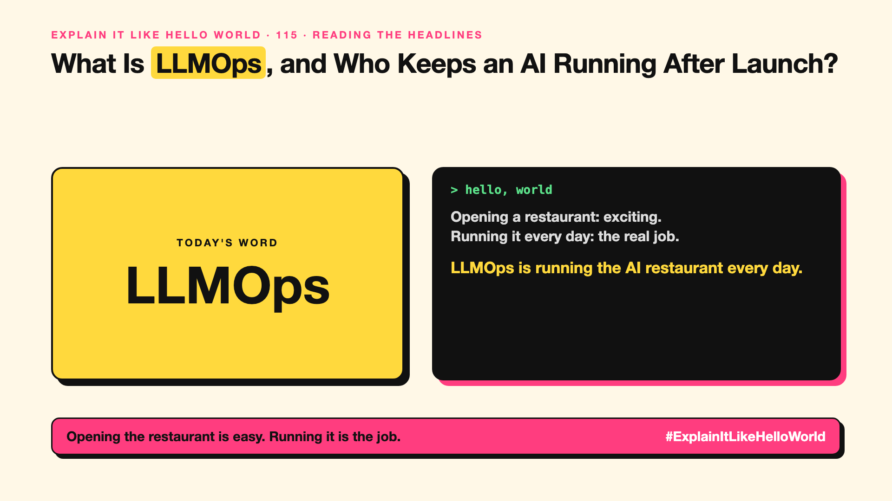

# 115. What Is LLMOps, and Who Keeps an AI Running After Launch? | LLMOps



*Explain It Like Hello World series: LLMOps*

"LLMOps." "AI ops." After the demo, someone has to keep the AI working every day. That work has a name.

## The hello world

Opening a restaurant is the exciting part. Running it is the real job: stock, hygiene checks, staff rotas, complaints, and noticing when a dish starts going wrong.

That's the hello world: **LLMOps** is the everyday work of running AI in production: monitoring, testing, updating and fixing it.

## One step further

It covers versioning prompts (write-up 20) and models, running evals (write-up 99) before every change, monitoring quality, cost and speed (write-up 56), tracing what happened in each answer, handling incidents, and rolling back bad changes.

It grew out of MLOps (for older machine learning), with new concerns: prompts, model updates from vendors, hallucinations and token costs.

## Where you've already met it

Dashboards showing AI cost, speed and quality. Teams that can say exactly which prompt and model version gave a bad answer.

## The real name

**LLMOps**, part of **AI operations**.

- **Monitoring:** watching quality, cost and speed continuously.
- **Tracing:** recording every step behind an answer.
- **Rollback:** switching back to the last good version.

## What it's not

LLMOps isn't a tool you buy once. It's a practice with owners. (Series 6 covers observability; Series 7 covers demo to production.)

## Take this to your next meeting

1. Name an owner for every AI feature after launch.
2. Version prompts like code.
3. Watch cost and quality dashboards weekly.

Opening the restaurant is easy. Running it is the job.

Next write-up (116): **What Is an AI Gateway, the Front Door to Your AI?**

Follow me for the next one. Who owns your AI after launch day?

**Earlier in this series:**

1. [AI words everyone uses. Nobody explains.](https://lnkd.in/p/d8abaPhq) (the curtain raiser post)
2. [What Actually Counts as Artificial Intelligence?](https://www.linkedin.com/pulse/2-what-actually-counts-artificial-intelligence-arpit-jain-su9lf)
3. [How Does Machine Learning Learn Without Being Told the Rules?](https://www.linkedin.com/pulse/3-how-does-machine-learning-learn-without-being-told-rules-arpit-jain-ppdyf)
4. [What's "Deep" About Deep Learning?](https://www.linkedin.com/pulse/4-whats-deep-learning-arpit-jain-rvlff)
5. Is a Neural Network Really Like a Brain? *(link added when published)*
6. What Makes Generative AI "Generative"? *(link added when published)*
7. Why Are They Called Foundation Models? *(link added when published)*
8. What Is a Frontier Model, and Who Decides? *(link added when published)*
9. What Is AGI, and What Would Make AI "General"? *(link added when published)*
10. What Is Superintelligence, and Should We Worry? *(link added when published)*
11. What Are Tokens, and Why Does an AI Read in Pieces? *(link added when published)*
12. How Does an LLM Write a Sentence? *(link added when published)*
13. How Do Embeddings Know "King" Is Close to "Queen"? *(link added when published)*
14. How Does Attention Help an AI Know What "It" Means? *(link added when published)*
15. What Is a Transformer, the "T" in GPT? *(link added when published)*
16. What Is a Context Window, and Why Does an AI Forget? *(link added when published)*
17. What's a Knowledge Cutoff, and Why Is the AI Behind on News? *(link added when published)*
18. Why Does Temperature Change the AI's Answer? *(link added when published)*
19. What Is a Prompt, and Why Does the Way You Ask Matter? *(link added when published)*
20. Is Prompt Engineering a Real Skill? *(link added when published)*
21. What's in a System Prompt, the Hidden Instruction Behind Every Chatbot? *(link added when published)*
22. What Is Zero-Shot, and Can an AI Do a Task It Was Never Shown? *(link added when published)*
23. Why Does Few-Shot Prompting Work So Well? *(link added when published)*
24. Why Does Chain of Thought ("Think Step by Step") Work? *(link added when published)*
25. Is Context Engineering the New Prompt Engineering? *(link added when published)*
26. How Does Structured Output Get an AI to Fill In a Form? *(link added when published)*
27. Why Does Streaming Make the AI Type Word by Word? *(link added when published)*
28. What Do Parameters, Like "70B", Actually Mean? *(link added when published)*
29. What Happens During Training, When an AI Goes to School? *(link added when published)*
30. What's the Difference Between Supervised and Unsupervised Learning? *(link added when published)*
31. What Is Inference, and What Happens When You Hit Send? *(link added when published)*
32. What Is Pretraining, and How Does an AI Learn Language? *(link added when published)*
33. What Is Fine-Tuning, and How Does an AI Learn Your Way? *(link added when published)*
34. What Is LoRA, and How Do You Customise an AI Cheaply? *(link added when published)*
35. How Does Reinforcement Learning Teach AI by Trial and Error? *(link added when published)*
36. What Is RLHF, and How Did the AI Learn to Be Polite? *(link added when published)*
37. What Is Constitutional AI, and Can an AI Follow Principles? *(link added when published)*
38. What Is Distillation, and How Does a Small AI Learn From a Big One? *(link added when published)*
39. What Is Synthetic Data, and Can an AI Learn From AI-Written Data? *(link added when published)*
40. What Is Data Labelling, and Who Teaches the AI What's Right? *(link added when published)*
41. What Is Overfitting, and Why Can an AI Ace the Practice Test and Fail? *(link added when published)*
42. What Are Scaling Laws, and Why Did Bigger AI Keep Getting Better? *(link added when published)*
43. Are Emergent Abilities Real, or Does Bigger AI Just Seem to Learn New Tricks? *(link added when published)*
44. What Is Model Collapse, and What Happens When AI Learns From AI? *(link added when published)*
45. What Is Quantization, and How Does a Giant AI Fit on a Laptop? *(link added when published)*
46. What Is a Mixture of Experts, and Why Doesn't the Whole AI Wake Up? *(link added when published)*
47. What Is a KV Cache, and Why Doesn't the AI Re-Read Everything? *(link added when published)*
48. How Does Prompt Caching Make Repeated Prompts Cheaper? *(link added when published)*
49. How Does Speculative Decoding Make a Big AI Faster? *(link added when published)*
50. What Is Test-Time Compute, and Why Does Thinking Cost More? *(link added when published)*
51. Why Does AI Run on a GPU, a Gaming Chip? *(link added when published)*
52. What Is a TPU, and Why Did Google Build One? *(link added when published)*
53. What Is an NPU, the AI Chip Inside Your New Laptop? *(link added when published)*
54. Can a Small Language Model Be Good Enough? *(link added when published)*
55. What Is On-Device AI, and Can an AI Live on Your Phone? *(link added when published)*
56. What Is Latency, and Why Does the AI Take So Long to Answer? *(link added when published)*
57. What Is Time to First Token, and Why Does the First Word Matter Most? *(link added when published)*
58. What Is RAG, and How Does an AI Answer From Your Documents? *(link added when published)*
59. Why Does AI Cut Your Documents Into Chunks? *(link added when published)*
60. What Is a Vector Database, and Where Does an AI Store Meaning? *(link added when published)*
61. How Does Semantic Search Understand What You Meant? *(link added when published)*
62. What Is Reranking, and Why Does AI Search Look Twice? *(link added when published)*
63. What Is a Knowledge Graph, and Who Is Connected to Whom? *(link added when published)*
64. What Is GraphRAG, and How Does an AI Answer About a Whole Pile of Documents? *(link added when published)*
65. What Is Grounding, and How Do You Keep an AI Tied to the Facts? *(link added when published)*
66. How Do Citations Show Where an AI Got Its Answer? *(link added when published)*
67. Can Deep Research Do Your Research for You? *(link added when published)*
68. What Makes an AI Agent an "Agent"? *(link added when published)*
69. What Does "Agentic AI" Really Mean? *(link added when published)*
70. How Does Tool Calling Let an AI Check the Weather? *(link added when published)*
71. What Is MCP, and Why Is Everyone Talking About It? *(link added when published)*
72. What Are Agent Skills, and Why Do Agents Need a Playbook? *(link added when published)*
73. What Is A2A, and How Do AI Agents Talk to Each Other? *(link added when published)*
74. Is a Multi-Agent System Better Than One AI Agent? *(link added when published)*
75. How Does AI Memory Remember You? *(link added when published)*
76. How Does Computer Use Let an AI Click Like You? *(link added when published)*
77. What's the Difference Between a Copilot and an Agent? *(link added when published)*
78. What Is an Agent Sandbox, and Where Should an AI Agent Work? *(link added when published)*
79. What Is a Reasoning Model, and Why Does the AI Think Before It Answers? *(link added when published)*
80. What Is a Decision Model, and Why Does It Choose Instead of Chat? *(link added when published)*
81. What Is Multimodal AI, and How Can One AI Read, See and Listen? *(link added when published)*
82. How Does a Diffusion Model Draw a Picture From Noise? *(link added when published)*
83. How Does Voice AI Talk Back Without a Pause? *(link added when published)*
84. How Does Text-to-Video Make a Video From a Sentence? *(link added when published)*
85. What Is a Deepfake, and How Can a Video of Someone Be Fake? *(link added when published)*
86. Can Voice Cloning Copy Your Voice From a Few Seconds of Audio? *(link added when published)*
87. What Is an AI Avatar, the Presenter Nobody Filmed? *(link added when published)*
88. What's a Digital Twin, and Why Do Factories Want One? *(link added when published)*
89. What Does "Open" Mean in an Open-Weight Model? *(link added when published)*
90. What Is a World Model, and Can an AI Imagine What Happens Next? *(link added when published)*
91. What Is Embodied AI, and When Does AI Get a Body? *(link added when published)*
92. What Is Hallucination, and Why Does an AI Sound Sure When It's Wrong? *(link added when published)*
93. What Is AI Sycophancy, and Why Does the AI Keep Agreeing? *(link added when published)*
94. What Are Guardrails, and How Do You Stop an AI Saying the Wrong Thing? *(link added when published)*
95. What Does "Human-in-the-Loop" Really Mean? *(link added when published)*
96. What Is a Jailbreak, and How Do People Trick an AI? *(link added when published)*
97. What Is Prompt Injection, and Can a Web Page Give Orders to Your AI? *(link added when published)*
98. What Is Red Teaming, and Who Attacks an AI on Purpose? *(link added when published)*
99. What Are Evals, and How Do You Know an AI Is Getting Better? *(link added when published)*
100. What Is LLM-as-a-Judge, and Can One AI Mark Another AI's Homework? *(link added when published)*
101. What Is AI Bias, and How Does an AI End Up Unfair? *(link added when published)*
102. What Is Explainability, and Can an AI Tell You Why It Decided? *(link added when published)*
103. What Is Alignment, and How Do You Make an AI Want What We Want? *(link added when published)*
104. Can Watermarking Tell You If AI Wrote This? *(link added when published)*
105. What Is AI Regulation, and Who Makes the Rules for AI? *(link added when published)*
106. What Does "Responsible AI" Actually Involve? *(link added when published)*
107. What Is Shadow AI, and Is Your Team Using AI You Don't Know About? *(link added when published)*
108. What Is Sovereign AI, and Why Do Countries Want Their Own? *(link added when published)*
109. What Do Benchmarks Mean, Like "Scored 90%"? *(link added when published)*
110. What Is Vibe Coding, and Can You Build an App by Describing It? *(link added when published)*
111. What Is AI Slop, and Why Is the Internet Filling Up With It? *(link added when published)*
112. What Is AI Washing, and How Do You Spot It? *(link added when published)*
113. What Is GEO, and How Do You Get Found When People Ask AI? *(link added when published)*
114. What Makes a Company "AI-Native"? *(link added when published)*

**Previous series:**

- **Series 1, #JustAddRAG:** [start here](https://www.linkedin.com/pulse/why-does-just-add-rag-sound-like-2-weeks-take-6-months-arpit-jain-l4kkf/) or jump to [the grand finale](https://www.linkedin.com/pulse/15-so-should-you-really-just-add-rag-grand-finale-arpit-jain-ninmf/)
- **Series 2, Beyond Just RAG: From Answers to Actions:** [start here](https://www.linkedin.com/pulse/1-your-ai-can-answer-now-has-act-from-answers-actions-arpit-jain-po6lf/) or jump to [the finale](https://www.linkedin.com/pulse/8-so-should-your-ai-do-things-just-answer-finale-arpit-jain-x7cxf)
- **Series 20, Today in AI** (ongoing): [start here](https://www.linkedin.com/pulse/today-ai-001-what-happens-when-your-agent-visits-someone-arpit-jain-2vqmf/) or read [the latest issue](https://www.linkedin.com/pulse/today-ai-011-text-to-speech-fits-your-phone-internet-needed-jain-1ipuf)

---

**Post text (copy and paste):**

```
Opening a restaurant: exciting.
Running it every day: the real job.

LLMOps is running the AI restaurant every day.

Monitor, test, update, fix.

Who owns your AI after launch day?

#AI #GenAI #LearnAI #ExplainItLikeHelloWorld
```

**Series index (post as the first comment):**

```
Explain It Like Hello World

Start here: AI words everyone uses. Nobody explains. https://lnkd.in/p/d8abaPhq
Previous: 114. What Makes a Company "AI-Native"? [link]
You're here: 115. What Is LLMOps, and Who Keeps an AI Running After Launch?
Next: 116. What Is an AI Gateway, the Front Door to Your AI?

Full list: in the curtain raiser post.
```
